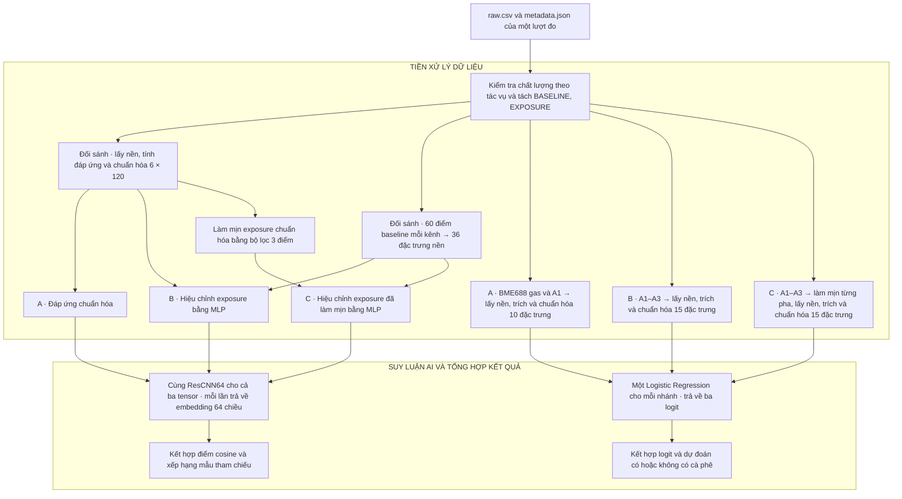
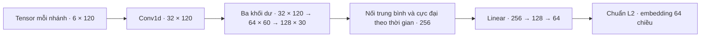

# Ứng dụng AI trong hệ thống RoboNose

**Cấu hình kết hợp V4**

RoboNose phân tích chuỗi thời gian từ hệ cảm biến mùi ESP32-S3 cho hai tác vụ. **Đối sánh mùi người** nhận một lượt truy vấn và xếp hạng các lượt tham chiếu theo độ tương đồng. **Phát hiện cà phê** nhận một lượt đo và dự đoán có hoặc không có cà phê. Cả hai dùng dữ liệu từ cùng thiết bị, nhưng yêu cầu hai cách biểu diễn khác nhau. Đối sánh giữ nguyên trục thời gian để học hình dạng đáp ứng. Phát hiện cà phê tóm tắt tín hiệu thành các đặc trưng định lượng để phân loại.

## 1. Dataset và thiết kế đánh giá

### 1.1. Đơn vị dữ liệu và kênh đo

Một mẫu là **một lượt đo** có UUID riêng. Tệp `raw.csv` lưu các lần đọc theo thời gian, nhãn pha, giá trị cảm biến và cờ chất lượng. Tệp `metadata.json` lưu tên lượt, phiên đo, thời điểm bắt đầu, cấu hình thiết bị và trạng thái xuất dữ liệu. Một phiên có thể chứa nhiều lượt. Với thiết lập 1 Hz, lượt chuẩn có 60 giây **BASELINE** để đo nền qua đầu lấy mẫu, 120 giây **EXPOSURE** khi tiếp xúc với mẫu và 60 giây **RECOVERY** qua khí lọc. Tín hiệu đầu vào của hai tác vụ đến từ BASELINE và EXPOSURE.

| Kênh | Đại lượng ghi nhận | Đối sánh mùi người | Phát hiện cà phê |
| --- | --- | :---: | :---: |
| A0 · TGS2602 | Điện áp V | ✓ | |
| A1 · MQ3 #1 | Điện áp V | ✓ | ✓ |
| A2 · MQ135 #2 | Điện áp V | ✓ | ✓ |
| A3 · MQ3 #2 | Điện áp V | ✓ | ✓ |
| BME688 gas | Điện trở Ω | ✓ | ✓ |
| BME688 RH | Độ ẩm tương đối % | ✓ | |

Bốn kênh analog dùng ADS1115 với hệ số `0,0001875 V/count` và hệ số chia áp bằng 1. Cấu hình tương thích của bộ đối sánh yêu cầu 1 Hz, bơm 80%, đúng sơ đồ kênh và profile BME688 gia nhiệt yêu cầu 300 °C trong 100 ms, oversampling nhiệt độ ×2, độ ẩm ×2 và áp suất ×4. [Cấu hình tương thích của bộ mã hóa](models/rescnn64/20261119_053351_6b8717/artifact.json)

### 1.2. Chọn mẫu, gán nhãn và chia dữ liệu

1. **Kho huấn luyện.** Chọn lượt `HARDWARE` trong khoảng **09–20/11/2026**, trạng thái `COMPLETE` và đã chốt xuất dữ liệu. Giữ riêng thư mục `data/hardware` để đối chiếu. Dùng SHA-256 của `raw.csv` để loại bản sao. Dùng UUID để nhận diện cùng lượt khi kiểm tra giao nhau cho tác vụ đối sánh. Lượt thiếu nhãn phù hợp hoặc thất bại khi kiểm tra đầu vào bị loại khỏi tập tương ứng.
2. **Nhãn người.** Ánh xạ tên lượt về một trong chín nhãn người đã biết. Có **93 lượt** để học bộ hiệu chỉnh. Trong đánh giá khác ngày, **76 lượt thuộc sáu nhãn** có ít nhất một mẫu cùng nhãn đủ điều kiện để đối chiếu. Tập đo trong `data/hardware` có **13 lượt thuộc bốn phiên**, gồm tám lượt Phúc và năm lượt Tài.
3. **Nhãn cà phê.** Tên lượt có từ khóa như `cf` hoặc `coffee` được gán dương. Lượt không khí đối chứng có tiền tố `blank` hoặc `khongkhi`. Lượt chỉ mang tên người được gán **âm quy ước**, vì tên lượt chưa xác nhận điều kiện có hay không có cà phê. Tập huấn luyện có **141 lượt trên 10 ngày đo**, gồm **32 lượt cà phê**, **16 lượt không khí** và **93 lượt tên người**. Hai tập đối chiếu gồm **8 lượt mang nhãn cà phê ngày 07/11** và **13 lượt mang tên người trong `data/hardware`**.
4. **Chia theo nhóm.** Mỗi vòng chọn cấu hình giữ riêng toàn bộ một ngày. Các tham số cần học ở vòng đó được fit trên các ngày còn lại. Khi xếp hạng mùi người, chỉ xét ứng viên khác phiên với lượt truy vấn. Khi chấm trên `data/hardware`, loại lượt trùng UUID hoặc hash với dữ liệu học hoặc kho tham chiếu, và loại phiên giao với tập học bộ hiệu chỉnh. Tên lượt, ngày đo và UUID phục vụ gán nhãn, chia tập và truy xuất dữ liệu.

Bộ mã hóa ResCNN64 dùng một checkpoint đã được fit trên **77 lượt, 9 nhãn**, với ngày đo trong khoảng 06–18/11/2026. Vì khoảng này giao với khoảng 09–20/11, phép chia theo ngày ở tác vụ đối sánh đo việc chọn **bộ hiệu chỉnh và trọng số kết hợp** với CNN cố định. [Nguồn dữ liệu của bộ mã hóa](models/rescnn64/20261119_053351_6b8717/report.json) · [Số lượt đối sánh](models_v4/identity_report.json) · [Số lượt cà phê](models_v4/coffee_report.json)

## 2. Tiền xử lý dữ liệu

Toàn bộ chuỗi xử lý **từ lượt đo thô đến tensor hoặc vector đưa vào mô hình chính** nằm trong phần này. Các bước gồm kiểm tra chất lượng, tách pha, lấy nền, biến đổi tín hiệu, làm mịn, hiệu chỉnh nền bằng MLP, trích đặc trưng và chuẩn hóa. MLP học cách điều chỉnh tín hiệu trong bước tiền xử lý của tác vụ đối sánh. ResCNN64 nhận các tensor đã xử lý. Logistic Regression nhận các vector đặc trưng đã chuẩn hóa.



### 2.1. Kiểm tra chất lượng và tách pha

| Kiểm tra | Đối sánh mùi người | Phát hiện cà phê |
| --- | --- | --- |
| Điều kiện của lượt | Schema `robonose.dataset.v1`, trạng thái `COMPLETE`, có UUID lượt, UUID phiên, thời gian bắt đầu và cấu hình tương thích checkpoint. | Lượt huấn luyện được chọn theo điều kiện ở mục 1.2. Bộ trích đặc trưng kiểm tra trực tiếp độ phủ và chất lượng từng tín hiệu cần dùng. |
| Thời gian | Đúng **60 điểm BASELINE** và **120 điểm EXPOSURE**. Thời gian monotonic tăng nghiêm ngặt trên cả lượt. Khoảng giữa hai điểm trong mỗi pha nằm trong **1 ± 0,1 giây**. | Thời gian trong pha hữu hạn, không giảm. Khoảng giữa hai dòng thô liên tiếp và giữa hai điểm hợp lệ liên tiếp tối đa **3 giây**. |
| Giá trị hợp lệ | Cả sáu kênh đủ điểm hợp lệ và hữu hạn. Bốn điện áp và điện trở gas phải dương. RH nằm trong **0–100%**. Kênh điện áp hoặc gas phẳng suốt EXPOSURE làm lượt bị loại. | Mỗi kênh có ít nhất **90% điểm hợp lệ** trong từng pha. Độ phủ từ điểm hợp lệ đầu đến cuối ít nhất **50 giây ở BASELINE** và **105 giây ở EXPOSURE**. |
| Cờ thiết bị | Kiểm tra trạng thái đọc `OK`, cờ `fresh`, `valid` và các cờ chất lượng `NEGATIVE`, `ADC_LIMIT`. BME688 gas yêu cầu thêm `gas_valid`, `heater_stable` và `new_data`. | Điểm được đưa vào đặc trưng khi trạng thái đọc là `OK`, giá trị hữu hạn và các cờ `fresh`, `valid` đạt. Với BME688 gas, kiểm tra thêm `gas_valid`, `heater_stable` và `new_data`. |

Ở tác vụ đối sánh, hệ thống tính độ trôi cho năm kênh điện áp và gas trên **30 điểm cuối BASELINE**. Chỉ số theo từng kênh là `100 × max(60 × |độ dốc|, max − min) / trung vị`. Cấu hình đang dùng ghi cảnh báo khi chỉ số vượt **5%**. Nếu có ít nhất **24 điểm** từ BASELINE và WAIT_EXPOSURE trong 30 giây ngay trước EXPOSURE, hệ thống kiểm tra thêm độ trôi và cảnh báo khi trung vị trước exposure lệch hơn **5%** so với mốc nền. Những điểm EXPOSURE nằm qua thời điểm đổi ngữ cảnh cũng được đánh dấu. Các dòng WAIT_EXPOSURE phục vụ kiểm tra chất lượng.

Giá trị thiếu giữ nguyên trong tệp thô. Ở tác vụ đối sánh, thiếu điểm bắt buộc làm lượt không đạt điều kiện đầu vào. Ở tác vụ cà phê, thống kê chỉ dùng điểm hợp lệ nếu kênh vẫn đủ độ phủ. Mọi thao tác làm mịn và biến đổi thực hiện trên dữ liệu đọc vào bộ nhớ. [Chuẩn bị tensor đối sánh](robonose_s3/rescnn64.py) · [Kiểm tra và trích tín hiệu cà phê](robonose_s3/coffee_detection/__init__.py)

### 2.2. Làm mịn nhẹ theo thời gian

Dùng bộ lọc hữu hạn ba điểm đối xứng. Với một điểm giữa hợp lệ:

```text
x_mịn[t] = (x[t−1] + 6 × x[t] + x[t+1]) / 8
```

Điểm hiện tại giữ **75%** trọng số. Mỗi láng giềng đóng góp **12,5%**. Tổng trọng số bằng 1 nên đoạn tín hiệu hằng giữ nguyên. Bộ lọc làm giảm dao động ngắn với cửa sổ nhỏ và giữ hai điểm ở biên. Ví dụ, ba giá trị điện áp `0,610`, `0,618` và `0,614 V` cho giá trị giữa sau lọc là `0,6165 V`.

- **Đối sánh.** Lọc theo thời gian trên từng kênh của **exposure đã trừ nền và chuẩn hóa**. Hệ thống thực hiện bước này ở nhánh C, trước MLP hiệu chỉnh. Chuỗi đầu vào đã qua kiểm tra đủ điểm và nhịp lấy mẫu ở mục 2.1.
- **Cà phê.** Nhánh C kiểm tra chất lượng tín hiệu thô trước, sau đó lọc **riêng từng pha** BASELINE và EXPOSURE trên A1–A3. Cửa sổ có điểm lỗi hoặc khoảng lấy mẫu dưới 0,9 hay trên 1,1 giây giữ nguyên điểm giữa. Sau khi lọc, hệ thống tính lại trung vị nền và trích đặc trưng.

Bộ lọc dùng cả điểm trước và điểm sau vì xử lý lượt đã ghi. [Đường xử lý đối sánh](models_v4/identity.py) · [Đường xử lý cà phê](models_v4/coffee.py)

### 2.3. Tạo ba tensor cho ResCNN64

**Bước 1 — Tính đáp ứng theo nền của từng lượt.** Với mỗi kênh `c`, lấy trung vị của 30 điểm cuối BASELINE làm `b[c]`. Gọi `x[c,t]` là điểm EXPOSURE thứ `t`. Với các kênh điện áp và RH, tính hiệu so với nền. Với điện trở gas, dùng log tự nhiên của tỷ số giữa điện trở đo được và điện trở nền.

```text
d[c,t] = x[c,t] − b[c]          cho A0, A1, A2, A3 và BME688 RH
d[c,t] = ln(x[c,t] / b[c])      cho BME688 gas
X[c,t] = (d[c,t] − center[c]) / scale[c]
```

Hai tham số `center[c]` và `scale[c]` được đọc từ cấu hình của bộ mã hóa để giữ đúng thang đo khi suy luận. Ví dụ, một điểm A3 là `0,61200 V` và trung vị nền `0,60675 V` cho hiệu `0,00525 V`. Dùng `center = 0,00815625 V` và `scale = 0,01298437 V` của kênh A3 cho `X ≈ −0,22383`. Tensor đáp ứng có kích thước **6 × 120**, theo thứ tự A0, A1, A2, A3, BME688 gas, BME688 RH. [Tham số chuẩn hóa từng kênh](models/rescnn64/20261119_053351_6b8717/model.json)

**Bước 2 — Tóm tắt diễn biến của toàn bộ baseline.** Lấy đủ 60 điểm BASELINE trên mỗi kênh. Chuyển riêng điện trở gas sang log tự nhiên rồi chia mỗi kênh thành sáu cửa sổ liên tiếp, mỗi cửa sổ 10 điểm. Lấy trung bình từng cửa sổ để tạo **6 kênh × 6 cửa sổ = 36 đặc trưng**. Nhờ giữ thứ tự các cửa sổ, bộ hiệu chỉnh có thông tin về mức nền và cách mức nền thay đổi trong suốt pha. Mỗi đặc trưng được chuẩn hóa bằng trung bình và độ lệch chuẩn fit trên tập học, rồi giới hạn trong **[−4, 4]**.

**Bước 3 — Học đường bù cho từng kênh.** Mỗi MLP có cấu trúc **36 → 16 → 12**, với `Tanh` sau lớp ẩn. Áp dụng `0,5 × tanh` lên 12 đầu ra để lấy sáu mức bù `offset[c]` và sáu độ dốc `slope[c]`. Với `u[t]` chạy đều từ −1 đến 1 qua 120 điểm:

```text
q[c,t] = 0,5 × (offset[c] + slope[c] × u[t])
X_hiệu_chỉnh[c,t] = X_đầu_vào[c,t] + q[c,t]
```

Phần bù theo thời gian bị giới hạn về trị tuyệt đối ở **0,5 đơn vị chuẩn hóa**. Mỗi bộ hiệu chỉnh có **796 tham số có thể học**. Hai bộ được fit riêng vì nhánh B và C nhận exposure khác nhau. Đường bù của mỗi kênh có dạng tuyến tính theo thời gian, còn quan hệ giữa 36 đặc trưng nền và các hệ số bù do MLP học.

| Nhánh | Thao tác cuối trong tiền xử lý | Tensor đưa vào ResCNN64 |
| --- | --- | --- |
| A · Đáp ứng chuẩn hóa | Giữ `X` từ bước 1. | `X`, kích thước 6 × 120 |
| B · Hiệu chỉnh theo baseline | Dùng 36 đặc trưng nền để dự đoán và cộng đường bù lên `X`. | `X + q_B`, kích thước 6 × 120 |
| C · Làm mịn và hiệu chỉnh | Lọc `X` theo mục 2.2, rồi dùng bộ hiệu chỉnh đã học cho tín hiệu sau lọc. | `smooth(X) + q_C`, kích thước 6 × 120 |

[Chương trình chuẩn bị ba đầu vào và học bộ hiệu chỉnh](models_v4/train.py) · [Luồng suy luận đối sánh](models_v4/identity.py)

### 2.4. Tạo ba vector cho Logistic Regression

**Bước 1 — Chọn kênh và lấy nền.** Nhánh A dùng BME688 gas và A1. Hai nhánh B và C dùng A1–A3. Nhánh C lấy tín hiệu đã làm mịn ở mục 2.2. Với mỗi kênh của mỗi nhánh, lấy trung vị **toàn bộ điểm BASELINE hợp lệ** làm `b`. Từ các điểm EXPOSURE hợp lệ, tính mức thay đổi tương đối `r[t] = 100 × (x[t] − b) / |b|`. Bộ trích đặc trưng yêu cầu mốc nền khác 0.

**Bước 2 — Trích năm đặc trưng từ mỗi kênh.** Tính theo thứ tự sau để tái tạo đúng vector đầu vào.

| Đặc trưng | Cách tính | Thông tin giữ lại |
| --- | --- | --- |
| Trung bình cả pha | Trung bình `r[t]` của các điểm hợp lệ trong EXPOSURE. | Mức đáp ứng chung. |
| Trung bình giữa pha | Trung bình `r[t]` với `40 ≤ t < 80` giây theo `phase_elapsed_s`. | Mức đáp ứng trong một khoảng đo thống nhất giữa các lượt. |
| Phân vị P10 | Phân vị 10% của `r[t]`, nội suy theo cách tính inclusive. | Mức đáp ứng ở phần thấp của phân bố. |
| Phân vị P90 | Phân vị 90% của `r[t]`, cùng phương pháp với P10. | Mức đáp ứng ở phần cao của phân bố. |
| Độ dốc theo phút | Hồi quy tuyến tính bình phương tối thiểu của `r[t]` theo thời gian pha, rồi nhân độ dốc với 60. | Xu hướng thay đổi, đơn vị điểm phần trăm mỗi phút. |

Ví dụ, nếu trung vị của cả BASELINE trên A3 là `0,60900 V` và điểm EXPOSURE là `0,61200 V` thì `r ≈ +0,493%`. Hệ thống tính năm thống kê trên chuỗi thay đổi tương đối, sau đó nối theo thứ tự kênh.

**Bước 3 — Chuẩn hóa đặc trưng.** Từng nhánh fit một `StandardScaler` trên phần train. Mỗi giá trị `f[j]` được chuyển thành `z[j] = (f[j] − μ[j]) / σ[j]`. Khi dự đoán, dùng đúng `μ` và `σ` đã đóng gói với trọng số Logistic.

| Nhánh | Kênh theo thứ tự | Dữ liệu dùng để tính trung vị và đặc trưng | Vector cho Logistic |
| --- | --- | --- | ---: |
| A · BME688 gas và A1 | BME688 gas, A1 | Tín hiệu hợp lệ trong hai pha | 10 |
| B · A1–A3 | A1, A2, A3 | Tín hiệu hợp lệ trong hai pha | 15 |
| C · A1–A3 làm mịn | A1, A2, A3 | Tín hiệu sau lọc riêng từng pha | 15 |

[Trích năm thống kê cảm biến](robonose_s3/coffee_detection/__init__.py) · [Kênh, scaler và trình tự suy luận](models_v4/coffee.py)

### 2.5. Làm giàu biểu diễn dữ liệu

Tác vụ đối sánh bổ sung thông tin về **diễn biến đường nền** qua 36 đặc trưng, đồng thời khai thác ba biểu diễn exposure của cùng một lượt. Tác vụ cà phê làm giàu đầu vào bằng **năm thống kê trên mỗi kênh**, kết hợp đặc trưng mức đáp ứng, khoảng phân bố và xu hướng. Đây là làm giàu đặc trưng. Số lượt huấn luyện vẫn là 93 và 141 tương ứng. Các cặp cùng nhãn và khác nhãn ở tác vụ đối sánh được dùng trong hàm mất mát của MLP.

## 3. Kiến trúc AI và công nghệ

| Tác vụ | Mô hình và công nghệ | Lý do lựa chọn kiến trúc |
| --- | --- | --- |
| Đối sánh mùi người | **ResCNN64** dùng PyTorch. Cùng một bộ mã hóa tích chập một chiều được áp dụng cho ba tensor. | Tích chập 1D học quan hệ giữa các kênh và các đoạn thời gian lân cận. Embedding chuẩn hóa cho phép đưa một lượt truy vấn và các lượt tham chiếu lên cùng thang cosine. |
| Phát hiện cà phê | **Logistic Regression** dùng scikit-learn để huấn luyện, bộ hệ số và scaler lưu dạng JSON. | Đầu vào gồm 10 hoặc 15 đặc trưng định lượng đã chuẩn hóa. Logistic dùng ít hệ số, có điều chuẩn và kiểm tra được đóng góp của từng thống kê qua hệ số. |

### 3.1. ResCNN64 và điểm đối sánh

Gọi `N` là số lượt trong batch. Hai chiều sau lần lượt là số kênh và số bước thời gian.



| Tầng | Cấu hình | Kích thước đầu ra |
| --- | --- | --- |
| Đầu vào | Một tensor đã tiền xử lý | `N × 6 × 120` |
| Stem | `Conv1d 6→32`, kernel 7, stride 1, GroupNorm 8 nhóm và GELU | `N × 32 × 120` |
| Khối dư 1 | `32→32`, kernel 5, stride 1 | `N × 32 × 120` |
| Khối dư 2 | `32→64`, kernel 5, stride 2 | `N × 64 × 60` |
| Khối dư 3 | `64→128`, kernel 3, stride 2 | `N × 128 × 30` |
| Pooling | Nối trung bình và giá trị cực đại trên trục thời gian | `N × 256` |
| Đầu embedding | `Linear 256→128`, GELU, dropout 0,2 trong huấn luyện, `Linear 128→64`, chuẩn L2 | `N × 64` |

Mỗi khối dư có hai lớp tích chập, GroupNorm sau mỗi lớp và GELU sau lớp thứ nhất và sau phép cộng với nhánh tắt. Khi kích thước thay đổi, nhánh tắt dùng tích chập kernel 1 với stride tương ứng. Kiến trúc có **168.960 tham số**, tính cả đầu phân lớp chín nhãn dùng trong huấn luyện. Khi đối sánh, hệ thống gọi đầu embedding.

Với embedding 64 chiều đã chuẩn L2 của từng nhánh `e_A`, `e_B`, `e_C`, nối ba vector sau khi nhân lần lượt với căn bậc hai của `0,60`, `0,20` và `0,20`. Vector gộp có **192 chiều**. Tích vô hướng của vector gộp giữa lượt truy vấn `u` và ứng viên `v` cho điểm:

```text
S(u,v) = 0,60 × cosine_A(u,v) + 0,20 × cosine_B(u,v) + 0,20 × cosine_C(u,v)
```

Hệ thống xếp hạng từ điểm cao xuống thấp. Điểm biểu thị độ tương đồng với ứng viên trong danh sách đã chọn. Cấu hình hiện tại dùng để xếp hạng, chưa có ngưỡng xác nhận danh tính đã hiệu chuẩn. [Kiến trúc bộ mã hóa](robonose_s3/rescnn64.py) · [Cách gộp embedding](models_v4/identity.py)

### 3.2. Logistic Regression và quyết định có cà phê

Mỗi nhánh có một Logistic Regression riêng. Với vector đầu vào đã chuẩn hóa `z`, mô hình tính `l = intercept + Σ(w[j] × z[j])`. Hệ số `w[j]` được học cho từng đặc trưng. Hai nhánh dùng cùng bộ kênh vẫn có scaler và hệ số riêng vì một nhánh dùng tín hiệu đã làm mịn.

```text
L = 0,10 × l_A + 0,45 × l_B + 0,45 × l_C
L > 0 → Có cà phê
L ≤ 0 → Không có cà phê
```

Trọng số kết hợp áp dụng cho **logit của nhánh**. Độ nhạy với từng kênh nằm trong các hệ số đã học của nhánh đó. Nếu một nhánh có trọng số dương thất bại khi kiểm tra đầu vào, hệ thống trả trạng thái không đủ điều kiện dự đoán cho lượt đó. [Trọng số và tham số Logistic](models_v4/coffee_ensemble.json) · [Mã quyết định](models_v4/coffee.py)

## 4. Huấn luyện, so sánh và chọn cấu hình

### 4.1. Phương pháp huấn luyện

**Đối sánh mùi người.** Đóng băng ResCNN64 và học hai MLP tiền xử lý. Gradient đi qua bộ mã hóa để tối ưu MLP. Mỗi MLP dùng AdamW, learning rate **0,003**, batch tối đa **24**, **20 epoch** và seed **42**. Các tham số lớp đầu ra của MLP khởi tạo bằng 0 để lúc bắt đầu đường bù bằng 0. Hàm mất mát có ba thành phần:

1. **Cross-entropy theo nhãn người.** Điểm lớp lấy từ cosine giữa embedding và vector lớp của bộ mã hóa, nhân 12. Trọng số lớp lấy căn bậc hai số lượt của lớp trong tập học.
2. **Phạt hiệu chỉnh quá mạnh.** Cộng trung bình bình phương của phần thay đổi `X_hiệu_chỉnh − X_đầu_vào`, nhân hệ số **0,25**.
3. **Mất mát tương phản khác ngày.** So embedding đã hiệu chỉnh với embedding mốc của lượt train khác ngày. Khuyến khích điểm gần mẫu cùng người cao tương đối so với mẫu khác người. Thành phần này có hệ số **0,5**, với tham số nhiệt độ **0,15**.

**Phát hiện cà phê.** Với từng nhánh, fit scaler trước rồi huấn luyện Logistic Regression với điều chuẩn L2, `C = 0,1`, `class_weight="balanced"` và tối đa 1.000 vòng lặp. Trong từng vòng đánh giá, cả scaler lẫn hệ số Logistic chỉ được học trên các ngày thuộc phần train. Sau khi chọn trọng số kết hợp, fit lại các thành phần cần học trên toàn bộ kho ngày 09–20/11. [Mã huấn luyện và chọn trọng số](models_v4/train.py)

### 4.2. Kết quả đối sánh mùi người

**Top 1** đếm số lượt có ứng viên hạng nhất cùng người. **Top 1 trung bình theo nhãn** tính tỷ lệ đúng riêng từng người rồi lấy trung bình đều giữa các nhãn. **MRR** là trung bình `1 / hạng` của ứng viên đúng đầu tiên. Chọn trọng số theo Top 1 trung bình theo nhãn, dùng MRR để phân xử khi bằng điểm.

| Cấu hình đối chứng | Trọng số A / B / C | Top 1 khác ngày | Top 1 trung bình theo nhãn | MRR khác ngày |
| --- | --- | ---: | ---: | ---: |
| Chỉ dùng đáp ứng chuẩn hóa | 1 / 0 / 0 | 48/76 | 60,70% | 0,7243 |
| Chỉ dùng hiệu chỉnh baseline | 0 / 1 / 0 | 50/76 | 66,09% | 0,7409 |
| Chỉ dùng làm mịn và hiệu chỉnh | 0 / 0 / 1 | 47/76 | 63,27% | 0,7176 |
| Kết hợp đều | ⅓ / ⅓ / ⅓ | 52/76 | 67,24% | 0,7564 |
| Ưu tiên hiệu chỉnh baseline | 0,15 / 0,65 / 0,20 | 49/76 | 65,52% | 0,7351 |
| Ưu tiên làm mịn và hiệu chỉnh | 0,15 / 0,20 / 0,65 | 48/76 | 64,94% | 0,7267 |
| **Kết hợp được chọn** | **0,60 / 0,20 / 0,20** | **54/76** | **71,14%** | **0,7705** |

Trên kho dữ liệu dùng để chọn trọng số, cấu hình kết hợp đạt **54/76 lượt đúng hạng nhất**, tương đương **71,05%** tính theo lượt. Top 1 trung bình theo nhãn cao hơn mỗi nhánh riêng khi xét trên cùng tập truy vấn.

| Cấu hình | Top 1 khác phiên trên hardware | MRR khác phiên |
| --- | ---: | ---: |
| Chỉ dùng đáp ứng chuẩn hóa | 7/13 | 0,6692 |
| Chỉ dùng hiệu chỉnh baseline | **8/13** | 0,7333 |
| Chỉ dùng làm mịn và hiệu chỉnh | **8/13** | **0,7372** |
| Kết hợp được chọn | 7/13 | 0,6859 |

Trên 13 lượt hardware, cấu hình kết hợp xếp đúng **5/8 lượt Phúc** và **2/5 lượt Tài**. Hai nhánh hiệu chỉnh độc lập đúng thêm một lượt. Kết quả khác phiên hiện có cho thấy lợi thế quan sát trên kho khác ngày cần được kiểm chứng thêm. [Báo cáo từng nhãn, từng trọng số và tập hardware](models_v4/identity_report.json)

### 4.3. Kết quả phát hiện cà phê

Chỉ số chính là **balanced accuracy**, bằng trung bình của recall cà phê `TP / (TP + FN)` và tỷ lệ nhận đúng nhóm âm `TN / (TN + FP)`. Cách tính này cho mỗi lớp trọng số bằng nhau khi chấm điểm, trong khi tập có 32 lượt dương và 109 lượt âm. Khi hai tổ hợp bằng điểm, chọn theo balanced accuracy tính riêng trên **cà phê và mẫu không khí**. Các dòng một nhánh dùng cùng cách chia ngày và cùng 141 lượt để đo đóng góp của kênh và bước làm mịn.

| Cấu hình đối chứng | Trọng số A / B / C | Bắt đúng cà phê | Đúng nhóm âm | Balanced accuracy toàn tập | Balanced accuracy cà phê và không khí |
| --- | --- | ---: | ---: | ---: | ---: |
| Chỉ BME688 gas và A1 | 1 / 0 / 0 | 15/32 | 86/109 | 62,89% | 73,44% |
| Chỉ A1–A3 | 0 / 1 / 0 | **21/32** | 85/109 | **71,80%** | **82,81%** |
| Chỉ A1–A3 làm mịn | 0 / 0 / 1 | **21/32** | 85/109 | **71,80%** | **82,81%** |
| Kết hợp đều | ⅓ / ⅓ / ⅓ | 16/32 | 85/109 | 63,99% | 75,00% |
| **Kết hợp được chọn** | **0,10 / 0,45 / 0,45** | **20/32** | **84/109** | **69,78%** | **81,25%** |

Thực nghiệm còn thử thêm một nhánh động học trên A0–A3. Nhánh này bổ sung trung bình đầu pha `[5, 30)` giây, trung bình cuối pha `[85, 105)` giây, độ chênh cuối–đầu và độ trải P90 − P10 của baseline, cùng các đặc trưng ở mục 2.4. Khi cấp 30% trọng số cho nhánh động học và chia 70% còn lại theo tỷ lệ `0,10 / 0,30 / 0,30`, balanced accuracy toàn tập vẫn là **69,78%**, còn điểm riêng trên cà phê và không khí là **78,13%**. Khi cấp 10% cho nhánh động học, với ba nhánh kia nhận `0,10 / 0,40 / 0,40`, hai chỉ số lần lượt là **68,68%** và **79,69%**. Cấu hình ba nhánh được chọn trong nhóm tổ hợp theo hai tiêu chí đã nêu. Hai đối chứng A1–A3 đứng cao nhất khi xét cả các dòng một nhánh.

Ma trận nhầm lẫn của cấu hình kết hợp trên dữ liệu chấm khác ngày:

| Nhãn đối chiếu | Dự đoán có cà phê | Dự đoán không có cà phê |
| --- | ---: | ---: |
| Có cà phê | 20 | 12 |
| Âm theo quy ước của tập | 25 | 84 |

Cấu hình bắt đúng **62,50%** lượt cà phê và nhận đúng **77,06%** lượt âm. Độ chính xác thông thường là **104/141 = 73,76%**. Trong 16 lượt không khí đối chứng, hệ thống nhận đúng cả 16.

| Kiểm tra trên tập đối chiếu | Kết quả cấu hình kết hợp | Cách đọc |
| --- | ---: | --- |
| Cà phê ngày 07/11 | **1/8** lượt dự đoán dương | Tập có tám lượt mang nhãn cà phê. Chỉ số đo tỷ lệ bắt đúng trong ngày này. |
| Lượt mang tên người trong `data/hardware` | **1/13** lượt báo dương | Tỷ lệ báo dương trên nhóm âm quy ước theo tên lượt. |

Kết quả ngày 07/11 cho thấy khả năng bắt cà phê thay đổi đáng kể giữa các điều kiện thu. Chỉ số balanced accuracy của cấu hình kết hợp trên tập chọn trọng số vẫn dưới **75%**. Hai tập đối chiếu mỗi tập chỉ có một lớp nhãn, nên báo số lượt tương ứng với lớp hiện diện. [Ma trận nhầm lẫn, tổ hợp động học và các tập đối chiếu](models_v4/coffee_report.json)

## 5. Tích hợp vào dashboard và phạm vi kết quả

Trong **04 · Đối sánh**, người dùng chọn một lượt truy vấn cùng danh sách tham chiếu đã lưu, rồi chọn mô hình ResCNN64 kết hợp ba nhánh. Dashboard hiển thị thứ hạng và điểm tương đồng. Trong **06 · Phát hiện cà phê**, chọn một lượt đã lưu và mô hình Logistic kết hợp ba nhánh để nhận dự đoán nhị phân. Pipeline áp dụng lại đúng thứ tự tiền xử lý và các tham số đã lưu khi chạy trên lượt mới.

Cả hai lựa chọn được đánh dấu thử nghiệm. Các bảng khác ngày là căn cứ chọn cấu hình và các phép đối chiếu hardware dùng số lượt nhỏ. Để đánh giá trên điều kiện đo mới, cần giữ riêng các phiên có cả mẫu cà phê, không khí đối chứng và lượt người được ghi rõ có hay không có cà phê. Khi đó có thể so recall, tỷ lệ báo nhầm và balanced accuracy trên cùng điều kiện thu. [Mã tích hợp giao diện](robonose_s3/web/index.html) · [Hướng dẫn tái lập thực nghiệm](models_v4/README.md)
