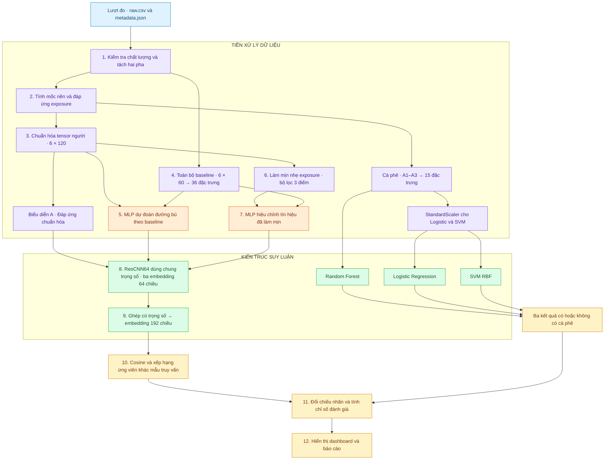
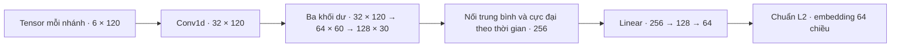

# Quy trình ứng dụng AI trong hệ thống RoboNose

Tài liệu mô tả một quy trình xử lý thống nhất từ lượt đo cảm biến đến kết quả đối sánh người và phát hiện cà phê. Quy trình gồm **thu và tổ chức dữ liệu → kiểm tra chất lượng → tiền xử lý → suy luận AI → đối chiếu nhãn và đánh giá → hiển thị kết quả**. Cấu hình nhận diện người cuối cùng dùng ResCNN64 với hiệu chỉnh theo baseline, làm mịn nhẹ và kết hợp biểu diễn. Phát hiện cà phê so sánh ba thuật toán trên cùng bộ đặc trưng.

## 1. Dữ liệu và mục tiêu đầu ra

### 1.1. Đơn vị dữ liệu và cảm biến

Một mẫu tương ứng một lượt đo có UUID bất biến, được lưu trong `raw.csv` và `metadata.json`. Dữ liệu ghi theo thời gian, kèm nhãn pha và các cờ trạng thái. Tại tần số 1 Hz, lượt chuẩn có **60 giây BASELINE**, **120 giây EXPOSURE** và **60 giây RECOVERY**. Baseline và exposure đều đo qua đầu lấy mẫu. Recovery đo qua khí lọc. Đầu vào AI sử dụng baseline và exposure.

| Kênh | Cảm biến và đại lượng | Dùng cho đối sánh người | Dùng cho ba model cà phê |
| --- | --- | :---: | :---: |
| A0 | TGS2602 · điện áp V | ✓ | |
| A1 | MQ3 #1 · điện áp V | ✓ | ✓ |
| A2 | MQ135 #2 · điện áp V | ✓ | ✓ |
| A3 | MQ3 #2 · điện áp V | ✓ | ✓ |
| BME688 gas | Điện trở Ω | ✓ | |
| BME688 RH | Độ ẩm tương đối % | ✓ | |

ADS1115 dùng hệ số `0,0001875 V/count` và hệ số chia áp 1. Cấu hình đầu vào bộ mã hóa yêu cầu bơm 80%, tần số 1 Hz và profile BME688 với gia nhiệt yêu cầu 300 °C trong 100 ms, oversampling T×2, H×2, P×4. [Cấu hình tương thích](models/rescnn64/20261119_053351_6b8717/artifact.json)

### 1.2. Quy mô dữ liệu và nguồn kết quả

| Phạm vi | Tổng lượt | Mẫu hợp lệ cà phê | Có CF | Không CF | Số ngày có phiên hoặc mẫu |
| --- | ---: | ---: | ---: | ---: | ---: |
| Toàn bộ `data` từ 07/11, tính mỗi UUID một lần | 140 | 133 | 22 | 111 | 11 |
| Riêng `data/hardware` | 83 | 78 | 7 | 71 | 6 |

Số liệu kiểm kê cập nhật ngày **28/11/2026**. Kho toàn bộ data có sáu lượt ABORTED và một lượt ERROR. Có 83 lượt được lưu bản sao ở cả trong và ngoài hardware. Ngày 27/11 có phiên lỗi và chưa tạo lượt mẫu. Ngày ghi trong metadata được dùng để thống kê. Coffee và NoCoffee trong bảng dùng quy ước **tên chứa CF không phân biệt hoa thường là nhãn dương**, các tên còn lại là nhãn âm.

Các artifact huấn luyện hiện tại được tạo từ tập dữ liệu tại thời điểm fit. Bộ hiệu chỉnh người học trên **93 lượt, 9 nhãn** trong khoảng 09–20/11. Các model cà phê học trên **141 lượt**, gồm 32 nhãn cà phê và 109 nhãn âm trong 10 ngày. Quy tắc gán nhãn train cà phê nhận thêm từ khóa coffee, cà phê và các tên quy ước đã biết. Số mẫu của snapshot huấn luyện và số mẫu hiện còn trên đĩa phản ánh hai thời điểm khác nhau. Các bảng ở mục 5 ghi rõ nguồn của từng phép chấm. [Snapshot người](models_v4/identity_report.json) · [Snapshot cà phê](robonose_s3/coffee_detection/ml_report.json)

## 2. Quy trình từ dữ liệu thô đến kết quả



Sơ đồ trình bày các thành phần của cùng hệ thống. Hai đầu ra sử dụng bộ kênh và cách tính mốc nền phù hợp với từng bài toán. Các mục sau quy định chính xác từng phép biến đổi.

## 3. Tiền xử lý dữ liệu theo từng bước

### 3.1. Bước 1 — Kiểm tra chất lượng và tách pha

| Kiểm tra | Đối sánh mùi người | Phát hiện cà phê |
| --- | --- | --- |
| Điều kiện của lượt | Schema `robonose.dataset.v1`, trạng thái `COMPLETE`, có UUID lượt, UUID phiên, thời gian bắt đầu và cấu hình tương thích checkpoint. | Lượt huấn luyện được chọn theo điều kiện ở mục 1.2. Bộ trích đặc trưng kiểm tra trực tiếp độ phủ và chất lượng từng tín hiệu cần dùng. |
| Thời gian | Đúng **60 điểm BASELINE** và **120 điểm EXPOSURE**. Thời gian monotonic tăng nghiêm ngặt trên cả lượt. Khoảng giữa hai điểm trong mỗi pha nằm trong **1 ± 0,1 giây**. | Thời gian trong pha hữu hạn, không giảm. Khoảng giữa hai dòng thô liên tiếp và giữa hai điểm hợp lệ liên tiếp tối đa **3 giây**. |
| Giá trị hợp lệ | Cả sáu kênh đủ điểm hợp lệ và hữu hạn. Bốn điện áp và điện trở gas phải dương. RH nằm trong **0–100%**. Kênh điện áp hoặc gas phẳng suốt EXPOSURE làm lượt bị loại. | Mỗi kênh có ít nhất **90% điểm hợp lệ** trong từng pha. Độ phủ từ điểm hợp lệ đầu đến cuối ít nhất **50 giây ở BASELINE** và **105 giây ở EXPOSURE**. |
| Cờ thiết bị | Kiểm tra trạng thái đọc `OK`, cờ `fresh`, `valid` và các cờ chất lượng `NEGATIVE`, `ADC_LIMIT`. BME688 gas yêu cầu thêm `gas_valid`, `heater_stable` và `new_data`. | Điểm được đưa vào đặc trưng khi trạng thái đọc là `OK`, giá trị hữu hạn và các cờ `fresh`, `valid` đạt. Với BME688 gas, kiểm tra thêm `gas_valid`, `heater_stable` và `new_data`. |

Ở tác vụ đối sánh, hệ thống tính độ trôi cho năm kênh điện áp và gas trên **30 điểm cuối BASELINE**. Chỉ số theo từng kênh là `100 × max(60 × |độ dốc|, max − min) / trung vị`. Cấu hình đang dùng ghi cảnh báo khi chỉ số vượt **5%**. Nếu có ít nhất **24 điểm** từ BASELINE và WAIT_EXPOSURE trong 30 giây ngay trước EXPOSURE, hệ thống kiểm tra thêm độ trôi và cảnh báo khi trung vị trước exposure lệch hơn **5%** so với mốc nền. Những điểm EXPOSURE nằm qua thời điểm đổi ngữ cảnh cũng được đánh dấu. Các dòng WAIT_EXPOSURE phục vụ kiểm tra chất lượng.

Giá trị thiếu giữ nguyên trong tệp thô. Ở tác vụ đối sánh, thiếu điểm bắt buộc làm lượt không đạt điều kiện đầu vào. Ở tác vụ cà phê, thống kê chỉ dùng điểm hợp lệ nếu kênh vẫn đủ độ phủ. Mọi thao tác làm mịn và biến đổi thực hiện trên dữ liệu đọc vào bộ nhớ. [Chuẩn bị tensor đối sánh](robonose_s3/rescnn64.py) · [Kiểm tra và trích tín hiệu cà phê](robonose_s3/coffee_detection/__init__.py)

### 3.2. Bước 2 — Chuyển exposure thành đáp ứng so với nền

Với đầu vào đối sánh người, lấy trung vị **30 điểm cuối BASELINE** trên mỗi kênh làm `b[c]`. Mốc này tóm tắt mức tín hiệu ngay cuối pha nền. Bốn điện áp và độ ẩm được biểu diễn bằng độ chênh với nền. Điện trở gas dùng log tự nhiên của tỷ số để biểu diễn thay đổi tương đối.

```text
d[c,t] = exposure[c,t] − b[c]        với A0, A1, A2, A3 và RH
d[c,t] = ln(exposure[c,t] / b[c])    với BME688 gas
```

Ví dụ minh họa, exposure A3 bằng `0,61200 V` và nền bằng `0,60675 V` cho đáp ứng `0,00525 V`. Giá trị nền được tính riêng cho mỗi lượt, nên các lượt đo có mức nền ban đầu khác nhau được biểu diễn theo thay đổi so với nền của chính lượt đó.

### 3.3. Bước 3 — Chuẩn hóa thang đo giữa các kênh

Tính `X[c,t] = (d[c,t] − center[c]) / scale[c]`. Hai tham số `center` và `scale` được nạp từ artifact của ResCNN64. Các tham số giữ cố định trong suy luận. Tensor đầu ra có kích thước **6 × 120**, thứ tự A0, A1, A2, A3, gas và RH. Với ví dụ A3 ở trên và tham số trong artifact, `X ≈ −0,22383`.

Việc chuẩn hóa đưa các đại lượng V, log tỷ số điện trở và phần trăm độ ẩm về thang dữ liệu mà CNN đã học. [Tham số từng kênh](models/rescnn64/20261119_053351_6b8717/model.json)

### 3.4. Bước 4 — Mã hóa diễn biến của toàn bộ baseline

Bổ sung thông tin diễn biến đường nền bằng **đủ 60 điểm trên cả sáu kênh**, ngoài mốc trung vị đã dùng ở bước 2.

1. Đọc ma trận baseline **6 × 60** theo đúng thứ tự kênh.
2. Chuyển riêng điện trở gas sang `ln(R)`.
3. Chia mỗi kênh thành sáu cửa sổ liên tiếp, mỗi cửa sổ 10 điểm.
4. Tính trung bình từng cửa sổ và nối theo kênh, thu được **36 đặc trưng**.
5. Chuẩn hóa 36 đặc trưng bằng trung bình và độ lệch chuẩn fit trên tập học của bộ hiệu chỉnh. Độ lệch chuẩn có cận dưới `10⁻⁶`.
6. Giới hạn đặc trưng chuẩn hóa trong **[−4, 4]** trước MLP.

Sáu giá trị của mỗi kênh giữ thông tin nền cao hay thấp và diễn biến tăng giảm qua từng đoạn. Bước chia cửa sổ là phép tóm tắt tín hiệu, số lượt học vẫn giữ nguyên.

### 3.5. Bước 5 — Học đường bù exposure từ baseline

Bộ tiền xử lý có một MLP **36 → 16 → 12**, dùng Tanh sau lớp ẩn. Lớp cuối có 12 đầu ra. Đặt `h = MLP(z_baseline)` rồi chia các hệ số sau biến đổi thành hai nhóm:

```text
offset[c] = 0,5 × tanh(h[c])
slope[c]  = 0,5 × tanh(h[c+6])
u[t]      = −1 + 2t/119, với t từ 0 đến 119
q[c,t]    = 0,5 × (offset[c] + slope[c] × u[t])
X_bù[c,t] = X[c,t] + q[c,t]
```

**Offset điều chỉnh mức của đường exposure, slope điều chỉnh xu hướng dọc theo thời gian.** Mối quan hệ giữa 36 đặc trưng baseline và các hệ số được học từ dữ liệu người có nhãn. Đường bù có dạng tuyến tính theo thời gian. Với mỗi kênh, `|q[c,t]| ≤ 0,5` đơn vị chuẩn hóa.

Ví dụ minh họa, MLP trả `offset = 0,10` và `slope = −0,04`. Phần bù ở đầu exposure là `0,07`, ở cuối là `0,03`. Cùng một tín hiệu exposure nhưng có diễn biến baseline khác có thể nhận hệ số bù khác. Giá trị trong ví dụ chỉ minh họa công thức.

MLP có **796 tham số học được**, lớp đầu ra được khởi tạo bằng 0. Khi bắt đầu học, phần bù bằng 0. MLP được tối ưu bằng lỗi nhận diện của CNN và ràng buộc độ lớn hiệu chỉnh ở mục 4.3. [Đường chuẩn bị và suy luận](models_v4/identity.py)

```mermaid
flowchart LR
    BASELINE["Baseline đủ 60 điểm mỗi kênh"] --> WINDOWS["6 cửa sổ mỗi kênh · 36 giá trị trung bình"]
    WINDOWS --> NORMALIZE["Chuẩn hóa và giới hạn trong −4 đến 4"]
    NORMALIZE --> MLP["Linear 36→16 · Tanh · Linear 16→12"]
    MLP --> COEFF["0,5 × Tanh · 6 offset và 6 slope"]
    COEFF --> CURVE["Đường bù q theo thời gian · 6 × 120"]
    CURVE --> ADD["Cộng với tensor exposure đầu vào"]
    EXPOSURE["Exposure chuẩn hóa hoặc đã làm mịn"] --> ADD
    ADD --> OUTPUT["Tensor hiệu chỉnh · 6 × 120"]
    classDef signal fill:#E0F2FE,stroke:#0284C7,color:#0C4A6E;
    classDef process fill:#EDE9FE,stroke:#7C3AED,color:#4C1D95;
    classDef learned fill:#FFEDD5,stroke:#EA580C,color:#7C2D12;
    classDef output fill:#DCFCE7,stroke:#16A34A,color:#14532D;
    class BASELINE,EXPOSURE signal;
    class WINDOWS,NORMALIZE,ADD process;
    class MLP,COEFF,CURVE learned;
    class OUTPUT output;
```



### 3.6. Bước 6 — Làm mịn nhẹ exposure chuẩn hóa

Một biểu diễn bổ sung được tạo bằng bộ lọc đối xứng ba điểm trên từng kênh của `X`:

```text
X_mịn[c,t] = (X[c,t−1] + 6X[c,t] + X[c,t+1]) / 8
```

| Thành phần | Trọng số |
| --- | ---: |
| Điểm ngay trước | 12,5% |
| Điểm đang xét | 75% |
| Điểm ngay sau | 12,5% |

Bộ lọc lấy giá trị của chuỗi đầu vào cho mỗi cửa sổ, giữ hai điểm biên và giữ đoạn tín hiệu hằng vì tổng trọng số bằng 1. Ví dụ ba giá trị chuẩn hóa `0,10; 0,18; 0,14` cho điểm giữa sau lọc **0,165**. Phép lọc thực hiện trên exposure sau trừ nền và chuẩn hóa, theo thời gian của từng kênh. Ma trận baseline dùng làm ngữ cảnh vẫn được xử lý theo bước 4.

Bộ lọc sử dụng điểm trước và sau nên phù hợp với lượt đã ghi đầy đủ. Nó được dùng để giảm dao động ngắn. Mức cải thiện thực tế được đánh giá ở cấp cấu hình hoàn chỉnh.

### 3.7. Bước 7 — Tạo đầu vào của cấu hình đối sánh được chọn

Hệ thống tạo ba biểu diễn từ cùng một lượt đo. Mỗi biểu diễn được đưa qua **cùng ResCNN64 với cùng trọng số**.

| Biểu diễn nội bộ | Đầu vào CNN | Vai trò |
| --- | --- | --- |
| A | `X` | Giữ đáp ứng đã chuẩn hóa. |
| B | `X + q_B` | Thích nghi mức và xu hướng exposure theo toàn bộ baseline. |
| C | `smooth(X) + q_C` | Bổ sung tín hiệu làm mịn và hiệu chỉnh phù hợp với tín hiệu sau lọc. |

MLP của B và C được học riêng vì chúng nhận exposure trước và sau lọc. Các đầu vào CNN đều có kích thước **6 × 120**. Đây là cấu trúc nội bộ của một cấu hình đối sánh, với cách kết hợp đầu ra quy định ở mục 4.1.

Các bước trên học sự liên hệ giữa đường nền và biểu diễn mùi để phục vụ đối sánh. Chưa có dữ liệu chuẩn về đáp ứng exposure lý tưởng trong từng môi trường để xác nhận khả năng khôi phục tín hiệu vật lý. Hiệu quả của hiệu chỉnh được báo cáo bằng số lượt nhận đúng và thứ hạng của ứng viên cùng người.

### 3.8. Tạo đầu vào chung của ba bộ phân loại cà phê

Các thuật toán cà phê dùng cùng **A1–A3**, trích đặc trưng theo năm bước.

1. **Lọc điểm theo chất lượng.** Dùng đúng điều kiện độ phủ tại bước 1.
2. **Lấy mốc nền.** Trên từng kênh, lấy trung vị toàn bộ điểm BASELINE hợp lệ làm `b`. Mốc phải khác 0.
3. **Chuyển sang đáp ứng phần trăm.** Tính `r[t] = 100 × (exposure[t] − b) / |b|`.
4. **Trích năm thống kê mỗi kênh.** Nối theo thứ tự A1, A2, A3 thành **15 đặc trưng**.
5. **Chuẩn hóa theo model.** Logistic Regression và SVM dùng StandardScaler fit trên phần train. Random Forest nhận 15 đặc trưng trước chuẩn hóa. Phép so sánh ba model dùng tín hiệu trước làm mịn.

| Đặc trưng mỗi kênh | Phép tính và ý nghĩa |
| --- | --- |
| Trung bình toàn exposure | Mức đáp ứng chung. |
| Trung bình khoảng `40 ≤ t < 80` giây | Mức đáp ứng giữa pha. |
| P10 | Phân vị 10%, nội suy inclusive. |
| P90 | Phân vị 90%, cùng cách nội suy. |
| Độ dốc theo phút | Hồi quy tuyến tính `r` theo thời gian pha, nhân hệ số góc với 60. |

Nếu nền là `0,60900 V` và điểm exposure là `0,61200 V`, đáp ứng phần trăm xấp xỉ **+0,493%**. Chuỗi đáp ứng được dùng để tính các thống kê trên. [Trích đặc trưng cà phê](robonose_s3/coffee_detection/__init__.py) · [Đầu vào ba model triển khai](robonose_s3/coffee_detection/ml.py)

## 4. Kiến trúc AI và đầu ra

### 4.1. ResCNN64 và điểm đối sánh

Gọi `N` là số lượt trong batch. Hai chiều sau lần lượt là số kênh và số bước thời gian.



| Tầng | Cấu hình | Kích thước đầu ra |
| --- | --- | --- |
| Đầu vào | Một tensor đã tiền xử lý | `N × 6 × 120` |
| Stem | `Conv1d 6→32`, kernel 7, stride 1, GroupNorm 8 nhóm và GELU | `N × 32 × 120` |
| Khối dư 1 | `32→32`, kernel 5, stride 1 | `N × 32 × 120` |
| Khối dư 2 | `32→64`, kernel 5, stride 2 | `N × 64 × 60` |
| Khối dư 3 | `64→128`, kernel 3, stride 2 | `N × 128 × 30` |
| Pooling | Nối trung bình và giá trị cực đại trên trục thời gian | `N × 256` |
| Đầu embedding | `Linear 256→128`, GELU, dropout 0,2 trong huấn luyện, `Linear 128→64`, chuẩn L2 | `N × 64` |

Mỗi khối dư có hai lớp tích chập, GroupNorm sau mỗi lớp và GELU sau lớp thứ nhất và sau phép cộng với nhánh tắt. Khi kích thước thay đổi, nhánh tắt dùng tích chập kernel 1 với stride tương ứng. Kiến trúc có **168.960 tham số**, tính cả đầu phân lớp chín nhãn dùng trong huấn luyện. Khi đối sánh, hệ thống gọi đầu embedding.

Với embedding 64 chiều đã chuẩn L2 của từng nhánh `e_A`, `e_B`, `e_C`, nối ba vector sau khi nhân lần lượt với căn bậc hai của `0,60`, `0,20` và `0,20`. Vector gộp có **192 chiều**. Tích vô hướng của vector gộp giữa lượt truy vấn `u` và ứng viên `v` cho điểm:

```text
S(u,v) = 0,60 × cosine_A(u,v) + 0,20 × cosine_B(u,v) + 0,20 × cosine_C(u,v)
```

Hệ thống xếp hạng từ điểm cao xuống thấp. Điểm biểu thị độ tương đồng với ứng viên trong danh sách đã chọn. Cấu hình hiện tại dùng để xếp hạng, chưa có ngưỡng xác nhận danh tính đã hiệu chuẩn. [Kiến trúc bộ mã hóa](robonose_s3/rescnn64.py) · [Cách gộp embedding](models_v4/identity.py)

### 4.2. Ba kiến trúc phân loại cà phê

| Model | Kiến trúc và cách quyết định | Cấu hình huấn luyện |
| --- | --- | --- |
| Logistic Regression | Vector chuẩn hóa 15 chiều → tổng tuyến tính `l = b + Σw[j]z[j]` → có cà phê khi `l > 0`. | Điều chuẩn L2, `C = 0,1`, `class_weight=balanced`, tối đa 1.000 vòng lặp. |
| Random Forest | Vector 15 chiều → **200 cây quyết định** → trung bình tỷ lệ lớp cà phê ở các lá → có cà phê khi điểm trung bình `> 0,5`. | Bootstrap, độ sâu tối đa 5, ít nhất 3 mẫu mỗi lá, `max_features=sqrt`, `class_weight=balanced`, seed 42. |
| SVM RBF | Vector chuẩn hóa 15 chiều → kernel `K(z,v) = exp(−γ‖z−v‖²)` với các support vector → tổng có trọng số và bias → có cà phê khi điểm `> 0`. | `C = 1`, `gamma=scale`, `class_weight=balanced`. |

Random Forest có thể mô tả các ngưỡng và tương tác phi tuyến giữa đặc trưng. SVM RBF mô tả ranh giới phi tuyến thông qua độ gần các support vector. Logistic Regression dùng biên tuyến tính có điều chuẩn. Việc chọn thuật toán dựa trên kết quả chấm cùng tập, cùng cách chia ngày và cùng bộ đặc trưng.

Các model trả ba dự đoán độc lập. Dashboard tính chỉ số riêng cho mỗi model. Artifact JSON lưu hệ số và scaler của Logistic, cấu trúc các cây của Random Forest, hoặc support vector, hệ số, gamma và scaler của SVM. Bộ suy luận chạy được bằng Python của ứng dụng. [Huấn luyện và xuất artifact](robonose_s3/coffee_detection/train_ml.py) · [Suy luận ba model](robonose_s3/coffee_detection/ml.py)

### 4.3. Huấn luyện các thành phần của pipeline

**Đối sánh mùi người.** Bộ mã hóa gồm stem tích chập, ba khối dư và đầu embedding học từ snapshot 77 lượt. Khi fit cấu hình cuối, đóng băng ResCNN64 và học hai MLP tiền xử lý. Gradient đi qua bộ mã hóa để tối ưu MLP. Mỗi MLP dùng AdamW, learning rate **0,003**, batch tối đa **24**, **20 epoch** và seed **42**. Các tham số lớp đầu ra của MLP khởi tạo bằng 0 để lúc bắt đầu đường bù bằng 0. Hàm mất mát có ba thành phần:

1. **Cross-entropy theo nhãn người.** Điểm lớp lấy từ cosine giữa embedding và vector lớp của bộ mã hóa, nhân 12. Trọng số lớp bằng nghịch đảo căn bậc hai số lượt của lớp trong tập học.
2. **Phạt hiệu chỉnh quá mạnh.** Cộng trung bình bình phương của phần thay đổi `X_hiệu_chỉnh − X_đầu_vào`, nhân hệ số **0,25**.
3. **Mất mát tương phản khác ngày.** So embedding đã hiệu chỉnh với embedding mốc của lượt train khác ngày. Khuyến khích điểm gần mẫu cùng người cao tương đối so với mẫu khác người. Thành phần này có hệ số **0,5**, với tham số nhiệt độ **0,15**.

Tổng mất mát cho mỗi bộ hiệu chỉnh là `L = L_CE + 0,25 × mean(q²) + 0,5 × L_contrastive`. Thành phần tương phản được tính với truy vấn có cả mẫu cùng nhãn và khác nhãn ở ngày khác trong phần train. Khi học, CNN ở chế độ eval và khóa trọng số, gradient được truyền qua CNN tới MLP. Trong lần suy luận, hai MLP và CNN đều dùng tham số đã lưu, không thực hiện cập nhật trọng số.

**Phát hiện cà phê.** Cả ba model dùng cùng 141 lượt, cùng 15 đặc trưng A1–A3 và cùng phép giữ riêng từng ngày. Mỗi vòng fit lại model bằng các ngày còn lại. Với Logistic và SVM, scaler cũng chỉ được fit trên phần train của vòng đó. Ghép các dự đoán trên ngày được giữ riêng để tính bảng kết quả. Sau đánh giá, fit lại mỗi model bằng toàn bộ 141 lượt và xuất artifact triển khai. Kiểm tra kết quả suy luận từ JSON trùng dự đoán của bộ phân loại trước khi xuất. [Thông số và kết quả đánh giá](robonose_s3/coffee_detection/ml_report.json)

## 5. Kết quả thực nghiệm theo bốn nội dung

Các bảng thống kê dưới đây sử dụng bộ model hiện có và dữ liệu được kiểm kê ngày **28/11/2026**. Thí nghiệm đối sánh ở mục 5.2–5.3 chạy lại bằng cấu hình **ResCNN64 với tiền xử lý kết hợp**, trọng số cosine 0,60 / 0,20 / 0,20. Mỗi UUID xuất hiện một lần trong tập suy luận.

### 5.1. Kết quả từng model trên validation và test

**Nhận diện người.** Validation là vòng giữ riêng từng ngày để chọn bộ hiệu chỉnh và cấu hình với CNN cố định, gồm 76 truy vấn. Tập test hardware có 13 truy vấn từ bốn phiên, gồm tám lượt Phúc và năm lượt Tài, được loại trùng với kho học và kho tham chiếu. Mỗi truy vấn test đối sánh với ứng viên khác phiên.

| Cấu hình | Validation đúng / tổng | Validation Accuracy Top 1 | Validation Macro Recall | Validation MRR | Test đúng / tổng | Test Accuracy Top 1 | Test Macro Recall | Test MRR |
| --- | ---: | ---: | ---: | ---: | ---: | ---: | ---: | ---: |
| ResCNN64 · đáp ứng chuẩn hóa | 48/76 | 63,16% | 60,70% | 0,7243 | 7/13 | 53,85% | 51,25% | 0,6692 |
| ResCNN64 · tiền xử lý kết hợp được chọn | 54/76 | 71,05% | 71,14% | 0,7705 | 7/13 | 53,85% | 51,25% | 0,6859 |

Cấu hình kết hợp được giữ cho pipeline vì tăng sáu truy vấn đúng trên validation và tăng MRR trên test. Test có Recall Phúc **5/8 = 62,50%**, Recall Tài **2/5 = 40,00%** ở cả hai cấu hình. CNN được huấn luyện trước trên 77 lượt chín nhãn, trong đó có ngày giao với validation. Bởi vậy, validation thể hiện việc chọn tiền xử lý với encoder cố định. [Nguồn kết quả người](models_v4/identity_report.json)

Accuracy Top 1 là tỷ lệ truy vấn có ứng viên đầu tiên cùng nhãn người. Macro Recall là trung bình đều tỷ lệ đúng Top 1 theo từng nhãn. MRR là trung bình nghịch đảo hạng của ứng viên đúng đầu tiên. Các tập đối chiếu này đã được xem ở nhiều vòng thử nghiệm, cần phiên đo mới để xác nhận kết quả sau khi chốt cấu hình.

**Phát hiện cà phê.** Validation gồm các dự đoán giữ riêng từng ngày của 141 mẫu, với 32 nhãn dương và 109 nhãn âm. Test hardware dưới đây lấy **19 mẫu không trùng raw hash với kho train**. Cả 19 đều mang nhãn âm theo quy ước tên CF.

| Model | Validation Accuracy | Validation Recall cà phê | Test đúng / tổng | Test Accuracy | Test Recall cà phê |
| --- | ---: | ---: | ---: | ---: | --- |
| Logistic Regression | 75,18% | 65,63% | 16/19 | 84,21% | Chưa xác định |
| Random Forest | 69,50% | 46,88% | 18/19 | 94,74% | Chưa xác định |
| SVM RBF | 71,63% | 62,50% | 18/19 | 94,74% | Chưa xác định |

Tập test hiện có đo được khả năng nhận đúng nhóm âm và báo nhầm. Recall dương cần mẫu cà phê ngoài kho train. Các cấu hình cà phê là cấu hình cố định, validation dùng cách chia ngày thống nhất. [Validation và tham số model cà phê](robonose_s3/coffee_detection/ml_report.json)

### 5.2. Bộ 10 mẫu demo — đối sánh hai điều kiện baseline E304 và F209

**Mục tiêu.** Kiểm tra độ tương đồng giữa mẫu cùng người và khác người khi thu ở **E304 và F209**, theo mô tả điều kiện nền của nhóm. Dữ liệu chỉ lấy từ `data/hardware`. Có đúng **10 lượt COMPLETE ngày 25/11/2026**, gồm **5 lượt Tài, 4 lượt Phúc và 1 lượt Quốc**. E304 có bốn lượt của Tài và Phúc, F209 có sáu lượt của cả ba người.

Hai địa điểm đại diện hai bối cảnh thu. Mỗi lượt có pha BASELINE riêng. Tên địa điểm và hai phiên đo cho biết điều kiện thực nghiệm, mức chênh nền cụ thể cần xem tín hiệu baseline.

**Cách chạy.** Lần lượt dùng đủ năm lượt Tài làm mẫu chính cho bảng Tài, bốn lượt Phúc làm mẫu chính cho bảng Phúc và một lượt Quốc cho bảng Quốc. Mỗi truy vấn so với chín lượt khác trong **đúng bộ 10 mẫu**. Ký hiệu — là truy vấn trùng ứng viên, được loại khỏi chấm điểm. Cosine được tính bằng cấu hình kết hợp đã mô tả tại mục 4.1.

| Mã | Người | Điều kiện thu | Giờ đo 25/11 | UUID |
| --- | --- | --- | --- | --- |
| M01 | Phúc | E304 | 14:55:24 | 3c6f33f0-68fc-487e-a3c4-1a6ccfe6efba |
| M02 | Phúc | E304 | 15:03:00 | 9297af5a-77a8-4846-b7bc-42f06d1da100 |
| M03 | Tài | E304 | 15:10:35 | 2966df95-142e-42ee-911b-5cd4323317f6 |
| M04 | Tài | E304 | 15:17:36 | 56b6a5d4-af97-4447-a0b0-df674d9f133c |
| M05 | Tài | F209 | 15:53:47 | 6cbc63d5-9b86-4b0f-8004-f3a31c7d75bb |
| M06 | Tài | F209 | 16:00:35 | 215e0f49-a0ce-44c7-ba9b-f6238b96efc8 |
| M07 | Phúc | F209 | 16:06:45 | cab3718d-4a15-4575-8c18-e5ecb9846c9f |
| M08 | Phúc | F209 | 16:24:39 | 94344ea9-08c9-43b4-a9bd-2a497a482171 |
| M09 | Quốc | F209 | 16:33:57 | d2412c3a-c0ae-48aa-bf65-8786d4e59159 |
| M10 | Tài | F209 | 16:42:56 | b72e106a-c812-4cc5-adc6-4520bceafcb4 |

**Bảng Tài làm chính.** Mỗi cột là một mẫu chính của Tài, mỗi hàng là một ứng viên. Nhãn môi trường cho phép đọc riêng các so sánh E304–F209.

| Ứng viên | Người | Điều kiện | M03 làm chính | M04 làm chính | M05 làm chính | M06 làm chính | M10 làm chính |
| --- | --- | --- | --- | --- | --- | --- | --- |
| M01 | Phúc | E304 | 0,4371 | 0,7483 | 0,2320 | -0,0889 | -0,1095 |
| M02 | Phúc | E304 | 0,4659 | 0,6248 | 0,1354 | -0,0730 | -0,0227 |
| M03 | Tài | E304 | — | 0,5508 | -0,0501 | 0,0269 | -0,1131 |
| M04 | Tài | E304 | 0,5508 | — | 0,3732 | 0,0445 | -0,1999 |
| M05 | Tài | F209 | -0,0501 | 0,3732 | — | 0,2723 | -0,1691 |
| M06 | Tài | F209 | 0,0269 | 0,0445 | 0,2723 | — | 0,6403 |
| M07 | Phúc | F209 | 0,0806 | 0,2592 | 0,4280 | 0,1303 | 0,0614 |
| M08 | Phúc | F209 | 0,5208 | 0,4013 | 0,1028 | -0,1657 | -0,0240 |
| M09 | Quốc | F209 | -0,4919 | -0,3776 | 0,2154 | -0,1051 | 0,0336 |
| M10 | Tài | F209 | -0,1131 | -0,1999 | -0,1691 | 0,6403 | — |

| Truy vấn | Ứng viên cao nhất | Người ứng viên | Cosine | Đối chiếu |
| --- | --- | --- | --- | --- |
| M03 | M04 | Tài | 0,5508 | Cùng người |
| M04 | M01 | Phúc | 0,7483 | Khác người |
| M05 | M07 | Phúc | 0,4280 | Khác người |
| M06 | M10 | Tài | 0,6403 | Cùng người |
| M10 | M06 | Tài | 0,6403 | Cùng người |

**Bảng Phúc làm chính.** Mỗi cột là một mẫu chính của Phúc, mỗi hàng là một ứng viên. Nhãn môi trường cho phép đọc riêng các so sánh E304–F209.

| Ứng viên | Người | Điều kiện | M01 làm chính | M02 làm chính | M07 làm chính | M08 làm chính |
| --- | --- | --- | --- | --- | --- | --- |
| M01 | Phúc | E304 | — | 0,8790 | 0,5877 | 0,5102 |
| M02 | Phúc | E304 | 0,8790 | — | 0,6578 | 0,5832 |
| M03 | Tài | E304 | 0,4371 | 0,4659 | 0,0806 | 0,5208 |
| M04 | Tài | E304 | 0,7483 | 0,6248 | 0,2592 | 0,4013 |
| M05 | Tài | F209 | 0,2320 | 0,1354 | 0,4280 | 0,1028 |
| M06 | Tài | F209 | -0,0889 | -0,0730 | 0,1303 | -0,1657 |
| M07 | Phúc | F209 | 0,5877 | 0,6578 | — | 0,3959 |
| M08 | Phúc | F209 | 0,5102 | 0,5832 | 0,3959 | — |
| M09 | Quốc | F209 | -0,2517 | -0,1958 | 0,3925 | -0,0543 |
| M10 | Tài | F209 | -0,1095 | -0,0227 | 0,0614 | -0,0240 |

| Truy vấn | Ứng viên cao nhất | Người ứng viên | Cosine | Đối chiếu |
| --- | --- | --- | --- | --- |
| M01 | M02 | Phúc | 0,8790 | Cùng người |
| M02 | M01 | Phúc | 0,8790 | Cùng người |
| M07 | M02 | Phúc | 0,6578 | Cùng người |
| M08 | M02 | Phúc | 0,5832 | Cùng người |

**Bảng Quốc làm chính.** Mỗi cột là một mẫu chính của Quốc, mỗi hàng là một ứng viên. Nhãn môi trường cho phép đọc riêng các so sánh E304–F209.

| Ứng viên | Người | Điều kiện | M09 làm chính |
| --- | --- | --- | --- |
| M01 | Phúc | E304 | -0,2517 |
| M02 | Phúc | E304 | -0,1958 |
| M03 | Tài | E304 | -0,4919 |
| M04 | Tài | E304 | -0,3776 |
| M05 | Tài | F209 | 0,2154 |
| M06 | Tài | F209 | -0,1051 |
| M07 | Phúc | F209 | 0,3925 |
| M08 | Phúc | F209 | -0,0543 |
| M09 | Quốc | F209 | — |
| M10 | Tài | F209 | 0,0336 |

| Truy vấn | Ứng viên cao nhất | Người ứng viên | Cosine | Đối chiếu |
| --- | --- | --- | --- | --- |
| M09 | M07 | Phúc | 0,3925 | Khác người |

Quốc chỉ có một lượt, được dùng làm **mẫu ngoại lệ để quan sát mức giống với Tài và Phúc**. Sau khi loại chính truy vấn, bộ ứng viên có hai người còn lại. Bảng này chưa xác định được có phải cùng người vì chưa có ngưỡng người lạ được hiệu chuẩn.

**Tổng hợp các cặp giữa hai điều kiện nền.** Chỉ giữ cặp có một lượt E304 và một lượt F209, đếm mỗi cặp một lần.

| Loại cặp E304–F209 | Số cặp | Cosine thấp nhất | Trung bình | Cao nhất |
| --- | --- | --- | --- | --- |
| Tài | 6 | -0,1999 | 0,0136 | 0,3732 |
| Phúc | 4 | 0,5102 | 0,5847 | 0,6578 |
| Khác người | 14 | -0,4919 | 0,0013 | 0,5208 |

Các bảng thể hiện độ tương đồng của cùng người khi thay bối cảnh thu và mức tương đồng khác người trong bộ demo. Chúng được chạy lại trên raw bằng model hiện tại. Để khẳng định trùng kết quả buổi demo cần đối chiếu model đã chọn hôm đó. Các lượt này chưa cấu thành phép test độc lập để chọn mô hình.

### 5.3. Đối sánh cùng người — Tài, Phúc và Dương trong hardware

**Phạm vi.** Chỉ dùng `data/hardware` và ba người **Tài, Phúc, Dương**. Quốc chỉ xuất hiện ở bộ demo tại mục 5.2. Mỗi UUID được lấy một lần. Phép chấm cùng người tạo tất cả cặp giữa các lượt COMPLETE của chính người đó, loại đường chéo và cặp đảo thứ tự.

| Người | Lượt COMPLETE dùng đối sánh | Lượt ABORTED bỏ qua | Số cặp cùng người |
| --- | ---: | ---: | ---: |
| Tài | 8 | 0 | 28 |
| Phúc | 16 | 0 | 120 |
| Dương | 1 | 1 | 0 |

Hai lượt `Phuc_CF_phongTai` được giữ vì đang đánh giá theo người và yêu cầu dùng toàn bộ mẫu Phúc. Chữ CF mô tả thêm điều kiện thu của lượt, cần xem khi giải thích khác biệt giữa các cặp.


**Tài — danh sách mẫu hardware.**

| Mã | Tên mẫu | Thời điểm | UUID |
| --- | --- | --- | --- |
| HT01 | Tai_phongTai | 16/11 22:02:02 | 4d7bd16b-c290-497d-9d57-26798c315fce |
| HT02 | Tai_phongTai | 16/11 22:16:57 | a8a0257e-42de-4586-bd48-c5336e39d89c |
| HT03 | Tai_phongTai | 17/11 19:41:23 | 8b531818-86f1-4ec5-a727-736eb25ce551 |
| HT04 | Tai_E304 | 25/11 15:10:35 | 2966df95-142e-42ee-911b-5cd4323317f6 |
| HT05 | Tai_E304 | 25/11 15:17:36 | 56b6a5d4-af97-4447-a0b0-df674d9f133c |
| HT06 | Tai_F209 | 25/11 15:53:47 | 6cbc63d5-9b86-4b0f-8004-f3a31c7d75bb |
| HT07 | Tai_F209 | 25/11 16:00:35 | 215e0f49-a0ce-44c7-ba9b-f6238b96efc8 |
| HT08 | Tai_F209 | 25/11 16:42:56 | b72e106a-c812-4cc5-adc6-4520bceafcb4 |

| Mẫu | HT01 | HT02 | HT03 | HT04 | HT05 | HT06 | HT07 | HT08 |
| --- | --- | --- | --- | --- | --- | --- | --- | --- |
| HT01 | — | 0,9046 | 0,8158 | -0,0883 | -0,1299 | -0,1143 | 0,6071 | 0,8724 |
| HT02 | 0,9046 | — | 0,9171 | -0,1711 | -0,2420 | -0,2724 | 0,4259 | 0,9064 |
| HT03 | 0,8158 | 0,9171 | — | -0,1172 | -0,3217 | -0,3885 | 0,2749 | 0,8655 |
| HT04 | -0,0883 | -0,1711 | -0,1172 | — | 0,5508 | -0,0501 | 0,0269 | -0,1131 |
| HT05 | -0,1299 | -0,2420 | -0,3217 | 0,5508 | — | 0,3732 | 0,0445 | -0,1999 |
| HT06 | -0,1143 | -0,2724 | -0,3885 | -0,0501 | 0,3732 | — | 0,2723 | -0,1691 |
| HT07 | 0,6071 | 0,4259 | 0,2749 | 0,0269 | 0,0445 | 0,2723 | — | 0,6403 |
| HT08 | 0,8724 | 0,9064 | 0,8655 | -0,1131 | -0,1999 | -0,1691 | 0,6403 | — |

**Phúc — danh sách mẫu hardware.**

| Mã | Tên mẫu | Thời điểm | UUID |
| --- | --- | --- | --- |
| HP01 | Phuc_phongTai | 18/11 20:59:52 | d04e6b15-6bbf-4c05-bce3-7b57b96dba37 |
| HP02 | Phuc_phongTai | 18/11 21:08:18 | 1088d9b9-321d-4a05-9ff1-b97fc5793bd2 |
| HP03 | Phuc_phongTai | 18/11 21:16:52 | d5235d9d-c50b-4db6-94fa-196f000c6102 |
| HP04 | Phuc_phongTai | 18/11 21:24:27 | 7e174545-a7ff-463b-9bb3-0b27e3a625fc |
| HP05 | Phuc_CF_phongTai | 18/11 21:32:03 | 71b6fde2-3b80-4725-aec9-0ca554ce3e90 |
| HP06 | Phuc_CF_phongTai | 18/11 21:39:14 | 64c2db31-077f-4bdf-94db-0b305638b727 |
| HP07 | Phucluu | 23/11 06:07:30 | 0e3e2d1a-423c-46d2-baf4-63ffb732844b |
| HP08 | Phucluu | 23/11 06:17:11 | 00e04a6f-81c9-4c9b-929d-0f845d6d1892 |
| HP09 | Phucluu | 23/11 06:25:45 | 852e9296-b978-4f6c-bfb2-dd4cf778bbfb |
| HP10 | Phucluu | 23/11 06:35:25 | ff7458e9-b174-48a8-b20b-32909ed34844 |
| HP11 | Phucluu | 23/11 07:48:18 | afa070e7-f04d-4554-ae09-99dd7323977d |
| HP12 | Phucluu | 23/11 08:00:16 | b6d5a321-7539-4a69-81af-ee6d06fc3975 |
| HP13 | PhucLuu_E304 | 25/11 14:55:24 | 3c6f33f0-68fc-487e-a3c4-1a6ccfe6efba |
| HP14 | PhucLuu_E304 | 25/11 15:03:00 | 9297af5a-77a8-4846-b7bc-42f06d1da100 |
| HP15 | Phuc_F209 | 25/11 16:06:45 | cab3718d-4a15-4575-8c18-e5ecb9846c9f |
| HP16 | Phuc_F209 | 25/11 16:24:39 | 94344ea9-08c9-43b4-a9bd-2a497a482171 |

| Mẫu | HP01 | HP02 | HP03 | HP04 | HP05 | HP06 | HP07 | HP08 | HP09 | HP10 | HP11 | HP12 | HP13 | HP14 | HP15 | HP16 |
| --- | --- | --- | --- | --- | --- | --- | --- | --- | --- | --- | --- | --- | --- | --- | --- | --- |
| HP01 | — | 0,8340 | 0,8084 | 0,7890 | 0,7473 | 0,8077 | 0,1776 | 0,1420 | 0,0289 | -0,2117 | 0,1374 | -0,0688 | 0,6750 | 0,7227 | 0,6836 | 0,5261 |
| HP02 | 0,8340 | — | 0,9035 | 0,8902 | 0,9232 | 0,8899 | 0,0360 | 0,1140 | -0,0095 | -0,2093 | 0,0818 | -0,0469 | 0,8618 | 0,9140 | 0,5987 | 0,6960 |
| HP03 | 0,8084 | 0,9035 | — | 0,9052 | 0,8464 | 0,9189 | -0,0210 | -0,0321 | 0,0155 | -0,0733 | -0,0672 | -0,2114 | 0,8160 | 0,9304 | 0,7411 | 0,6162 |
| HP04 | 0,7890 | 0,8902 | 0,9052 | — | 0,8351 | 0,8926 | -0,0799 | -0,0473 | -0,0073 | -0,1102 | -0,1551 | -0,2437 | 0,8760 | 0,9450 | 0,6899 | 0,4325 |
| HP05 | 0,7473 | 0,9232 | 0,8464 | 0,8351 | — | 0,8949 | 0,0184 | 0,1285 | -0,0626 | -0,2213 | 0,0902 | 0,0018 | 0,8483 | 0,8940 | 0,5916 | 0,7333 |
| HP06 | 0,8077 | 0,8899 | 0,9189 | 0,8926 | 0,8949 | — | 0,1397 | 0,1400 | -0,0400 | -0,2339 | -0,0254 | -0,0698 | 0,8475 | 0,8883 | 0,7814 | 0,5799 |
| HP07 | 0,1776 | 0,0360 | -0,0210 | -0,0799 | 0,0184 | 0,1397 | — | 0,8849 | 0,3204 | -0,4815 | 0,6098 | 0,7701 | 0,0656 | -0,1571 | 0,1790 | 0,0839 |
| HP08 | 0,1420 | 0,1140 | -0,0321 | -0,0473 | 0,1285 | 0,1400 | 0,8849 | — | 0,3190 | -0,5365 | 0,6586 | 0,8912 | 0,2249 | -0,0943 | 0,0756 | 0,2021 |
| HP09 | 0,0289 | -0,0095 | 0,0155 | -0,0073 | -0,0626 | -0,0400 | 0,3204 | 0,3190 | — | -0,0703 | 0,5515 | 0,3645 | -0,0091 | -0,0450 | -0,0411 | -0,0201 |
| HP10 | -0,2117 | -0,2093 | -0,0733 | -0,1102 | -0,2213 | -0,2339 | -0,4815 | -0,5365 | -0,0703 | — | -0,3669 | -0,4694 | -0,2392 | -0,0754 | 0,0668 | -0,1250 |
| HP11 | 0,1374 | 0,0818 | -0,0672 | -0,1551 | 0,0902 | -0,0254 | 0,6098 | 0,6586 | 0,5515 | -0,3669 | — | 0,7420 | 0,0029 | -0,1327 | -0,0974 | 0,2837 |
| HP12 | -0,0688 | -0,0469 | -0,2114 | -0,2437 | 0,0018 | -0,0698 | 0,7701 | 0,8912 | 0,3645 | -0,4694 | 0,7420 | — | 0,0120 | -0,2354 | -0,1335 | 0,1518 |
| HP13 | 0,6750 | 0,8618 | 0,8160 | 0,8760 | 0,8483 | 0,8475 | 0,0656 | 0,2249 | -0,0091 | -0,2392 | 0,0029 | 0,0120 | — | 0,8790 | 0,5877 | 0,5102 |
| HP14 | 0,7227 | 0,9140 | 0,9304 | 0,9450 | 0,8940 | 0,8883 | -0,1571 | -0,0943 | -0,0450 | -0,0754 | -0,1327 | -0,2354 | 0,8790 | — | 0,6578 | 0,5832 |
| HP15 | 0,6836 | 0,5987 | 0,7411 | 0,6899 | 0,5916 | 0,7814 | 0,1790 | 0,0756 | -0,0411 | 0,0668 | -0,0974 | -0,1335 | 0,5877 | 0,6578 | — | 0,3959 |
| HP16 | 0,5261 | 0,6960 | 0,6162 | 0,4325 | 0,7333 | 0,5799 | 0,0839 | 0,2021 | -0,0201 | -0,1250 | 0,2837 | 0,1518 | 0,5102 | 0,5832 | 0,3959 | — |

**Dương — danh sách mẫu hardware.**

| Mã | Tên mẫu | Thời điểm | UUID |
| --- | --- | --- | --- |
| HD01 | anhDuong_warn_phongTai | 18/11 09:49:51 | d9586af0-c003-409e-96c0-59a04e2abb05 |

**Thống kê cosine cùng người.**

| Nhóm | Số lượt | Số cặp | Thấp nhất | Trung bình | Trung vị | Cao nhất | Cặp ≥ 0,9 |
| --- | --- | --- | --- | --- | --- | --- | --- |
| Tài | 8 | 28 | -0,3885 | 0,2186 | 0,0357 | 0,9171 | 3 |
| Phúc | 16 | 120 | -0,5365 | 0,3127 | 0,1647 | 0,9450 | 7 |
| Dương | 1 | 0 | Chưa xác định | Chưa xác định | Chưa xác định | Chưa xác định | 0 |

**Đối chiếu với baseline và thời gian.** Lấy trung vị 30 điểm cuối baseline trên bốn kênh điện áp và gas. Trung bình chênh lệch đối xứng của năm kênh tạo `D_nền`. Chỉ số nhỏ hơn biểu thị mức nền gần nhau hơn theo cách đo này.

```text
D_nền = mean_c [100 × |b_i[c] − b_j[c]| / ((b_i[c] + b_j[c]) / 2)]
```

| Người | Cặp xem xét | Mã cặp | Cosine | Cách nhau giờ | D_nền | Cùng phiên |
| --- | --- | --- | --- | --- | --- | --- |
| Tài | Cao nhất | HT02–HT03 | 0,9171 | 21,41 | 11,29% | Không |
| Tài | Thấp nhất | HT03–HT06 | -0,3885 | 188,21 | 75,56% | Không |
| Tài | Gần −0,121 | HT03–HT04 | -0,1172 | 187,49 | 74,19% | Không |
| Phúc | Cao nhất | HP04–HP14 | 0,9450 | 161,64 | 70,58% | Không |
| Phúc | Thấp nhất | HP08–HP10 | -0,5365 | 0,30 | 6,04% | Có |
| Phúc | Gần −0,121 | HP10–HP16 | -0,1250 | 57,82 | 75,44% | Không |

**Diễn giải điểm cao và điểm âm.** Baseline gần nhau và thời gian đo gần là các giả thuyết có thể khảo sát về tính ổn định tín hiệu. Cần xét đồng thời đường exposure và điều kiện đưa mẫu. Ví dụ, cặp Phúc HP08–HP10 cùng phiên, cách khoảng 18,2 phút, `D_nền` khoảng 6,04% nhưng cosine **−0,5365**. Vì vậy dữ liệu hiện có chưa đủ để quy toàn bộ điểm trên 0,9 cho baseline gần và đo gần giờ.

Giá trị **−0,121** trong ghi chú chưa có cặp UUID và model đi kèm. Bảng ghi cặp gần nhất với giá trị đó trong mỗi nhóm. Cosine âm biểu thị hai embedding khác hướng. Các yếu tố cần kiểm tra ở cặp cụ thể gồm mức và độ trôi baseline, hình dạng exposure, cường độ đáp ứng, cách đưa mẫu và cờ cảm biến.

**Tình trạng nhóm Dương KTX.** Trong hardware hiện có `anhDuong_warn_phongTai` COMPLETE ngày 18/11 và `anhDuong_phongTai` ABORTED cùng ngày. Chưa có lượt mang tên Dương KTX trong phạm vi này, nên chưa thể báo ma trận hoặc khoảng cosine của 10 lượt KTX trên hai ngày liên tiếp theo yêu cầu chỉ dùng hardware. Lượt ABORTED được loại khỏi đầu vào mô hình.

Sáu lượt `Duong_KTX` đã từng được thống kê nằm ở các thư mục ngày 09–10/11 **bên ngoài hardware**. Chúng chưa thuộc tập kết quả của mục này. Khi có đủ UUID và dữ liệu hardware tương ứng, chạy lại theo đúng danh sách sẽ cho khoảng điểm để xác nhận mô tả “quanh 0,8–0,9”.


### 5.4. Kiểm tra cà phê bằng Accuracy và Recall

Cùng ba model Logistic Regression, Random Forest và SVM chạy trên các mẫu hardware đã chọn trong dashboard. Bảng dưới tổng hợp lần kiểm tra **toàn bộ 78 lượt hardware COMPLETE**, gồm bảy tên chứa CF và 71 tên không chứa CF, không phân biệt hoa thường. Cả ba model dự đoán được đủ 78 lượt.

| Model | Đúng / tổng | Accuracy | Phát hiện đúng CF / tổng CF | Recall cà phê |
| --- | ---: | ---: | ---: | ---: |
| Logistic Regression | 67/78 | 85,90% | 5/7 | 71,43% |
| Random Forest | 75/78 | 96,15% | 7/7 | 100,00% |
| SVM RBF | 69/78 | 88,46% | 5/7 | 71,43% |

Trong 78 lượt có **59 lượt trùng raw hash với kho train**, gồm cả bảy lượt CF. Kết quả này mô tả phép kiểm tra toàn thư mục hiện tại. Đánh giá validation và test không trùng được ghi riêng ở mục 5.1.

```text
Accuracy = (số dự đoán đúng) / (số mẫu dự đoán thành công)
Recall cà phê = (số mẫu CF được dự đoán có cà phê) / (số mẫu CF dự đoán thành công)
```

Dashboard dùng cùng quy ước nhãn CF, đếm mẫu lỗi riêng và không cộng mẫu lỗi vào mẫu số. Nếu chỉ chọn một phần danh sách mẫu thì các chỉ số được tính lại theo đúng tập đã chọn. Recall được ghi chưa xác định khi tập chấm không có mẫu CF dự đoán thành công.

## 6. Suy luận, đánh giá và sử dụng trên dashboard

Trong **05 · Danh sách mẫu**, người dùng tick mẫu và bấm **Lưu lựa chọn**. Mục **06 · Phát hiện cà phê** có nút **Chạy cả 3 model** để chạy Logistic Regression, Random Forest và SVM trên cùng các lượt hardware COMPLETE đã chọn. Bảng tổng hợp hiển thị Accuracy, Recall, số mẫu dự đoán và số mẫu lỗi theo thuật toán. Bảng chi tiết hiển thị kết quả từng lượt, đối chiếu tên CF và biểu tượng đúng hoặc sai. Bộ mẫu được chốt tại thời điểm bấm chạy. Mẫu đang chọn trong trình duyệt có thể là một tập con của 78 lượt hardware được chấm toàn thư mục ở mục 5.4.

Trong **04 · Đối sánh**, chọn cấu hình **Kết hợp ba nhánh** để chạy pipeline nhận diện người được mô tả trong báo cáo. Người dùng chọn một lượt truy vấn và đối sánh với các mẫu tham chiếu đã lưu lựa chọn. Cấu hình kết hợp dùng cùng pipeline ba nhánh và trọng số 0,60 / 0,20 / 0,20 đã mô tả. Danh sách hiển thị điểm tương đồng và thứ hạng của từng ứng viên.

### 6.1. Trình tự suy luận trên một lượt đã lưu

1. Chọn lượt đã lưu hoàn chỉnh và đọc metadata, raw cùng artifact tương ứng.
2. Thực hiện kiểm tra chất lượng. Lượt hoặc kênh thiếu điều kiện trả trạng thái chưa thể dự đoán, kèm lý do.
3. Chạy lại tiền xử lý theo mục 3 với các tham số đã học. Trong lượt suy luận, các trọng số và scaler giữ cố định.
4. Với người, tạo embedding 192 chiều cho truy vấn và từng ứng viên, tính điểm ở mục 4.1 rồi xếp hạng. Với cà phê, đưa vector 15 đặc trưng qua từng thuật toán và nhận ba dự đoán độc lập.
5. Hiển thị tên mẫu, UUID, model và kết quả. Khi có nhãn đối chiếu, tính chỉ số người theo mục 5.1 và cà phê theo mục 5.4.
6. Lượt dữ liệu mới chỉ được dùng để cập nhật model khi thực hiện một đợt huấn luyện và đánh giá riêng.

Đối sánh người yêu cầu truy vấn khác ứng viên theo lựa chọn trên dashboard. Trong thực nghiệm báo cáo, áp dụng thêm điều kiện khác phiên. Điểm cosine nằm trên thang −1 đến 1. Giá trị cosine 0,8 biểu thị độ tương đồng trong không gian embedding, còn Accuracy 80% yêu cầu có 80% lượt dự đoán đúng so với nhãn. Ngưỡng nhận người lạ chưa được hiệu chuẩn, nên đầu ra người được trình bày bằng thứ hạng và độ tương đồng.

### 6.2. Phạm vi sử dụng kết quả

Các phép đối chiếu hardware hiện có dùng số lượt nhỏ và mức giao nhau khác nhau theo tác vụ. Những phiên thu tiếp theo cần ghi rõ người, điều kiện có hoặc không có cà phê, đối chứng không khí và môi trường, rồi giữ riêng để đo đồng thời khả năng bắt đúng và báo nhầm. [Mã giao diện](robonose_s3/web/index.html) · [Suy luận cà phê](robonose_s3/coffee_detection/ml.py)
