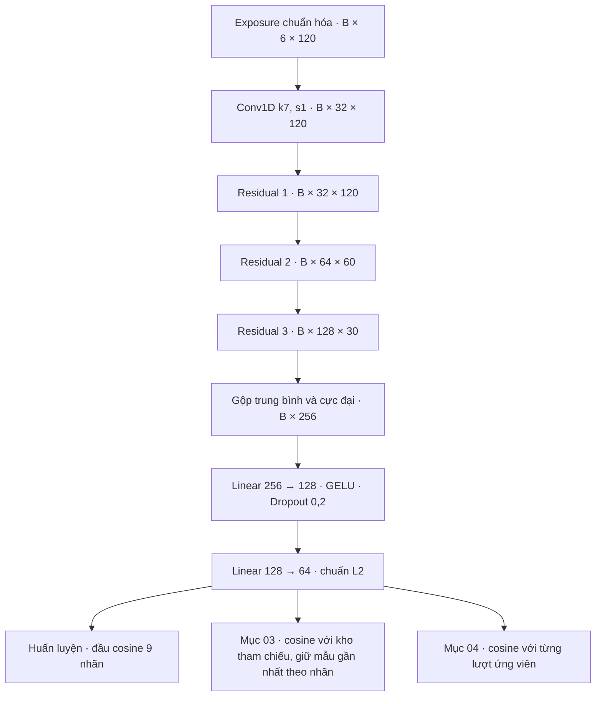
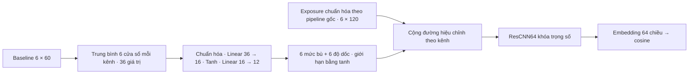
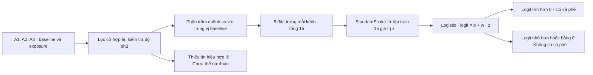
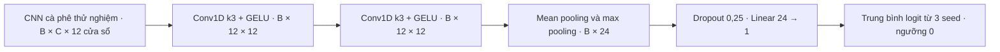

# Ứng dụng AI trong hệ thống RoboNose

Tài liệu báo cáo PBL6 · Số liệu đối chiếu với mã nguồn và kết quả thực nghiệm đến 27/11/2026.

**Trình tự trình bày khi bảo vệ** · [Chọn và gán nhãn dataset](#3-dataset-và-nhãn) → [Tiền xử lý và làm giàu](#4-tiền-xử-lý-và-làm-giàu-tín-hiệu) → [Kiến trúc AI](#5-kiến-trúc-model) → [Bảng so sánh và quyết định](#6-thử-nghiệm-và-tiêu-chí-chọn-model).

## 1. Bài toán và phương án được chọn

RoboNose dùng chuỗi đo từ mảng cảm biến để giải quyết hai bài toán độc lập. Cùng một lượt thu có thể được đưa vào cả hai bài toán.

| Bài toán | Model được chọn | Kết quả trả về | Lý do lựa chọn |
| --- | --- | --- | --- |
| Nhận diện và đối sánh người | ResCNN64, một CNN tích chập một chiều với các khối residual. Mục 04 có thêm tùy chọn V2 hiệu chỉnh exposure trước CNN. | Mục 03 xếp hạng các nhãn trong kho tham chiếu. Mục 04 xếp hạng các lượt được chọn theo điểm cosine với một lượt tham chiếu. | CNN học được hình dạng đáp ứng theo thời gian của nhiều kênh. Embedding 64 chiều dùng được cho cả nhận diện theo kho mẫu và đối sánh từng lượt. |
| Phát hiện cà phê | Logistic Regression V2 trên ba kênh **MQ3 #1 A1, MQ135 #2 A2, MQ3 #2 A3**. | Mục 06 báo có mùi cà phê, không có mùi cà phê hoặc chưa đủ dữ liệu để dự đoán. | Đây là bản có kết quả cân bằng cao nhất trong các phương án đã thử trên tập 09–20/11. Model nhỏ, dễ triển khai và truy vết đóng góp của từng kênh. |

Mục 03 và mục 06 dùng API và kết quả riêng. Cà phê có thể được kiểm tra ngay cả khi một job nhận diện người thất bại. [Điểm vào API](robonose_s3/web_server.py) · [Job suy luận](robonose_s3/inference.py)

## 2. Kiến trúc hệ thống và công nghệ

```text
TGS2602 + MQ3 #1 + MQ135 #2 + MQ3 #2 → ADS1115 ┐
                                             ├─ ESP32-S3 → USB native CDC
BME688 (điện trở gas, nhiệt độ, RH, áp suất) ────┘
          → host Python ghi raw.csv và metadata.json theo UUID lượt đo
          → dashboard chọn mẫu đã lưu → hàng đợi inference
               ├─ Mục 03 → ResCNN64 → embedding → kho tham chiếu → xếp hạng nhãn
               ├─ Mục 04 → tùy chọn hiệu chỉnh V2 → ResCNN64 → cosine giữa các lượt
               └─ Mục 06 → đặc trưng đáp ứng → Logistic Regression → có/không cà phê
```

| Lớp | Công nghệ và vai trò |
| --- | --- |
| Thiết bị | ESP32-S3 chạy firmware C++, lấy mẫu danh định 1 Hz và điều khiển bơm/van theo pha. ADS1115 số hóa bốn điện áp analog. BME688 cung cấp điện trở gas và dữ liệu môi trường. |
| Thu và lưu | Host Python trên Windows nhận dữ liệu USB, lưu CSV và metadata. UUID theo từng lượt giúp phân biệt các mẫu trùng tên và đối chiếu dữ liệu giữa các lần chạy. |
| Huấn luyện | NumPy xử lý tensor và đặc trưng. PyTorch dùng cho ResCNN64, bộ hiệu chỉnh V2 và CNN cà phê thử nghiệm. scikit-learn dùng để fit Logistic Regression, Extra Trees, SVM và LDA. |
| Suy luận | ResCNN64 dùng PyTorch, có thể chạy qua một tiến trình Python riêng. Logistic dùng hệ số xuất dưới dạng JSON và tính điểm bằng Python tiêu chuẩn. Hàng đợi inference tách việc chấm mẫu khỏi thu dữ liệu. |
| Giao diện | HTTP server Python cục bộ và HTML/CSS/JavaScript. Dashboard có danh sách mẫu, xếp hạng danh tính, đối sánh và kiểm tra cà phê. |

[Firmware và thông số thiết bị](firmware/RoboNose_Dataset_S3/config.h) · [Worker ResCNN64](robonose_s3/rescnn_worker.py)

## 3. Dataset và nhãn

### 3.1. Đơn vị dữ liệu

Một mẫu đưa vào model là **một lượt đo đã lưu hoàn chỉnh**. Mỗi lượt gồm `raw.csv` và `metadata.json`. Raw giữ các giá trị đo, thời gian monotonic, pha, cờ hợp lệ, trạng thái cảm biến, đường khí và PWM. Metadata ghi UUID, phiên, tên mẫu, trạng thái và cấu hình thiết bị. Luồng thu có baseline danh định 60 giây, exposure 120 giây và recovery 60 giây. Baseline và exposure qua đầu lấy mẫu, recovery qua khí lọc. Các pha chờ có nhãn riêng.

Lượt `COMPLETE` thể hiện đã đi hết quy trình. Chất lượng tín hiệu được kiểm tra riêng trước khi vào model. Những bản xuất trùng UUID hoặc nội dung raw trùng hash được lọc ở các thử nghiệm có kiểm tra chống trùng. Các tập sau phục vụ mục đích khác nhau, có thể dùng lại một phần lượt đo. [Cấu trúc lưu trữ](data/README.md)

### 3.2. Tập theo từng bài toán

| Tập | Quy mô và cách dùng |
| --- | --- |
| ResCNN64 gốc | **77 lượt huấn luyện, 9 nhãn**. Báo cáo artifact ghi `full_fit`, các ngày train nằm trong 06–18/11/2026. Báo cáo gốc không có ngày test độc lập. |
| Bộ hiệu chỉnh người V2 | **93 lượt thuộc 9 nhãn**, ngày **09–20/11/2026**, tách khỏi cây `data/hardware`. Loại **60 lượt không xác nhận được nhãn danh tính** và **3 lượt chưa hoàn chỉnh**. |
| Kiểm tra người khác phiên | **13 lượt từ 4 phiên** trong `data/hardware`, gồm 8 lượt Phúc Lưu và 5 lượt Tài. Khi chấm một truy vấn, ứng viên chỉ đến từ phiên khác. Loại trùng theo UUID, hash hoặc phiên theo quy tắc của script. |
| Cà phê, chọn và huấn luyện model | **141 lượt ngày 09–20/11** gồm **32 lượt tên có cà phê**, **16 đối chứng không khí**, và **93 lượt chỉ mang tên người** được dùng làm nhãn âm quy ước. Nhóm cuối chưa có xác nhận thực nghiệm rằng từng lượt đều không có cà phê. |
| Cà phê, kiểm tra ngoài khoảng huấn luyện V2 | **8 lượt ghi nhãn cà phê ngày 07/11**. Tập này chỉ có mẫu dương đủ điều kiện trong phép kiểm tra, nên dùng để báo tỷ lệ phát hiện. |
| Cà phê, kiểm tra `data/hardware` | Có **13 lượt có tên người** trong tập so sánh có nhãn quy ước. Tập đã dùng trong báo cáo chưa có mẫu cà phê được xác nhận, nên chỉ báo số lượt model dự đoán có cà phê. |

[Báo cáo ResCNN64 gốc](models/rescnn64/20261119_053351_6b8717/report.json) · [Tập V2 nhận diện người](models_v2/grouped_training_report.json) · [Tập cà phê](models_v2/coffee_sensor_report.json)

### 3.3. Chọn mẫu trước khi huấn luyện

1. **Chọn đúng nguồn.** Đọc các lượt hardware đã lưu hoàn chỉnh. Khi huấn luyện bộ hiệu chỉnh V2 và cà phê, giới hạn ngày 09–20/11 và loại cây `data/hardware` khỏi tập chọn cấu hình. Với ResCNN64 gốc, số liệu lấy từ báo cáo huấn luyện đã nhập cùng artifact.
2. **Gán nhãn theo nhiệm vụ.** Nhận diện người ánh xạ những tên mẫu đã biết vào 9 nhãn danh tính. Cà phê dùng tên có từ khóa cà phê làm dương, mẫu không khí làm đối chứng âm và danh sách tên người đã biết làm âm quy ước. Những lượt có tên mơ hồ nằm ngoài tập gán nhãn tương ứng.
3. **Lọc trùng và lỗi.** Đối chiếu UUID hoặc SHA-256 của raw theo script. Kiểm tra số điểm, thời gian, cấu hình và tín hiệu theo hợp đồng từng model. Tên mẫu, UUID và ngày dùng để gán nhãn, tách tập hoặc phát hiện trùng. Đầu vào classifier chỉ chứa tín hiệu cảm biến đã xử lý.
4. **Chia theo ngày hoặc phiên.** Các lần so trên archive dùng cả ngày làm nhóm. Bộ hiệu chỉnh danh tính được chấm riêng trên hardware bằng cách đổi truy vấn lần lượt và chỉ chọn ứng viên khác phiên. Tập ngày 07/11 dùng thêm cho cà phê để đánh giá ngoài khoảng huấn luyện. [Chọn dữ liệu người](models_v2/improve.py) · [Chọn dữ liệu cà phê](models_v2/train_coffee.py)

## 4. Tiền xử lý và làm giàu tín hiệu

### 4.1. Nhận diện người

| Bước | Thao tác cụ thể | Đầu ra |
| --- | --- | --- |
| 1. Kiểm tra mẫu | Kiểm tra schema `robonose.dataset.v1`, trạng thái `COMPLETE`, cấu hình lấy mẫu 1 Hz, PWM 80%, map kênh, ADS và profile BME. Trong mỗi pha, hai điểm liên tiếp cách `1 ± 0,1` giây. Đồng hồ monotonic toàn lượt phải tăng nghiêm ngặt. | Lượt đủ **60 điểm baseline và 120 điểm exposure**. |
| 2. Lọc chất lượng | Yêu cầu 6 kênh có số hữu hạn, trạng thái `OK`, cờ `fresh` và `valid` đúng. BME gas cần thêm `gas_valid`, `heater_stable` và `new_data`. Điện áp và điện trở phải dương, RH nằm trong 0–100%. Nếu một trong năm kênh mùi đứng yên suốt exposure hoặc có điểm không hợp lệ, loại lượt. | Hai ma trận **6 × 60** và **6 × 120**. Không điền 0 hay nội suy để ép đủ điểm. |
| 3. Ghi cảnh báo | Đo độ trôi theo phút và chênh đỉnh–đỉnh trên 30 giây cuối baseline. Giá trị lớn hơn vượt 5% tạo cảnh báo với artifact hiện tại. Các dòng ngay trước exposure và cờ đo cắt qua lúc chuyển pha có thể tạo cảnh báo bổ sung. | Cờ chất lượng đi kèm kết quả suy luận. |
| 4. Trừ nền | Lấy trung vị 30 điểm cuối của từng kênh làm mốc `b`. Với 4 điện áp và RH, tính `d = x − b`. Với BME gas, tính `d = ln(x/b)`. | Tensor đáp ứng `d[6,120]`. Thứ tự là A0, A1, A2, A3, BME gas, BME RH. |
| 5. Chuẩn hóa | Tính `X = (d − center) / scale` theo từng kênh với thông số từ `model.json` gốc. Chuyển sang `float32` và thêm chiều batch. | ResCNN64 gốc nhận `[1,6,120]`. |
| 6. Bổ sung riêng cho V2 | Đọc cả 60 điểm baseline, lấy log kênh điện trở gas rồi lấy trung bình từng cửa sổ 10 điểm. Chuẩn hóa **36 đặc trưng** bằng mean/độ lệch chuẩn của train, giới hạn trong `[-4,4]`. MLP sinh 6 mức bù và 6 độ dốc. Cộng đường bù lên `X`, với biên tối đa 0,5 đơn vị chuẩn hóa. | V2 vẫn đưa `[1,6,120]` qua CNN gốc. |

Nhiệt độ, áp suất và recovery nằm ngoài tensor nhận diện người. `WAIT_EXPOSURE` có thể tham gia kiểm tra chất lượng trước exposure. [Quy trình đầy đủ ở models](models/TIEN_XU_LY_RESCNN64.md) · [Quy trình hiệu chỉnh ở models_v2](models_v2/BAO_CAO_KY_THUAT_V2.md)

### 4.2. Phát hiện cà phê

| Bước | Thao tác cụ thể | Đầu ra |
| --- | --- | --- |
| 1. Chọn kênh và pha | Bản V2 chọn A1, A2 và A3 theo thứ tự artifact. Đọc hai pha `BASELINE` và `EXPOSURE`, định vị điểm bằng `phase_elapsed_s`. | Ba chuỗi baseline và ba chuỗi exposure. |
| 2. Lọc chất lượng | Với mỗi pha và mỗi kênh, kiểm tra thời gian hữu hạn, không giảm và không nhảy quá 3 giây giữa hai dòng liên tiếp. Giữ điểm số hữu hạn, trạng thái `OK` và cờ `valid/fresh` đúng. Mỗi pha cần ít nhất 90% điểm hợp lệ, khoảng trống giữa điểm hợp lệ tối đa 3 giây. Độ phủ từ điểm hợp lệ đầu đến cuối phải đạt ≥ 50 giây ở baseline và ≥ 105 giây ở exposure. | Chuỗi hợp lệ. Thiếu độ phủ sẽ trả chưa dự đoán được. |
| 3. Tính đáp ứng tương đối | Lấy trung vị **toàn bộ baseline hợp lệ** làm `b`, yêu cầu `b ≠ 0`. Đổi từng điểm exposure `x` thành `r = 100 × (x − b) / abs(b)`. | Đáp ứng phần trăm theo thời gian, riêng cho từng kênh. |
| 4. Nén thành đặc trưng | Với mỗi kênh, tính trung bình toàn exposure, trung bình trong `40 ≤ t < 80` giây, P10, P90 và độ dốc hồi quy tuyến tính theo phút. Cửa sổ 40–80 giây phải có điểm hợp lệ. | Vector **3 × 5 = 15** giá trị theo thứ tự A1, A2, A3. |
| 5. Chuẩn hóa và chấm | Tính `z = (đặc trưng − mean) / scale` với scaler fit từ train. Tính logit `intercept + w · z`. | Có cà phê khi logit > 0. |

**Ví dụ một lượt thật dùng cho cả hai pipeline.** Ở lượt UUID đầu `0e3e2d1a`, điểm A3 đầu exposure là **0,61200 V**. ResCNN64 lấy nền 30 điểm cuối là **0,60675 V**, trừ ra **0,00525 V**, chuẩn hóa thành **−0,22383**. Bộ hiệu chỉnh V2 biến giá trị này thành **−0,27970** bằng thông tin nền của cả sáu kênh. Model cà phê lấy nền của toàn pha là **0,60900 V**, đổi cùng điểm đo thành **+0,49261%**. Từ cả exposure của A3, nó rút năm giá trị xấp xỉ **0,79382**, **0,85206**, **0,45874**, **1,29310** và **−0,17508** theo thứ tự đặc trưng trong bảng. Sau khi ghép đủ 15 đặc trưng và chuẩn hóa, Logistic cho logit **−1,99942** và dự đoán không có cà phê. Đây là ví dụ chạy pipeline, nhãn tên người của lượt này vẫn là nhãn âm quy ước.

### 4.3. Làm giàu dữ liệu và đặc trưng

| Biện pháp | Thực hiện trên dữ liệu | Trạng thái |
| --- | --- | --- |
| Bổ sung diễn biến nền ở V2 người | Thêm 36 giá trị trung bình cửa sổ baseline. Loss contrastive tận dụng embedding cùng nhãn khác ngày. | Đang dùng cho tùy chọn V2 ở mục 04. |
| Mở rộng đặc trưng cà phê | Thêm trung bình 5–30 giây, trung bình 85–105 giây, chênh lệch cuối–đầu exposure và P90−P10 của baseline. | Đã so bằng dữ liệu tách ngày. Logistic đang chạy dùng 15 đặc trưng của pipeline đã chọn. |
| Tạo cặp cà phê và tên người cùng ngày | Tạo hiệu vector đặc trưng giữa các lượt cùng ngày. Dùng các hiệu và hiệu đảo dấu khi fit, rồi hiệu chỉnh intercept bằng lượt train. | Thử nghiệm Logistic, chưa được chọn. |
| Tăng cường đầu vào CNN cà phê | Nén exposure thành 12 cửa sổ 10 giây. Trong train, nhân hệ số biên độ theo lượt/kênh và cộng nhiễu nhẹ. Cả scaler và tăng cường chỉ dựa trên fold train. | Thử nghiệm CNN, chưa được chọn. |

Các đặc trưng và biến thể tăng cường được tính cho model. CSV gốc chỉ được đọc. [Tiền xử lý ResCNN64](robonose_s3/rescnn64.py#L117) · [Tiền xử lý cà phê](robonose_s3/coffee_detection/__init__.py) · [CNN cà phê thử nghiệm](models_v2/benchmark_coffee_cnn.py)

## 5. Kiến trúc model

### 5.1. ResCNN64 cho người



`B` là kích thước batch, `k` là kích thước kernel và `s` là stride.

| Khối | Cấu hình |
| --- | --- |
| Đầu vào | Chuỗi `[batch, 6, 120]`, bốn kênh điện áp, điện trở gas và độ ẩm. |
| Trích xuất theo thời gian | `Conv1d 6 → 32`, kernel 7, GroupNorm, GELU. |
| Khối residual | `32 → 32`, kernel 5, stride 1. Tiếp theo `32 → 64`, kernel 5, stride 2 và `64 → 128`, kernel 3, stride 2. Mỗi khối gồm hai lớp tích chập và một nhánh nối tắt. |
| Gộp theo thời gian | Nối trung bình và cực đại của từng kênh đặc trưng để được vector 256 chiều. |
| Đầu embedding | `Linear 256 → 128 → 64`, GELU, dropout 0,2 trong train và chuẩn L2 ở đầu ra. |
| Đầu phân lớp | Nhân cosine giữa embedding và vector trọng số lớp chuẩn L2 với hệ số 12. Lúc chạy dashboard, hệ thống dùng embedding để tính cosine. Mục 03 lấy ứng viên tốt nhất của từng nhãn trong kho, bỏ lượt có UUID hoặc raw hash trùng truy vấn. |

CNN 1D phù hợp vì mỗi lượt là chuỗi nhiều kênh đồng bộ. Tích chập học đặc trưng biến thiên cục bộ theo thời gian. Embedding cho phép mục 04 xếp hạng các mẫu do người dùng chọn, kể cả khi tên mẫu khác tên lớp trong kho. Ngưỡng xác nhận danh tính chưa được hiệu chuẩn, nên giao diện trình bày thứ hạng thay vì khẳng định danh tính. [Kiến trúc ResCNN64](robonose_s3/rescnn64.py#L217) · [Trạng thái hiệu chuẩn](models/rescnn64/20261119_053351_6b8717/artifact.json)

### 5.2. Bộ hiệu chỉnh trước CNN trong V2



Với từng kênh `c`, bộ hiệu chỉnh có dạng `X_v2[c,t] = X[c,t] + 0,5 × (offset[c] + slope[c] × u[t])`. `u[t]` chạy đều từ −1 đến 1 trên 120 điểm. Sau `0,5 × tanh`, từng hệ số `offset` và `slope` có độ lớn tối đa 0,5, nên biên chỉnh tại mỗi điểm được giới hạn ở 0,5 đơn vị chuẩn hóa.

**Trọng số ResCNN64 được khóa**, còn gradient đi qua CNN để học 796 tham số của bộ hiệu chỉnh. Các cấu hình dùng AdamW với learning rate 0,003, batch tối đa 24 và 20 epoch. Hàm mất mát của cấu hình được chọn gồm cross-entropy có trọng số lớp, phạt bình phương độ lớn đường chỉnh với hệ số 0,25, và thành phần contrastive khác ngày với hệ số 0,5. Contrastive dùng embedding CNN gốc của các lượt train khác ngày làm mốc để tăng độ gần tương đối với lượt cùng nhãn. [Chi tiết kiến trúc V2](models_v2/BAO_CAO_KY_THUAT_V2.md) · [Nguồn gốc supervised contrastive learning](https://proceedings.neurips.cc/paper_files/paper/2020/hash/d89a66c7c80a29b1bdbab0f2a1a94af8-Abstract.html)

### 5.3. Model Logistic Regression cho cà phê



Với vector 15 đặc trưng sau chuẩn hóa `z`, model tính logit `b + w · z`. Logit lớn hơn 0 thì model trả có cà phê. Logistic dùng L2 với `C = 0,1` và cân bằng trọng số lớp khi train. Có thể so chuẩn L2 của hệ số theo nhóm kênh để diễn giải mức đóng góp trong model này. Thứ tự đo được là **MQ3 #2**, **MQ3 #1**, rồi **MQ135 #2**. Đây là độ lớn hệ số trong mô hình đã fit, còn đáp ứng từng cảm biến có thể thay đổi theo điều kiện đo. [Artifact Logistic V2](robonose_s3/coffee_detection/model_sensor_v2.json) · [Kết quả chọn kênh](models_v2/coffee_sensor_report.json)

### 5.4. Kiến trúc các model cà phê đối chứng

| Model | Kiến trúc hoặc nguyên tắc | Lý do đưa vào so sánh |
| --- | --- | --- |
| Logistic Regression | Tổ hợp tuyến tính của đặc trưng chuẩn hóa. L2 hạn chế hệ số lớn. Bản thử đầu/cuối và bản học cặp thay đổi dữ liệu đầu vào hoặc mục tiêu fit. | Mốc đơn giản, ít tham số, dễ xem kênh nào đóng góp vào quyết định. |
| Extra Trees | Trung bình điểm của 80 cây, độ sâu tối đa 6. Mỗi cây dùng các phép chia phi tuyến trên đặc trưng. | Kiểm tra tương tác giữa các kênh mà bộ phân lớp tuyến tính có thể bỏ qua. |
| SVM RBF | Chuẩn hóa robust theo khoảng P10–P90. Ranh giới phi tuyến theo khoảng cách tới các support vector. | Thử ranh giới phi tuyến với tập dữ liệu vừa và nhỏ. |
| LDA có shrinkage | Ranh giới tuyến tính từ trung bình lớp và hiệp phương sai chung được regularize. | Thử cách dùng tương quan giữa đặc trưng với mẫu ít. |
| CNN 1D | Hai Conv1D kernel 3, mỗi lớp 12 kênh và GELU. Ghép mean/max pooling thành 24 giá trị, qua dropout 0,25 và Linear `24 → 1`. Lấy trung bình logit của ba seed. | Kiểm tra xem hình dạng phản ứng theo thời gian có thêm thông tin so với thống kê rút gọn hay không. |



`C` là số kênh cảm biến được thử, gồm bộ 3 kênh V2 hoặc toàn bộ 5 kênh mùi. Các model đối chứng được chạy ngoại tuyến. Việc thử thêm model không làm thay đổi artifact đã chọn cho dashboard. [Extra Trees và Logistic](models_v2/benchmark_coffee.py) · [SVM và LDA](models_v2/benchmark_coffee_ml.py) · [CNN](models_v2/benchmark_coffee_cnn.py)

## 6. Thử nghiệm và tiêu chí chọn model

### 6.1. Đối sánh danh tính

Trên archive, bộ hiệu chỉnh được chọn bằng cách lần lượt giữ riêng một ngày. Trong bốn cấu hình, phép thử dùng **top 1 trung bình theo lớp** làm chỉ số chính để mỗi nhãn có trọng số ngang nhau. MRR là trung bình nghịch đảo thứ hạng của ứng viên cùng nhãn đầu tiên, dùng để so khi điểm chính bằng nhau. Sau khi chốt cấu hình mới đánh giá 13 lượt hardware.

**Bước 1. Chọn cấu hình trên archive 09–20/11.** Vòng này có 76 truy vấn hợp lệ từ 6 nhãn có đối chiếu cùng người khác ngày. Khi giữ riêng một ngày, bộ hiệu chỉnh và bộ chuẩn hóa baseline được fit lại bằng các ngày còn lại. CNN gốc là checkpoint đã huấn luyện trước, mức tách ngày áp dụng cho phần hiệu chỉnh V2.

| Cấu hình | Top 1 | Trung bình Top 1 theo lớp | MRR |
| --- | ---: | ---: | ---: |
| CNN gốc | 48/76 | 60,70% | 0,7243 |
| Giữ mức baseline, dùng cross-entropy và phạt mức chỉnh | 49/76 | 63,33% | 0,7329 |
| Trừ trung bình baseline, dùng cross-entropy và phạt mức chỉnh | 45/76 | 63,79% | 0,6774 |
| **Giữ mức baseline và thêm contrastive** | **50/76** | **66,09%** | **0,7409** |
| Trừ trung bình baseline và thêm contrastive | 44/76 | 62,60% | 0,6668 |

**Bước 2. Fit lại cấu hình đã chọn trên 93 lượt, rồi chấm khác phiên.** Với từng truy vấn hardware, xếp hạng ứng viên bằng cosine và kiểm tra ứng viên đầu tiên có cùng nhãn hay không. Nếu ứng viên cùng nhãn đầu tiên ở hạng 3, lượt đó có Top 1 = 0 và đóng góp `1/3` vào MRR.

| Model | Top 1 trên 13 lượt hardware khác phiên | MRR hardware | Kết luận sử dụng |
| --- | ---: | ---: | --- |
| ResCNN64 gốc | 7/13 (53,8%) | 0,6692 | Giữ cho mục 03 và lựa chọn mặc định ở mục 04. |
| V2 bù theo công thức | 4/13 (30,8%) | 0,5231 | Giữ dưới dạng thử nghiệm. |
| V2 bộ hiệu chỉnh đã học lần đầu | 6/13 (46,2%) | 0,5788 | Bản thử trước khi chọn cấu hình theo ngày. |
| **V2 hiện tại, `v2-grouped`** | **8/13 (61,5%)** | **0,7333** | Tùy chọn **Bộ hiệu chỉnh đã học** ở mục 04. |
| V2 thử thêm trọng số cảm biến | 8/13 (61,5%) | 0,7418 | Top 1 trung bình theo lớp trên archive giảm từ 66,09% xuống 65,15%. Mục 04 tiếp tục dùng `v2-grouped`. |

Trên archive, V2 hiện tại đạt **50/76** truy vấn đúng hạng 1, so với **48/76** của CNN gốc. Trên hardware, V2 cải thiện tổng cộng một lượt đúng so với CNN gốc. Tập hardware chỉ có hai nhãn và đã dùng qua nhiều lần đánh giá, nên cần phiên mới để xác nhận khả năng tổng quát. [Báo cáo V2](models_v2/grouped_training_report.json) · [Thử nghiệm trọng số](models_v2/identity_sensor_report.json) · [Kết quả các bản V2](models_v2/BAO_CAO_KY_THUAT_V2.md)

### 6.2. Phát hiện cà phê

Mỗi fold giữ riêng toàn bộ một ngày. Model và scaler được fit trên các ngày còn lại. Báo cáo dùng **balanced accuracy** = trung bình của tỷ lệ bắt đúng cà phê và tỷ lệ nhận đúng nhóm âm. Chỉ số này giúp đánh giá khi mẫu âm nhiều hơn mẫu dương. Kiểm tra riêng ngày 07/11 cho thấy khả năng phát hiện ngoài khoảng ngày train. Với phép thử tối ưu Logistic, vòng trong chọn cấu hình và ngưỡng, vòng ngoài chấm trên ngày được giữ riêng. [Nghiên cứu về kiểm định lồng](https://pubmed.ncbi.nlm.nih.gov/16504092/)

**Bước 1. Chọn kênh và mức regularization.** So tất cả 31 tập con khác rỗng của 5 kênh mùi, mỗi tập thử `C ∈ {0,1; 1; 10}`, tổng cộng **93 cấu hình Logistic**. Chọn theo balanced accuracy trên dự đoán khác ngày. Nếu bằng điểm, ưu tiên ít bỏ sót hơn, ít kênh hơn, rồi `C` nhỏ hơn. Tập A1–A2–A3 với `C = 0,1` đạt 71,8%. Tập A2–A3 với cùng `C` đạt 71,6% và bắt đúng ít hơn một lượt cà phê.

**Bước 2. So với các phương án AI khác.** Bảng dưới dùng cùng nguồn archive có 141 lượt. Model cũ được chạy như mốc tham chiếu cố định. Các điểm dùng để chọn cấu hình trên archive chưa tương đương một phép đánh giá xác nhận trên tập mới. Dòng kiểm định lồng được ghi riêng vì cách chấm chặt hơn.

| Phương án | Balanced accuracy trên tập 09–20/11 | Bắt đúng lượt cà phê | Ghi chú |
| --- | ---: | ---: | --- |
| Logistic cũ, BME688 gas và MQ3 #1 | 54,6% | 10/32 | Chạy lại checkpoint cũ để tham chiếu. Phạm vi trùng tập train cũ chưa xác minh. |
| **Logistic V2, ba kênh analog** | **71,8%** | **21/32** | Bản được chọn. Nhận đúng 85/109 lượt âm theo quy ước. |
| Logistic bổ sung đặc trưng đầu/cuối exposure tốt nhất | 71,6% | 20/32 | Trên hardware mang tên người, báo dương 5/13 so với 1/13 của V2. |
| Extra Trees tốt nhất | 59,9% | 14/32 | Ensemble cây chưa vượt Logistic trên dữ liệu này. |
| LDA có shrinkage tốt nhất | 70,2% | 20/32 | Ngày 07/11 bắt được 1/8, bằng V2. |
| SVM RBF tốt nhất | 65,2% | 20/32 | Báo dương 35/109 lượt âm theo quy ước khi kiểm tra khác ngày. |
| Logistic tinh chỉnh bằng kiểm định lồng | 62,3% | 17/32 | Thử 36 cấu hình và 9 ngưỡng. Dùng kết quả vòng ngoài để báo cáo. |
| Logistic học thêm từ cặp cùng ngày | 68,2% | 19/32 | Chưa cải thiện so với V2. |
| CNN 1D ba kênh | 61,9% | 22/32 | Bắt 4/8 ngày 07/11, đồng thời báo dương 49/109 lượt âm theo quy ước. |
| Kết hợp Logistic và CNN | 70,9% | 21/32 | Bản kết hợp được chọn vẫn bắt 1/8 ngày 07/11. |

**Căn cứ chọn Logistic V2.** Bản này đạt 71,8% balanced accuracy, bắt **21/32** lượt cà phê, báo dương **0/16** đối chứng không khí trong kiểm tra theo ngày và **1/13** lượt hardware mang tên người. Accuracy thông thường là **106/141 (75,2%)**, còn recall cà phê là **65,6%**. Balanced accuracy vẫn dưới 75%, và đợt 07/11 chỉ phát hiện **1/8**. Vì vậy có thể trình bày bản demo và đo lường kết quả, còn khả năng nhận diện ổn định qua nhiều đợt đo vẫn cần xác nhận.

| Nhãn theo bộ dữ liệu | Model báo có cà phê | Model báo không có cà phê |
| --- | ---: | ---: |
| 32 lượt mang nhãn cà phê | 21 | 11 |
| 109 lượt âm gồm không khí và tên người quy ước | 24 | 85 |

Từ bảng, tỷ lệ phát hiện là `21/32 = 65,6%`, tỷ lệ nhận đúng nhóm âm là `85/109 ≈ 78,0%`, và balanced accuracy là `(21/32 + 85/109) / 2 ≈ 71,8%`. CNN 1D bắt đúng **22/32** nhưng báo dương trên **49/109** lượt nhóm âm. So cả hai tỷ lệ giải thích vì sao Logistic V2 được chọn dù CNN bắt được thêm một lượt dương trên archive.

[Logistic cũ và V2](models_v2/coffee_sensor_report.json) · [Logistic thêm đặc trưng và Extra Trees](models_v2/coffee_v3_report.json) · [SVM và LDA](models_v2/coffee_ml_report.json) · [Kiểm định lồng](models_v2/coffee_logistic_tuned_report.json) · [Học cặp](models_v2/coffee_pairs_report.json) · [CNN và kết hợp](models_v2/coffee_cnn_report.json)

## 7. Điểm cần nêu khi bảo vệ

1. **Hai tác vụ, hai mục tiêu.** Nhận diện người cần xếp hạng hình dạng mùi giữa nhiều lượt; phát hiện cà phê là phân loại nhị phân. Hai bài toán dùng bộ đặc trưng và tiêu chí đánh giá riêng.
2. **Chọn model bằng dữ liệu khác phiên hoặc khác ngày.** Tách theo ngày hạn chế việc mẫu cùng điều kiện đo rơi vào cả train và test. Báo riêng kết quả chọn cấu hình, kết quả hardware và các tập chỉ có một lớp.
3. **Đánh giá theo ngữ cảnh mẫu.** Một mẫu chỉ mang tên người là nhãn âm quy ước. Muốn đo báo nhầm chắc chắn, cần ghi rõ có hay không có cà phê khi thu. Lượt cà phê riêng và lượt người kèm cà phê cũng nên được báo cáo riêng.
4. **Hướng kiểm chứng tiếp.** Thu xen kẽ cùng người có và không có cà phê trong cùng phiên, thêm đối chứng không khí và mùi dễ nhầm. Giữ riêng các phiên mới để chấm đồng thời recall, tỷ lệ báo nhầm và balanced accuracy.
