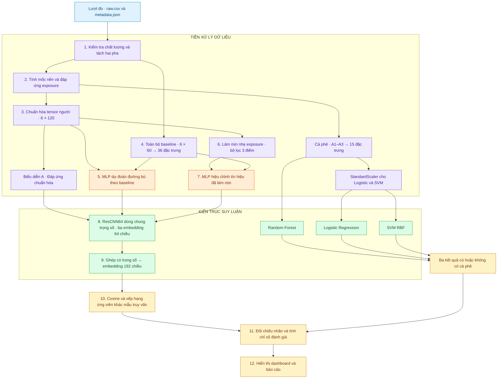
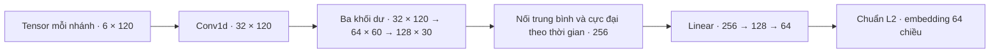

# Quy trình ứng dụng AI trong hệ thống RoboNose

Tài liệu mô tả một quy trình xử lý thống nhất từ lượt đo cảm biến đến kết quả đối sánh người và phát hiện cà phê. Quy trình gồm **thu và tổ chức dữ liệu → kiểm tra chất lượng → tiền xử lý → suy luận AI → đối chiếu nhãn và đánh giá → hiển thị kết quả**. Cấu hình nhận diện người cuối cùng dùng ResCNN64 với hiệu chỉnh theo baseline, làm mịn nhẹ và kết hợp biểu diễn. Phát hiện cà phê so sánh ba thuật toán trên cùng bộ đặc trưng.

## 1. Dữ liệu và mục tiêu đầu ra

### 1.1. Đơn vị dữ liệu và cảm biến

Một mẫu tương ứng một lượt đo có UUID bất biến, được lưu trong `raw.csv` và `metadata.json`. Dữ liệu ghi theo thời gian, kèm nhãn pha và các cờ trạng thái. Tại tần số 1 Hz, lượt chuẩn có **60 giây BASELINE**, **120 giây EXPOSURE** và **60 giây RECOVERY**. Baseline và exposure đều đo qua đầu lấy mẫu. Recovery đo qua khí lọc. Đầu vào AI sử dụng baseline và exposure.

| Kênh | Cảm biến và đại lượng | Dùng cho đối sánh người | Dùng cho ba model cà phê |
| --- | --- | :---: | :---: |
| A0 | TGS2602 · điện áp V | ✓ | |
| A1 | MQ3 #1 · điện áp V | ✓ | ✓ |
| A2 | MQ135 #2 · điện áp V | ✓ | ✓ |
| A3 | MQ3 #2 · điện áp V | ✓ | ✓ |
| BME688 gas | Điện trở Ω | ✓ | |
| BME688 RH | Độ ẩm tương đối % | ✓ | |

ADS1115 dùng hệ số `0,0001875 V/count` và hệ số chia áp 1. Cấu hình đầu vào bộ mã hóa yêu cầu bơm 80%, tần số 1 Hz và profile BME688 với gia nhiệt yêu cầu 300 °C trong 100 ms, oversampling T×2, H×2, P×4. [Cấu hình tương thích](models/rescnn64/20261119_053351_6b8717/artifact.json)

### 1.2. Quy mô dữ liệu và nguồn kết quả

| Phạm vi | Tổng lượt | Mẫu hợp lệ cà phê | Có CF | Không CF | Số ngày có phiên hoặc mẫu |
| --- | ---: | ---: | ---: | ---: | ---: |
| Toàn bộ `data` từ 07/11, tính mỗi UUID một lần | 140 | 133 | 22 | 111 | 11 |
| Riêng `data/hardware` | 83 | 78 | 7 | 71 | 6 |

Số liệu kiểm kê cập nhật ngày **28/11/2026**. Kho toàn bộ data có sáu lượt ABORTED và một lượt ERROR. Có 83 lượt được lưu bản sao ở cả trong và ngoài hardware. Ngày 27/11 có phiên lỗi và chưa tạo lượt mẫu. Ngày ghi trong metadata được dùng để thống kê. Coffee và NoCoffee trong bảng dùng quy ước **tên chứa CF không phân biệt hoa thường là nhãn dương**, các tên còn lại là nhãn âm.

Các artifact huấn luyện hiện tại được tạo từ tập dữ liệu tại thời điểm fit. Bộ hiệu chỉnh người học trên **93 lượt, 9 nhãn** trong khoảng 09–20/11. Các model cà phê học trên **141 lượt**, gồm 32 nhãn cà phê và 109 nhãn âm trong 10 ngày. Quy tắc gán nhãn train cà phê nhận thêm từ khóa coffee, cà phê và các tên quy ước đã biết. Số mẫu của snapshot huấn luyện và số mẫu hiện còn trên đĩa phản ánh hai thời điểm khác nhau. Các bảng ở mục 5 ghi rõ nguồn của từng phép chấm. [Snapshot người](models_v4/identity_report.json) · [Snapshot cà phê](robonose_s3/coffee_detection/ml_report.json)

## 2. Quy trình từ dữ liệu thô đến kết quả



Sơ đồ trình bày các thành phần của cùng hệ thống. Hai đầu ra sử dụng bộ kênh và cách tính mốc nền phù hợp với từng bài toán. Các mục sau quy định chính xác từng phép biến đổi.

## 3. Tiền xử lý dữ liệu theo từng bước

### 3.1. Bước 1 — Kiểm tra chất lượng và tách pha

| Kiểm tra | Đối sánh mùi người | Phát hiện cà phê |
| --- | --- | --- |
| Điều kiện của lượt | Schema `robonose.dataset.v1`, trạng thái `COMPLETE`, có UUID lượt, UUID phiên, thời gian bắt đầu và cấu hình tương thích checkpoint. | Lượt huấn luyện được chọn theo điều kiện ở mục 1.2. Bộ trích đặc trưng kiểm tra trực tiếp độ phủ và chất lượng từng tín hiệu cần dùng. |
| Thời gian | Đúng **60 điểm BASELINE** và **120 điểm EXPOSURE**. Thời gian monotonic tăng nghiêm ngặt trên cả lượt. Khoảng giữa hai điểm trong mỗi pha nằm trong **1 ± 0,1 giây**. | Thời gian trong pha hữu hạn, không giảm. Khoảng giữa hai dòng thô liên tiếp và giữa hai điểm hợp lệ liên tiếp tối đa **3 giây**. |
| Giá trị hợp lệ | Cả sáu kênh đủ điểm hợp lệ và hữu hạn. Bốn điện áp và điện trở gas phải dương. RH nằm trong **0–100%**. Kênh điện áp hoặc gas phẳng suốt EXPOSURE làm lượt bị loại. | Mỗi kênh có ít nhất **90% điểm hợp lệ** trong từng pha. Độ phủ từ điểm hợp lệ đầu đến cuối ít nhất **50 giây ở BASELINE** và **105 giây ở EXPOSURE**. |
| Cờ thiết bị | Kiểm tra trạng thái đọc `OK`, cờ `fresh`, `valid` và các cờ chất lượng `NEGATIVE`, `ADC_LIMIT`. BME688 gas yêu cầu thêm `gas_valid`, `heater_stable` và `new_data`. | Điểm được đưa vào đặc trưng khi trạng thái đọc là `OK`, giá trị hữu hạn và các cờ `fresh`, `valid` đạt. Với BME688 gas, kiểm tra thêm `gas_valid`, `heater_stable` và `new_data`. |

Ở tác vụ đối sánh, hệ thống tính độ trôi cho năm kênh điện áp và gas trên **30 điểm cuối BASELINE**. Chỉ số theo từng kênh là `100 × max(60 × |độ dốc|, max − min) / trung vị`. Cấu hình đang dùng ghi cảnh báo khi chỉ số vượt **5%**. Nếu có ít nhất **24 điểm** từ BASELINE và WAIT_EXPOSURE trong 30 giây ngay trước EXPOSURE, hệ thống kiểm tra thêm độ trôi và cảnh báo khi trung vị trước exposure lệch hơn **5%** so với mốc nền. Những điểm EXPOSURE nằm qua thời điểm đổi ngữ cảnh cũng được đánh dấu. Các dòng WAIT_EXPOSURE phục vụ kiểm tra chất lượng.

Giá trị thiếu giữ nguyên trong tệp thô. Ở tác vụ đối sánh, thiếu điểm bắt buộc làm lượt không đạt điều kiện đầu vào. Ở tác vụ cà phê, thống kê chỉ dùng điểm hợp lệ nếu kênh vẫn đủ độ phủ. Mọi thao tác làm mịn và biến đổi thực hiện trên dữ liệu đọc vào bộ nhớ. [Chuẩn bị tensor đối sánh](robonose_s3/rescnn64.py) · [Kiểm tra và trích tín hiệu cà phê](robonose_s3/coffee_detection/__init__.py)

### 3.2. Bước 2 — Chuyển exposure thành đáp ứng so với nền

Với đầu vào đối sánh người, lấy trung vị **30 điểm cuối BASELINE** trên mỗi kênh làm `b[c]`. Mốc này tóm tắt mức tín hiệu ngay cuối pha nền. Bốn điện áp và độ ẩm được biểu diễn bằng độ chênh với nền. Điện trở gas dùng log tự nhiên của tỷ số để biểu diễn thay đổi tương đối.

```text
d[c,t] = exposure[c,t] − b[c]        với A0, A1, A2, A3 và RH
d[c,t] = ln(exposure[c,t] / b[c])    với BME688 gas
```

Ví dụ minh họa, exposure A3 bằng `0,61200 V` và nền bằng `0,60675 V` cho đáp ứng `0,00525 V`. Giá trị nền được tính riêng cho mỗi lượt, nên các lượt đo có mức nền ban đầu khác nhau được biểu diễn theo thay đổi so với nền của chính lượt đó.

### 3.3. Bước 3 — Chuẩn hóa thang đo giữa các kênh

Tính `X[c,t] = (d[c,t] − center[c]) / scale[c]`. Hai tham số `center` và `scale` được nạp từ artifact của ResCNN64. Các tham số giữ cố định trong suy luận. Tensor đầu ra có kích thước **6 × 120**, thứ tự A0, A1, A2, A3, gas và RH. Với ví dụ A3 ở trên và tham số trong artifact, `X ≈ −0,22383`.

Việc chuẩn hóa đưa các đại lượng V, log tỷ số điện trở và phần trăm độ ẩm về thang dữ liệu mà CNN đã học. [Tham số từng kênh](models/rescnn64/20261119_053351_6b8717/model.json)

### 3.4. Bước 4 — Mã hóa diễn biến của toàn bộ baseline

Bổ sung thông tin diễn biến đường nền bằng **đủ 60 điểm trên cả sáu kênh**, ngoài mốc trung vị đã dùng ở bước 2.

1. Đọc ma trận baseline **6 × 60** theo đúng thứ tự kênh.
2. Chuyển riêng điện trở gas sang `ln(R)`.
3. Chia mỗi kênh thành sáu cửa sổ liên tiếp, mỗi cửa sổ 10 điểm.
4. Tính trung bình từng cửa sổ và nối theo kênh, thu được **36 đặc trưng**.
5. Chuẩn hóa 36 đặc trưng bằng trung bình và độ lệch chuẩn fit trên tập học của bộ hiệu chỉnh. Độ lệch chuẩn có cận dưới `10⁻⁶`.
6. Giới hạn đặc trưng chuẩn hóa trong **[−4, 4]** trước MLP.

Sáu giá trị của mỗi kênh giữ thông tin nền cao hay thấp và diễn biến tăng giảm qua từng đoạn. Bước chia cửa sổ là phép tóm tắt tín hiệu, số lượt học vẫn giữ nguyên.

### 3.5. Bước 5 — Học đường bù exposure từ baseline

Bộ tiền xử lý có một MLP **36 → 16 → 12**, dùng Tanh sau lớp ẩn. Lớp cuối có 12 đầu ra. Đặt `h = MLP(z_baseline)` rồi chia các hệ số sau biến đổi thành hai nhóm:

```text
offset[c] = 0,5 × tanh(h[c])
slope[c]  = 0,5 × tanh(h[c+6])
u[t]      = −1 + 2t/119, với t từ 0 đến 119
q[c,t]    = 0,5 × (offset[c] + slope[c] × u[t])
X_bù[c,t] = X[c,t] + q[c,t]
```

**Offset điều chỉnh mức của đường exposure, slope điều chỉnh xu hướng dọc theo thời gian.** Mối quan hệ giữa 36 đặc trưng baseline và các hệ số được học từ dữ liệu người có nhãn. Đường bù có dạng tuyến tính theo thời gian. Với mỗi kênh, `|q[c,t]| ≤ 0,5` đơn vị chuẩn hóa.

Ví dụ minh họa, MLP trả `offset = 0,10` và `slope = −0,04`. Phần bù ở đầu exposure là `0,07`, ở cuối là `0,03`. Cùng một tín hiệu exposure nhưng có diễn biến baseline khác có thể nhận hệ số bù khác. Giá trị trong ví dụ chỉ minh họa công thức.

MLP có **796 tham số học được**, lớp đầu ra được khởi tạo bằng 0. Khi bắt đầu học, phần bù bằng 0. MLP được tối ưu bằng lỗi nhận diện của CNN và ràng buộc độ lớn hiệu chỉnh ở mục 5.1. [Đường chuẩn bị và suy luận](models_v4/identity.py)



```mermaid
flowchart LR
    BASELINE["Baseline đủ 60 điểm mỗi kênh"] --> WINDOWS["6 cửa sổ mỗi kênh · 36 giá trị trung bình"]
    WINDOWS --> NORMALIZE["Chuẩn hóa và giới hạn trong −4 đến 4"]
    NORMALIZE --> MLP["Linear 36→16 · Tanh · Linear 16→12"]
    MLP --> COEFF["0,5 × Tanh · 6 offset và 6 slope"]
    COEFF --> CURVE["Đường bù q theo thời gian · 6 × 120"]
    CURVE --> ADD["Cộng với tensor exposure đầu vào"]
    EXPOSURE["Exposure chuẩn hóa hoặc đã làm mịn"] --> ADD
    ADD --> OUTPUT["Tensor hiệu chỉnh · 6 × 120"]
    classDef signal fill:#E0F2FE,stroke:#0284C7,color:#0C4A6E;
    classDef process fill:#EDE9FE,stroke:#7C3AED,color:#4C1D95;
    classDef learned fill:#FFEDD5,stroke:#EA580C,color:#7C2D12;
    classDef output fill:#DCFCE7,stroke:#16A34A,color:#14532D;
    class BASELINE,EXPOSURE signal;
    class WINDOWS,NORMALIZE,ADD process;
    class MLP,COEFF,CURVE learned;
    class OUTPUT output;
```

### 3.6. Bước 6 — Làm mịn nhẹ exposure chuẩn hóa

Một biểu diễn bổ sung được tạo bằng bộ lọc đối xứng ba điểm trên từng kênh của `X`:

```text
X_mịn[c,t] = (X[c,t−1] + 6X[c,t] + X[c,t+1]) / 8
```

| Thành phần | Trọng số |
| --- | ---: |
| Điểm ngay trước | 12,5% |
| Điểm đang xét | 75% |
| Điểm ngay sau | 12,5% |

Bộ lọc lấy giá trị của chuỗi đầu vào cho mỗi cửa sổ, giữ hai điểm biên và giữ đoạn tín hiệu hằng vì tổng trọng số bằng 1. Ví dụ ba giá trị chuẩn hóa `0,10; 0,18; 0,14` cho điểm giữa sau lọc **0,165**. Phép lọc thực hiện trên exposure sau trừ nền và chuẩn hóa, theo thời gian của từng kênh. Ma trận baseline dùng làm ngữ cảnh vẫn được xử lý theo bước 4.

Bộ lọc sử dụng điểm trước và sau nên phù hợp với lượt đã ghi đầy đủ. Nó được dùng để giảm dao động ngắn. Mức cải thiện thực tế được đánh giá ở cấp cấu hình hoàn chỉnh.

### 3.7. Bước 7 — Tạo đầu vào của cấu hình đối sánh được chọn

Hệ thống tạo ba biểu diễn từ cùng một lượt đo. Mỗi biểu diễn được đưa qua **cùng ResCNN64 với cùng trọng số**.

| Biểu diễn nội bộ | Đầu vào CNN | Vai trò |
| --- | --- | --- |
| A | `X` | Giữ đáp ứng đã chuẩn hóa. |
| B | `X + q_B` | Thích nghi mức và xu hướng exposure theo toàn bộ baseline. |
| C | `smooth(X) + q_C` | Bổ sung tín hiệu làm mịn và hiệu chỉnh phù hợp với tín hiệu sau lọc. |

MLP của B và C được học riêng vì chúng nhận exposure trước và sau lọc. Các đầu vào CNN đều có kích thước **6 × 120**. Đây là cấu trúc nội bộ của một cấu hình đối sánh, với cách kết hợp đầu ra quy định ở mục 4.1.

Các bước trên học sự liên hệ giữa đường nền và biểu diễn mùi để phục vụ đối sánh. Chưa có dữ liệu chuẩn về đáp ứng exposure lý tưởng trong từng môi trường để xác nhận khả năng khôi phục tín hiệu vật lý. Hiệu quả của hiệu chỉnh được báo cáo bằng số lượt nhận đúng và thứ hạng của ứng viên cùng người.

### 3.8. Tạo đầu vào chung của ba bộ phân loại cà phê

Các thuật toán cà phê dùng cùng **A1–A3**, trích đặc trưng theo năm bước.

1. **Lọc điểm theo chất lượng.** Dùng đúng điều kiện độ phủ tại bước 1.
2. **Lấy mốc nền.** Trên từng kênh, lấy trung vị toàn bộ điểm BASELINE hợp lệ làm `b`. Mốc phải khác 0.
3. **Chuyển sang đáp ứng phần trăm.** Tính `r[t] = 100 × (exposure[t] − b) / |b|`.
4. **Trích năm thống kê mỗi kênh.** Nối theo thứ tự A1, A2, A3 thành **15 đặc trưng**.
5. **Chuẩn hóa theo model.** Logistic Regression và SVM dùng StandardScaler fit trên phần train. Random Forest nhận 15 đặc trưng trước chuẩn hóa. Phép so sánh ba model dùng tín hiệu trước làm mịn.

| Đặc trưng mỗi kênh | Phép tính và ý nghĩa |
| --- | --- |
| Trung bình toàn exposure | Mức đáp ứng chung. |
| Trung bình khoảng `40 ≤ t < 80` giây | Mức đáp ứng giữa pha. |
| P10 | Phân vị 10%, nội suy inclusive. |
| P90 | Phân vị 90%, cùng cách nội suy. |
| Độ dốc theo phút | Hồi quy tuyến tính `r` theo thời gian pha, nhân hệ số góc với 60. |

Nếu nền là `0,60900 V` và điểm exposure là `0,61200 V`, đáp ứng phần trăm xấp xỉ **+0,493%**. Chuỗi đáp ứng được dùng để tính các thống kê trên. [Trích đặc trưng cà phê](robonose_s3/coffee_detection/__init__.py) · [Đầu vào ba model triển khai](robonose_s3/coffee_detection/ml.py)

## 4. Kiến trúc AI và đầu ra

### 4.1. ResCNN64 và điểm đối sánh

Gọi `N` là số lượt trong batch. Hai chiều sau lần lượt là số kênh và số bước thời gian.



| Tầng | Cấu hình | Kích thước đầu ra |
| --- | --- | --- |
| Đầu vào | Một tensor đã tiền xử lý | `N × 6 × 120` |
| Stem | `Conv1d 6→32`, kernel 7, stride 1, GroupNorm 8 nhóm và GELU | `N × 32 × 120` |
| Khối dư 1 | `32→32`, kernel 5, stride 1 | `N × 32 × 120` |
| Khối dư 2 | `32→64`, kernel 5, stride 2 | `N × 64 × 60` |
| Khối dư 3 | `64→128`, kernel 3, stride 2 | `N × 128 × 30` |
| Pooling | Nối trung bình và giá trị cực đại trên trục thời gian | `N × 256` |
| Đầu embedding | `Linear 256→128`, GELU, dropout 0,2 trong huấn luyện, `Linear 128→64`, chuẩn L2 | `N × 64` |

Mỗi khối dư có hai lớp tích chập, GroupNorm sau mỗi lớp và GELU sau lớp thứ nhất và sau phép cộng với nhánh tắt. Khi kích thước thay đổi, nhánh tắt dùng tích chập kernel 1 với stride tương ứng. Kiến trúc có **168.960 tham số**, tính cả đầu phân lớp chín nhãn dùng trong huấn luyện. Khi đối sánh, hệ thống gọi đầu embedding.

Với embedding 64 chiều đã chuẩn L2 của từng nhánh `e_A`, `e_B`, `e_C`, nối ba vector sau khi nhân lần lượt với căn bậc hai của `0,60`, `0,20` và `0,20`. Vector gộp có **192 chiều**. Tích vô hướng của vector gộp giữa lượt truy vấn `u` và ứng viên `v` cho điểm:

```text
S(u,v) = 0,60 × cosine_A(u,v) + 0,20 × cosine_B(u,v) + 0,20 × cosine_C(u,v)
```

Hệ thống xếp hạng từ điểm cao xuống thấp. Điểm biểu thị độ tương đồng với ứng viên trong danh sách đã chọn. Cấu hình hiện tại dùng để xếp hạng, chưa có ngưỡng xác nhận danh tính đã hiệu chuẩn. [Kiến trúc bộ mã hóa](robonose_s3/rescnn64.py) · [Cách gộp embedding](models_v4/identity.py)

### 4.2. Ba kiến trúc phân loại cà phê

| Model | Kiến trúc và cách quyết định | Cấu hình huấn luyện |
| --- | --- | --- |
| Logistic Regression | Vector chuẩn hóa 15 chiều → tổng tuyến tính `l = b + Σw[j]z[j]` → có cà phê khi `l > 0`. | Điều chuẩn L2, `C = 0,1`, `class_weight=balanced`, tối đa 1.000 vòng lặp. |
| Random Forest | Vector 15 chiều → **200 cây quyết định** → trung bình tỷ lệ lớp cà phê ở các lá → có cà phê khi điểm trung bình `> 0,5`. | Bootstrap, độ sâu tối đa 5, ít nhất 3 mẫu mỗi lá, `max_features=sqrt`, `class_weight=balanced`, seed 42. |
| SVM RBF | Vector chuẩn hóa 15 chiều → kernel `K(z,v) = exp(−γ‖z−v‖²)` với các support vector → tổng có trọng số và bias → có cà phê khi điểm `> 0`. | `C = 1`, `gamma=scale`, `class_weight=balanced`. |

Random Forest có thể mô tả các ngưỡng và tương tác phi tuyến giữa đặc trưng. SVM RBF mô tả ranh giới phi tuyến thông qua độ gần các support vector. Logistic Regression dùng biên tuyến tính có điều chuẩn. Việc chọn thuật toán dựa trên kết quả chấm cùng tập, cùng cách chia ngày và cùng bộ đặc trưng.

Các model trả ba dự đoán độc lập. Dashboard tính chỉ số riêng cho mỗi model. Artifact JSON lưu hệ số và scaler của Logistic, cấu trúc các cây của Random Forest, hoặc support vector, hệ số, gamma và scaler của SVM. Bộ suy luận chạy được bằng Python của ứng dụng. [Huấn luyện và xuất artifact](robonose_s3/coffee_detection/train_ml.py) · [Suy luận ba model](robonose_s3/coffee_detection/ml.py)

## 5. Huấn luyện, so sánh và chọn cấu hình

### 5.1. Phương pháp huấn luyện

**Đối sánh mùi người.** Bộ mã hóa gồm stem tích chập, ba khối dư và đầu embedding học từ snapshot 77 lượt. Khi fit cấu hình cuối, đóng băng ResCNN64 và học hai MLP tiền xử lý. Gradient đi qua bộ mã hóa để tối ưu MLP. Mỗi MLP dùng AdamW, learning rate **0,003**, batch tối đa **24**, **20 epoch** và seed **42**. Các tham số lớp đầu ra của MLP khởi tạo bằng 0 để lúc bắt đầu đường bù bằng 0. Hàm mất mát có ba thành phần:

1. **Cross-entropy theo nhãn người.** Điểm lớp lấy từ cosine giữa embedding và vector lớp của bộ mã hóa, nhân 12. Trọng số lớp bằng nghịch đảo căn bậc hai số lượt của lớp trong tập học.
2. **Phạt hiệu chỉnh quá mạnh.** Cộng trung bình bình phương của phần thay đổi `X_hiệu_chỉnh − X_đầu_vào`, nhân hệ số **0,25**.
3. **Mất mát tương phản khác ngày.** So embedding đã hiệu chỉnh với embedding mốc của lượt train khác ngày. Khuyến khích điểm gần mẫu cùng người cao tương đối so với mẫu khác người. Thành phần này có hệ số **0,5**, với tham số nhiệt độ **0,15**.

Tổng mất mát cho mỗi bộ hiệu chỉnh là `L = L_CE + 0,25 × mean(q²) + 0,5 × L_contrastive`. Thành phần tương phản được tính với truy vấn có cả mẫu cùng nhãn và khác nhãn ở ngày khác trong phần train. Khi học, CNN ở chế độ eval và khóa trọng số, gradient được truyền qua CNN tới MLP. Trong lần suy luận, hai MLP và CNN đều dùng tham số đã lưu, không thực hiện cập nhật trọng số.

**Phát hiện cà phê.** Cả ba model dùng cùng 141 lượt, cùng 15 đặc trưng A1–A3 và cùng phép giữ riêng từng ngày. Mỗi vòng fit lại model bằng các ngày còn lại. Với Logistic và SVM, scaler cũng chỉ được fit trên phần train của vòng đó. Ghép các dự đoán trên ngày được giữ riêng để tính bảng kết quả. Sau đánh giá, fit lại mỗi model bằng toàn bộ 141 lượt và xuất artifact triển khai. Kiểm tra kết quả suy luận từ JSON trùng dự đoán của bộ phân loại trước khi xuất. [Thông số và kết quả đánh giá](robonose_s3/coffee_detection/ml_report.json)

### 5.2. So sánh hai cấu hình nhận diện người và quyết định lựa chọn

Phép so sánh tập trung vào **hai cấu hình dùng chung kiến trúc ResCNN64**. Cấu hình đối chứng nhận tensor đáp ứng đã chuẩn hóa. Cấu hình cuối nhận ba biểu diễn từ cùng lượt, gồm đáp ứng chuẩn hóa, hiệu chỉnh baseline và làm mịn kèm hiệu chỉnh. Hai cấu hình dùng cùng checkpoint CNN để đo ảnh hưởng của phần tiền xử lý và kết hợp.

| Thành phần | ResCNN64 với đáp ứng chuẩn hóa · đối chứng | ResCNN64 với tiền xử lý kết hợp · được chọn |
| --- | --- | --- |
| Đầu vào | Một tensor 6 × 120 | Ba tensor 6 × 120 của cùng lượt |
| Mốc nền | Trung vị 30 điểm cuối baseline | Cùng mốc nền |
| Khai thác diễn biến toàn baseline | Tensor dùng mốc trung vị | Thêm 36 đặc trưng để học đường bù |
| Làm mịn | Dùng tensor chuẩn hóa | Thêm biểu diễn lọc nhẹ 3 điểm |
| Bộ mã hóa | Một checkpoint ResCNN64 | Cùng checkpoint, áp dụng cho cả ba biểu diễn |
| Biểu diễn cuối | Embedding 64 chiều | Embedding 192 chiều ghép theo căn trọng số |
| Đối sánh | Cosine giữa hai embedding | Tổng ba điểm cosine với trọng số 0,60 / 0,20 / 0,20 |

**Tiêu chí chọn.** Dùng Top 1 trung bình theo nhãn trên vòng giữ riêng từng ngày, xét thêm MRR khi bằng điểm. Trong vòng này, bộ hiệu chỉnh được học lại trên các ngày thuộc phần train. Có **76 truy vấn từ sáu nhãn** đủ ứng viên cùng nhãn để chấm. Bộ mã hóa được khóa.

| Chỉ số trên tập khác ngày dùng chọn cấu hình | Đối chứng | Tiền xử lý kết hợp |
| --- | ---: | ---: |
| Số truy vấn | 76 | 76 |
| Đúng hạng nhất | 48 | **54** |
| Sai hạng nhất | 28 | **22** |
| Accuracy Top 1 | 63,16% | **71,05%** |
| Top 1 trung bình theo nhãn | 60,70% | **71,14%** |
| MRR | 0,7243 | **0,7705** |

**Giữ cấu hình tiền xử lý kết hợp cho pipeline trình bày trong báo cáo**, vì tăng sáu truy vấn đúng và cao hơn theo cả chỉ số chọn cấu hình lẫn MRR trên tập này. Các trọng số 0,60 / 0,20 / 0,20 được lưu cùng artifact và dùng cố định khi suy luận. [Kết quả chọn cấu hình](models_v4/identity_report.json)

Checkpoint CNN trước đó đã fit trên **77 lượt thuộc chín nhãn** trong khoảng 06–18/11/2026. Kho ngày của checkpoint có giao với vòng chấm 09–20/11. Do đó mức tách ngày trong bảng áp dụng cho học bộ hiệu chỉnh và chọn cấu hình với encoder cố định. Khả năng tổng quát được xem thêm qua tập hardware khác phiên ở mục 5.4. [Nguồn gốc checkpoint](models/rescnn64/20261119_053351_6b8717/report.json)

### 5.3. Kết quả phát hiện cà phê bằng ba thuật toán ML

Các bảng cập nhật ngày **28/11/2026**. Toàn bộ kết quả hardware dưới đây được chạy lại từ `D:\PBL6_feature\data\hardware` bằng ba artifact đang tích hợp trong giao diện. Lượt thu cũ được đọc để suy luận, các model giữ bộ tham số đã huấn luyện.

#### 5.3.1. Quy mô và quan hệ giữa các tập

| Tập dữ liệu | Tổng lượt | Cà phê | Không cà phê | Cách sử dụng |
| --- | ---: | ---: | ---: | --- |
| Kho huấn luyện 09–20/11 | 141 | 32 | 109 | Đánh giá giữ riêng từng ngày, sau đó fit artifact triển khai bằng toàn bộ kho. |
| Hardware hiện tại, đủ điều kiện | 78 | 7 | 71 | Chạy trực tiếp artifact đã fit, đối chiếu nhãn theo tên. |
| Hardware trùng kho train theo SHA-256 | 59 | 7 | 52 | Thống kê mức giao nhau trong bảng hardware. |
| Hardware không trùng kho train theo SHA-256 | 19 | 0 | 19 | Kiểm tra báo nhầm trên các lượt ngoài kho train. |
| Hardware ABORTED | 5 | — | — | Bỏ qua vì lượt chưa hoàn thành quy trình. |

Thư mục hardware có tổng cộng **83 lượt**, trong đó 78 lượt COMPLETE đã xuất hoàn chỉnh. Cả ba model dự đoán được đủ 78 lượt. Nhãn của lần chấm hardware được lấy bằng phép kiểm tra tên chứa chuỗi **CF không phân biệt hoa thường**. Lượt có CF nhận nhãn dương, lượt còn lại nhận nhãn âm theo quy ước người thu. Trong đánh giá kho 141 lượt, nhãn huấn luyện giữ quy tắc nhận dạng từ khóa cà phê và tên người tại mục 1.2.

#### 5.3.2. Kết quả trên toàn bộ hardware hiện tại

| Chỉ số | Logistic Regression | Random Forest | SVM RBF |
| --- | ---: | ---: | ---: |
| Tổng dự đoán thành công | 78 | 78 | 78 |
| Tổng đúng | 67 | 75 | 69 |
| Tổng sai | 11 | 3 | 9 |
| **Accuracy** | **85,90%** | **96,15%** | **88,46%** |
| **Recall cà phê** | **71,43%** | **100,00%** | **71,43%** |
| Precision cà phê | 35,71% | 70,00% | 41,67% |
| F1-score cà phê | 47,62% | 82,35% | 52,63% |
| Specificity | 87,32% | 95,77% | 90,14% |
| Balanced accuracy | 79,38% | 97,89% | 80,78% |
| TP · Bắt đúng cà phê | 5 | 7 | 5 |
| FN · Bỏ sót cà phê | 2 | 0 | 2 |
| TN · Nhận đúng không cà phê | 62 | 68 | 64 |
| FP · Báo nhầm có cà phê | 9 | 3 | 7 |
| Mẫu lỗi, chưa dự đoán | 0 | 0 | 0 |

Random Forest đúng **75/78 lượt**, phát hiện đủ **7/7 lượt CF** và báo nhầm ba lượt âm. Logistic đúng **67/78**, phát hiện **5/7 lượt CF**. SVM đúng **69/78**, phát hiện **5/7 lượt CF**. Có 59 mẫu hardware trùng kho huấn luyện, bao gồm toàn bộ bảy mẫu CF. Vì thế, bảng này mô tả khả năng tái dự đoán trên tập thư mục hiện có và cần đọc cùng bảng ngoài kho train.

#### 5.3.3. Kết quả giữ riêng từng ngày trên kho 141 lượt

| Chỉ số | Logistic Regression | Random Forest | SVM RBF |
| --- | ---: | ---: | ---: |
| Tổng dự đoán thành công | 141 | 141 | 141 |
| Tổng đúng | 106 | 98 | 101 |
| Tổng sai | 35 | 43 | 40 |
| **Accuracy** | **75,18%** | **69,50%** | **71,63%** |
| **Recall cà phê** | **65,63%** | **46,88%** | **62,50%** |
| Precision cà phê | 46,67% | 36,59% | 41,67% |
| F1-score cà phê | 54,55% | 41,10% | 50,00% |
| Specificity | 77,98% | 76,15% | 74,31% |
| Balanced accuracy | 71,80% | 61,51% | 68,41% |
| TP · Bắt đúng cà phê | 21 | 15 | 20 |
| FN · Bỏ sót cà phê | 11 | 17 | 12 |
| TN · Nhận đúng không cà phê | 85 | 83 | 81 |
| FP · Báo nhầm có cà phê | 24 | 26 | 28 |
| Mẫu lỗi, chưa dự đoán | 0 | 0 | 0 |

Logistic Regression cao nhất trong phép đánh giá này, với Accuracy **75,18%**, Recall **65,63%** và balanced accuracy **71,80%**. Các chỉ số được tính từ dự đoán trên ngày được giữ riêng ở từng vòng. Các cấu hình model là cấu hình cố định ở mục 4.2, chưa có vòng kiểm định lồng để chọn siêu tham số. [Số liệu, ngày đo và tham số từng thuật toán](robonose_s3/coffee_detection/ml_report.json)

#### 5.3.4. Kết quả hardware không trùng kho huấn luyện

| Kết quả trên 19 lượt âm | Logistic Regression | Random Forest | SVM RBF |
| --- | ---: | ---: | ---: |
| Nhận đúng không cà phê · TN | 16 | 18 | 18 |
| Báo nhầm có cà phê · FP | 3 | 1 | 1 |
| Accuracy | 84,21% | 94,74% | 94,74% |
| Specificity | 84,21% | 94,74% | 94,74% |
| Recall cà phê | Chưa xác định | Chưa xác định | Chưa xác định |
| Balanced accuracy | Chưa xác định | Chưa xác định | Chưa xác định |
| Mẫu lỗi | 0 | 0 | 0 |

Tập này có 19 lượt âm và không có lượt CF, nên đánh giá được khả năng nhận đúng nhóm âm cùng tỷ lệ báo nhầm. Muốn xác định Recall và balanced accuracy ngoài kho huấn luyện, cần có thêm mẫu cà phê ngoài kho train. Kiểm tra không trùng sử dụng SHA-256 của nội dung raw, còn kết luận về điều kiện đo mới cần thông tin ngày, phiên và môi trường.

### 5.4. Đối chiếu hai cấu hình người trên hardware

Chạy lại ngày **28/11/2026**, giữ nguyên checkpoint ResCNN64 và bộ hiệu chỉnh đã học. Trong 83 lượt hardware, ánh xạ nhãn dùng cho phép chấm chấp nhận **63 lượt**, còn **20 lượt ngoài điều kiện nhãn hoặc chưa hoàn chỉnh**. Sau khi loại mẫu trùng UUID hoặc raw hash với kho học, kho tham chiếu và các phiên giao tập học, còn **13 lượt thuộc bốn phiên**. Mỗi truy vấn chỉ so với ứng viên khác phiên, có ít nhất một ứng viên cùng người và ít nhất hai nhãn ứng viên.

| Kết quả khác phiên | Đối chứng | Tiền xử lý kết hợp |
| --- | ---: | ---: |
| Số truy vấn | 13 | 13 |
| Đúng Top 1 | 7 | 7 |
| Sai Top 1 | 6 | 6 |
| Accuracy Top 1 | 53,85% | 53,85% |
| Macro Recall / Top 1 theo nhãn | 51,25% | 51,25% |
| MRR | 0,6692 | 0,6859 |
| Phúc · đúng / tổng | 5/8 | 5/8 |
| Phúc · Recall | 62,50% | 62,50% |
| Tài · đúng / tổng | 2/5 | 2/5 |
| Tài · Recall | 40,00% | 40,00% |

Cấu hình kết hợp giữ số truy vấn đúng hạng nhất và tăng MRR từ 0,6692 lên 0,6859. Bảng hardware hiện có xác nhận mức cải thiện về thứ hạng trung bình của ứng viên đúng, còn Accuracy Top 1 giữ ở 53,85%. Quy mô 13 lượt, hai nhãn giới hạn mức suy rộng của phép chấm.

Accuracy Top 1 tính số truy vấn có ứng viên đầu tiên cùng người chia tổng truy vấn đủ điều kiện. Macro Recall lấy trung bình đều Recall của Phúc và Tài, bằng `(62,50% + 40,00%) / 2 = 51,25%`. MRR là trung bình nghịch đảo hạng của ứng viên đúng đầu tiên. Bảng đo năng lực xếp hạng mùi với bộ tham chiếu khác phiên. [Số lượt đúng theo người](models_v4/identity_report.json)

### 5.5. Cách đọc và chọn cấu hình theo bằng chứng

| Nội dung đánh giá | Cấu hình cao nhất trong phép chấm | Bằng chứng và phạm vi |
| --- | --- | --- |
| Cà phê trên 78 lượt hardware hiện có | Random Forest | Accuracy 96,15%, Recall 100%. Có 59 lượt trùng train, gồm toàn bộ lượt CF. |
| Cà phê giữ riêng từng ngày trên 141 lượt | Logistic Regression | Accuracy 75,18%, Recall 65,63%, balanced accuracy 71,80%. |
| Nhận đúng nhóm âm trên 19 lượt hardware không trùng train | Random Forest và SVM | Cùng đúng 18/19, báo nhầm 1/19. Chưa có lượt dương để đo Recall. |
| Người trên 13 truy vấn khác phiên, so hai cấu hình đã chọn | Cùng Accuracy, cấu hình kết hợp cao hơn MRR | Hai cấu hình cùng đúng 7/13. MRR tăng từ 0,6692 lên 0,6859. |
| Người trên 76 truy vấn khác ngày trong vòng chọn cấu hình | Kết hợp ba nhánh | Đúng 54/76, Top 1 theo nhãn 71,14%. CNN đã được huấn luyện trước trên một số ngày giao nhau với kho đánh giá. |

| Chỉ số | Công thức hoặc cách tính |
| --- | --- |
| Accuracy nhị phân | `(TP + TN) / (TP + TN + FP + FN)` |
| Recall cà phê | `TP / (TP + FN)` |
| Precision cà phê | `TP / (TP + FP)` |
| F1-score cà phê | `2TP / (2TP + FP + FN)` |
| Specificity | `TN / (TN + FP)` |
| Balanced accuracy | `(Recall + Specificity) / 2` |
| Accuracy Top 1 người | Số truy vấn có ứng viên đầu tiên cùng người chia số truy vấn đủ điều kiện. |
| Macro Recall người | Trung bình đều Recall từng nhãn trên quyết định Top 1. |
| MRR người | Trung bình nghịch đảo hạng của ứng viên đúng đầu tiên. |

Mẫu lỗi được đếm riêng và nằm ngoài mẫu số chỉ số dự đoán. Chỉ số có mẫu số bằng 0 được ghi **chưa xác định**. Khi báo cáo kết quả cần nêu cùng lúc quy mô tập, phân bố nhãn, cách chia theo ngày hoặc phiên và mức giao nhau với tập huấn luyện.

## 6. Suy luận, đánh giá và sử dụng trên dashboard

Trong **05 · Danh sách mẫu**, người dùng tick mẫu và bấm **Lưu lựa chọn**. Mục **06 · Phát hiện cà phê** có nút **Chạy cả 3 model** để chạy Logistic Regression, Random Forest và SVM trên cùng các lượt hardware COMPLETE đã chọn. Bảng tổng hợp hiển thị Accuracy, Recall, số mẫu dự đoán và số mẫu lỗi theo thuật toán. Bảng chi tiết hiển thị kết quả từng lượt, đối chiếu tên CF và biểu tượng đúng hoặc sai. Bộ mẫu được chốt tại thời điểm bấm chạy. Mẫu đang chọn trong trình duyệt có thể là một tập con của 78 lượt hardware được chấm toàn thư mục ở mục 5.3.

Trong **04 · Đối sánh**, chọn cấu hình **Kết hợp ba nhánh** để chạy pipeline nhận diện người được mô tả trong báo cáo. Người dùng chọn một lượt truy vấn và đối sánh với các mẫu tham chiếu đã lưu lựa chọn. Cấu hình kết hợp dùng cùng pipeline ba nhánh và trọng số 0,60 / 0,20 / 0,20 đã mô tả. Danh sách hiển thị điểm tương đồng và thứ hạng của từng ứng viên.

### 6.1. Trình tự suy luận trên một lượt đã lưu

1. Chọn lượt đã lưu hoàn chỉnh và đọc metadata, raw cùng artifact tương ứng.
2. Thực hiện kiểm tra chất lượng. Lượt hoặc kênh thiếu điều kiện trả trạng thái chưa thể dự đoán, kèm lý do.
3. Chạy lại tiền xử lý theo mục 3 với các tham số đã học. Trong lượt suy luận, các trọng số và scaler giữ cố định.
4. Với người, tạo embedding 192 chiều cho truy vấn và từng ứng viên, tính điểm ở mục 4.1 rồi xếp hạng. Với cà phê, đưa vector 15 đặc trưng qua từng thuật toán và nhận ba dự đoán độc lập.
5. Hiển thị tên mẫu, UUID, model và kết quả. Khi có nhãn đối chiếu, tính chỉ số theo mục 5.5.
6. Lượt dữ liệu mới chỉ được dùng để cập nhật model khi thực hiện một đợt huấn luyện và đánh giá riêng.

Đối sánh người yêu cầu truy vấn khác ứng viên theo lựa chọn trên dashboard. Trong thực nghiệm báo cáo, áp dụng thêm điều kiện khác phiên. Điểm cosine nằm trên thang −1 đến 1. Giá trị cosine 0,8 biểu thị độ tương đồng trong không gian embedding, còn Accuracy 80% yêu cầu có 80% lượt dự đoán đúng so với nhãn. Ngưỡng nhận người lạ chưa được hiệu chuẩn, nên đầu ra người được trình bày bằng thứ hạng và độ tương đồng.

### 6.2. Phạm vi sử dụng kết quả

Các phép đối chiếu hardware hiện có dùng số lượt nhỏ và mức giao nhau khác nhau theo tác vụ. Những phiên thu tiếp theo cần ghi rõ người, điều kiện có hoặc không có cà phê, đối chứng không khí và môi trường, rồi giữ riêng để đo đồng thời khả năng bắt đúng và báo nhầm. [Mã giao diện](robonose_s3/web/index.html) · [Suy luận cà phê](robonose_s3/coffee_detection/ml.py)
