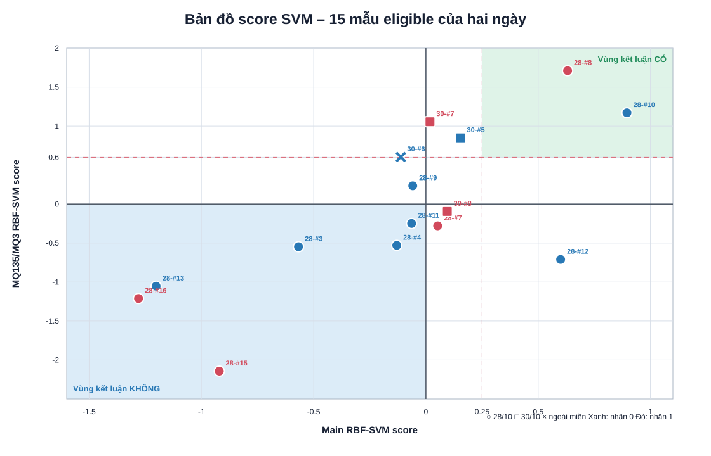
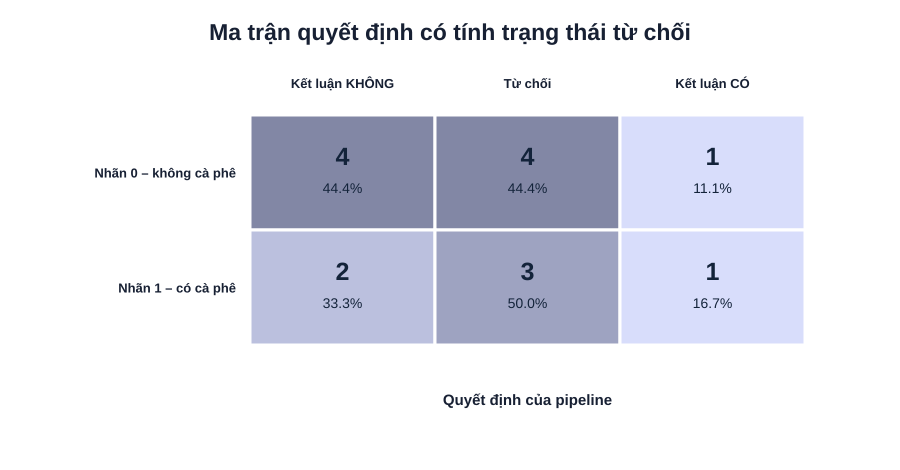
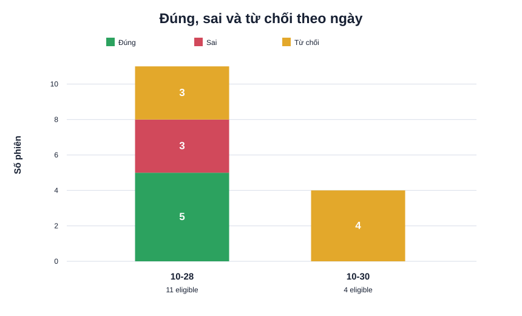

# Báo cáo SVM train/test trên dữ liệu 2026-10-28 và 2026-10-30

> Tạo lúc: 2026-10-31 13:58:09

## 1. Phạm vi thay đổi

Pipeline xử lý được giữ nguyên: 25 đặc trưng chuẩn hóa theo baseline, `StandardScaler`, RBF-SVM chính và RBF-SVM phụ MQ135-1/MQ3-1, cùng các ngưỡng quyết định cũ. Thay đổi duy nhất về mô hình là nguồn phiên dùng để train và test.

- Train pool: các phiên người có nhãn trong `data/2026-10-28` và `data/2026-10-30`.
- Tổng tập học: **15 phiên**, gồm **9 âm** và **6 dương**.
- Ngày 30/10: `Duong`, `Dat` được gán nhãn 0; `DuongCaphe2` được gán nhãn 1 theo tên phiên đã đánh nhãn.
- `Caphe1`, `Caphe2`, `khongkhi` và các protocol ngoài bài toán người mang mùi cà phê chỉ được hiển thị, không tính accuracy.

## 2. Cách kiểm thử

Vì người dùng yêu cầu test lại chính hai ngày dùng để xây dựng tập học, mỗi phiên eligible được kiểm tra bằng **leave-one-session-out**: loại phiên đang test khỏi train, train trên 14 phiên còn lại rồi mới dự đoán. Cách này tránh việc một file vừa nằm trong train vừa nằm trong test của chính nó.

Ngoài ra, báo cáo giữ kết quả **holdout theo ngày**: train trên một ngày và test toàn bộ ngày còn lại.

## 3. Kết quả tổng hợp LOOCV

- Raw balanced accuracy tại dấu score 0: **66.7%**.
- Raw sensitivity: **66.7%**; raw specificity: **66.7%**.
- Coverage sau vùng từ chối: **53.3%** (8/15).
- Accuracy khi mô hình đưa ra kết luận: **62.5%** (5/8).
- Tỷ lệ đúng trên toàn bộ eligible, tính cả từ chối: **33.3%**.
- Mẫu có cà phê: phát hiện **1/6**, nhầm thành không cà phê **2**, từ chối **3**.
- Mẫu không cà phê bị báo nhầm có cà phê: **1/9**.

## 4. Biểu đồ kết quả SVM

*Hình 1. Bản đồ Main score và MQ score của 15 mẫu eligible. Hình tròn là ngày 28/10, hình vuông là ngày 30/10; màu thể hiện nhãn thật.*

Vùng xanh lá chỉ được kết luận có cà phê khi **Main ≥ 0,25 và MQ ≥ 0,60**. Vùng xanh dương được kết luận không cà phê khi **Main < 0 và MQ < 0**. Mọi vùng còn lại là vùng hai mô hình mâu thuẫn hoặc bằng chứng chưa đủ mạnh, vì vậy pipeline trả về `UNCERTAIN`.

*Hình 2. Ma trận quyết định gồm ba cột: không cà phê, từ chối và có cà phê. Tỷ lệ được tính riêng trong từng nhãn thật.*

*Hình 3. Số phiên đúng, sai và bị từ chối theo ngày.*

Ngày 30/10 không có kết luận dứt khoát trong LOOCV: cả bốn phiên người đều rơi vào vùng bất đồng, bằng chứng yếu hoặc ngoài miền học. Đây là dấu hiệu rõ của batch effect giữa hai ngày.

## 5. Vì sao các mẫu bị từ chối?

`UNCERTAIN` không có nghĩa là file lỗi. Nó có nghĩa score chưa đồng thời thỏa một trong hai luật kết luận. `OUT_OF_DOMAIN` xảy ra trước bước áp ngưỡng khi vector 25 đặc trưng quá xa các phiên train còn lại.

| Ngày–STT | Nhãn | Main | MQ | Trạng thái | Lý do trực tiếp |
|---|:---:|---:|---:|---|---|
| 10-28–#7 | 1 | +0.052 | -0.279 | `UNCERTAIN` | Main và MQ trái dấu, hai mô hình không đồng thuận |
| 10-28–#9 | 0 | -0.059 | +0.234 | `UNCERTAIN` | Main và MQ trái dấu, hai mô hình không đồng thuận |
| 10-28–#12 | 0 | +0.600 | -0.710 | `UNCERTAIN` | Main và MQ trái dấu, hai mô hình không đồng thuận |
| 10-30–#5 | 0 | +0.154 | +0.849 | `UNCERTAIN` | Bằng chứng CÓ chưa đủ: Main +0.154 < 0.25 |
| 10-30–#6 | 0 | -0.112 | +0.604 | `OUT_OF_DOMAIN` | Ngoài miền học: distance 6.16 > ngưỡng 2.06; max |z| = 18.32 > 5 |
| 10-30–#7 | 1 | +0.018 | +1.056 | `UNCERTAIN` | Bằng chứng CÓ chưa đủ: Main +0.018 < 0.25 |
| 10-30–#8 | 1 | +0.095 | -0.095 | `UNCERTAIN` | Main và MQ trái dấu, hai mô hình không đồng thuận |

## 6. Kết quả theo ngày

| Ngày | Eligible | Âm | Dương | Kết luận | Đúng | Sai | Từ chối | Coverage | Accuracy khi kết luận |
|---|---:|---:|---:|---:|---:|---:|---:|---:|---:|
| 2026-10-28 | 11 | 7 | 4 | 8 | 5 | 3 | 3 | 72.7% | 62.5% |
| 2026-10-30 | 4 | 2 | 2 | 0 | 0 | 0 | 4 | 0.0% | – |

## 7. Holdout chéo theo ngày

| Ngày test | Raw balanced accuracy | Sensitivity | Specificity | Coverage | Accuracy khi kết luận |
|---|---:|---:|---:|---:|---:|
| 2026-10-28 | 50.0% | 0.0% | 100.0% | 63.6% | 57.1% |
| 2026-10-30 | 50.0% | 0.0% | 100.0% | 50.0% | 0.0% |

## 8. Chi tiết toàn bộ phiên của hai ngày

| Ngày | STT | Nhãn | Main | MQ | Kết quả | Đánh giá | Nhóm | Folder |
|---|---:|:---:|---:|---:|---|---|---|---|
| 2026-10-28 | 1 | – | -0.207 | -0.417 | `OUT_OF_DOMAIN` | **OUT_OF_SCOPE** | AIR | `khongkhi_20261028_125835_c727a4b77a3745eaac01a4e8b43f601f` |
| 2026-10-28 | 2 | – | -0.152 | +0.131 | `UNCERTAIN` | **OUT_OF_SCOPE** | COFFEE_ONLY | `CF_it_20261028_130942_89958870da3a414b996875ce9bb53232` |
| 2026-10-28 | 3 | 0 | -0.567 | -0.548 | `NO_COFFEE_ODOR_LIKELY` | **CORRECT** | HUMAN_ONLY | `Tai_20261028_132052_c0f2cb166de84dafa9f32ad51b027407` |
| 2026-10-28 | 4 | 0 | -0.130 | -0.530 | `NO_COFFEE_ODOR_LIKELY` | **CORRECT** | HUMAN_ONLY | `Tai_20261028_133044_f11c5d5df1e5465ab58d4fb146b042f7` |
| 2026-10-28 | 5 | – | -1.211 | -0.440 | `NO_COFFEE_ODOR_LIKELY` | **OUT_OF_SCOPE** | PAIRED | `BaseTai_ExposeTaivsCF_20261028_134433_8624967b0af04e46b1423e34d4089175` |
| 2026-10-28 | 6 | – | -0.284 | -0.008 | `NO_COFFEE_ODOR_LIKELY` | **OUT_OF_SCOPE** | COFFEE_ONLY | `CF_nhieu_20261028_135336_dfdeeb8c63c34ceb8e7c36d906385b8f` |
| 2026-10-28 | 7 | 1 | +0.052 | -0.279 | `UNCERTAIN` | **ABSTAIN** | HUMAN_COFFEE | `TaivsCF_20261028_140100_1bff9ed3f85e48aba0e88fbce6d069a1` |
| 2026-10-28 | 8 | 1 | +0.631 | +1.711 | `COFFEE_ODOR_LIKELY` | **CORRECT** | HUMAN_COFFEE | `TaivsCF_20261028_140732_6ebb709e66fe428d8a409526c6953b89` |
| 2026-10-28 | 9 | 0 | -0.059 | +0.234 | `UNCERTAIN` | **ABSTAIN** | HUMAN_ONLY | `aMinh_20261028_220050_fc400e4c0b5042ac9895362f00432bc4` |
| 2026-10-28 | 10 | 0 | +0.895 | +1.171 | `COFFEE_ODOR_LIKELY` | **WRONG** | HUMAN_ONLY | `Tai_20261028_221033_4d88fcedc38343888cb6f5a4b4763339` |
| 2026-10-28 | 11 | 0 | -0.064 | -0.249 | `NO_COFFEE_ODOR_LIKELY` | **CORRECT** | HUMAN_ONLY | `Tai_20261028_221651_451fe4ecf7e040cd8fff14d31f84d574` |
| 2026-10-28 | 12 | 0 | +0.600 | -0.710 | `UNCERTAIN` | **ABSTAIN** | HUMAN_ONLY | `Tai_20261028_222430_7a1dbcddcf764f6abea499bbb1b7a6df` |
| 2026-10-28 | 13 | 0 | -1.202 | -1.052 | `NO_COFFEE_ODOR_LIKELY` | **CORRECT** | HUMAN_ONLY | `aQuy_20261028_223510_9c3f50c498fd48cdb4e2320b3131b781` |
| 2026-10-28 | 14 | – | +0.750 | +1.515 | `COFFEE_ODOR_LIKELY` | **OUT_OF_SCOPE** | COFFEE_ONLY | `CF_nhieu_20261028_225145_a3b36b8b17f74a27a78e9cdf0bf801c9` |
| 2026-10-28 | 15 | 1 | -0.920 | -2.143 | `NO_COFFEE_ODOR_LIKELY` | **WRONG** | HUMAN_COFFEE | `TaivsCF_nhieu_20261028_225757_2f3ce2dc50b841b2afd5fe04460dfa3a` |
| 2026-10-28 | 16 | 1 | -1.280 | -1.211 | `NO_COFFEE_ODOR_LIKELY` | **WRONG** | HUMAN_COFFEE | `TaivsCF_it_20261028_230521_c569d712285e4b26b742e40bd22abfd7` |
| 2026-10-28 | 17 | – | -0.703 | -1.099 | `NO_COFFEE_ODOR_LIKELY` | **OUT_OF_SCOPE** | COFFEE_ONLY | `CF_it_20261028_231123_f244e3adf50341a7a662dca618aaa7dd` |
| 2026-10-30 | 1 | – | +0.864 | -0.507 | `UNCERTAIN` | **OUT_OF_SCOPE** | COFFEE_ONLY | `Caphe1_20261030_203017_871caad33bf64215bd9a666fc7caed9e` |
| 2026-10-30 | 2 | – | -0.207 | -0.417 | `OUT_OF_DOMAIN` | **OUT_OF_SCOPE** | COFFEE_ONLY | `Caphe1_20261030_204457_afd196b845944d6993a768cb8945a8a6` |
| 2026-10-30 | 3 | – | -0.204 | -0.405 | `NO_COFFEE_ODOR_LIKELY` | **OUT_OF_SCOPE** | COFFEE_ONLY | `Caphe2_20261030_203702_6a625623374a441ebff580e8efd9c600` |
| 2026-10-30 | 4 | – | -0.207 | -0.417 | `OUT_OF_DOMAIN` | **OUT_OF_SCOPE** | COFFEE_ONLY | `Caphe2_20261030_205234_8d8ab5e48fe64b3d9223ffc104ab4f5e` |
| 2026-10-30 | 5 | 0 | +0.154 | +0.849 | `UNCERTAIN` | **ABSTAIN** | HUMAN_ONLY | `Dat_20261030_205930_945f34464d34468eb330ffa31fc7906f` |
| 2026-10-30 | 6 | 0 | -0.112 | +0.604 | `OUT_OF_DOMAIN` | **ABSTAIN** | HUMAN_ONLY | `Duong_20261030_202335_e21dd1809439460e935095f3898682ca` |
| 2026-10-30 | 7 | 1 | +0.018 | +1.056 | `UNCERTAIN` | **ABSTAIN** | HUMAN_COFFEE | `DuongCaphe2_20261030_210809_30792bb198724e5985451d15da43c4ca` |
| 2026-10-30 | 8 | 1 | +0.095 | -0.095 | `UNCERTAIN` | **ABSTAIN** | HUMAN_COFFEE | `DuongCaphe2_20261030_211622_3ddd2f394b5b455bbb075655849481a8` |
| 2026-10-30 | 9 | – | +0.501 | +1.338 | `COFFEE_ODOR_LIKELY` | **OUT_OF_SCOPE** | AIR | `khongkhi_20261030_200336_33b9cc9750bc4087bb088c4f171825f0` |

## 9. Nhận xét

- Việc thêm ngày 30/10 làm tập dương tăng từ 4 lên 6 phiên và giúp đánh giá được khả năng chuyển ngày, nhưng tổng dữ liệu vẫn rất nhỏ.
- LOOCV raw balanced accuracy phản ánh khả năng phân lớp trước khi áp dụng vùng từ chối; chỉ số accuracy khi kết luận phản ánh pipeline hoàn chỉnh.
- Các phiên `UNCERTAIN` không phải kết luận sai mà là mô hình chưa đủ đồng thuận giữa score tổng và score MQ để đưa ra nhãn chắc chắn.
- Kết quả trên coffee-only và ambient-air không được dùng để tuyên bố accuracy của bài toán phát hiện cà phê trên người.
- Holdout theo ngày là kiểm tra khó hơn LOOCV và đáng tin hơn để đánh giá batch effect, nhưng ngày 30/10 mới chỉ có bốn phiên người.

## 10. Khả năng tái lập

- Model version: `coffee-rbf-ensemble-v5-train-20261028-20261030`
- Feature version: `baseline-normalized-exposure-v2-time-window`
- Training manifest hash: `fbf4fd751f207517`
- Lệnh chạy: `.\.venv\Scripts\python.exe analysis\report_svm_2026_10_28_30.py`
