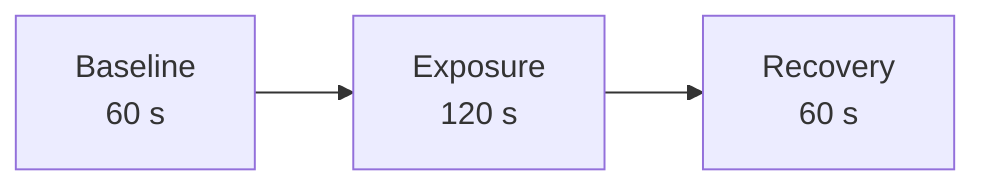
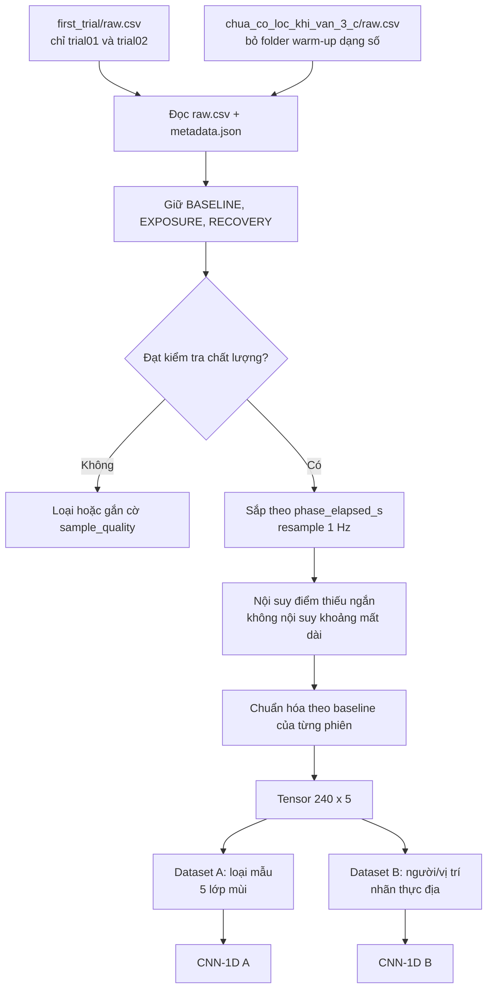
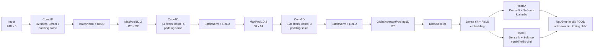
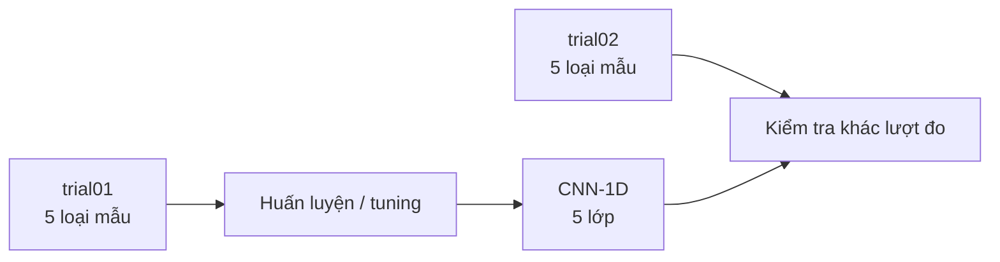
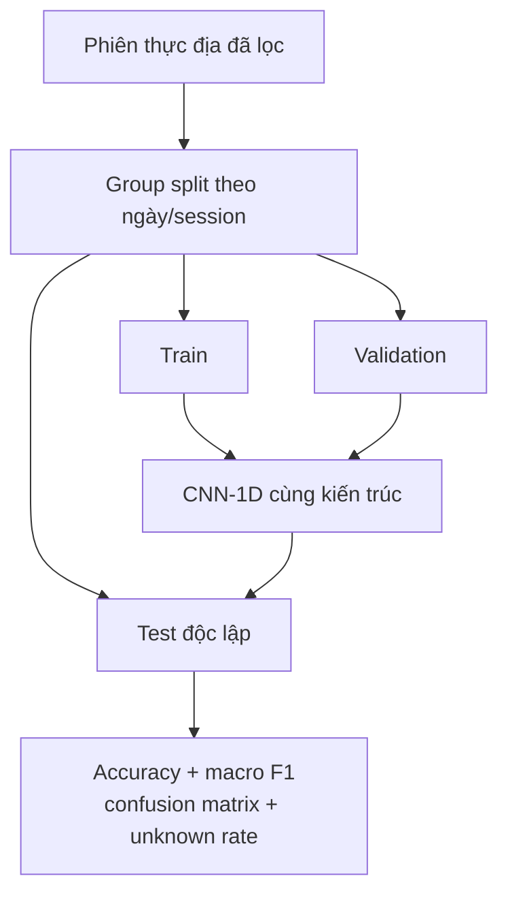
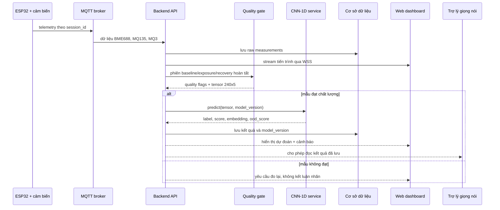

# Sơ đồ CNN-1D cho hệ thống mũi điện tử

## 1. Mục tiêu

CNN-1D nhận chuỗi thời gian từ **BME688, MQ135 và MQ3**, học hình dạng đáp ứng của cảm biến trong một chu kỳ đo, sau đó trả kết quả có cấu trúc cho backend và web dashboard.

Hai bộ dữ liệu hiện có dùng cùng schema nhưng **không có cùng bài toán nhãn**:

| Bộ dữ liệu | Vai trò đề xuất | Nhãn mục tiêu |
|---|---|---|
| `data/first_trial/` | Thử nghiệm pipeline phân loại mùi | `không khí`, `áo`, `nách`, `nước hoa`, `mắm tôm` |
| `data/chua_co_loc_khi_van_3_c/` | Thử nghiệm nhận dạng trong điều kiện thực địa | người, vị trí đo, trạng thái có/không áo |

Vì vậy không nên ghép tất cả thành một softmax duy nhất. Hai model có thể dùng **cùng kiến trúc encoder CNN-1D**, nhưng cần đầu ra và cách chia tập riêng.

## 2. Dữ liệu đầu vào

Mỗi phiên hoàn chỉnh có tần số lấy mẫu khoảng `1 Hz` và ba pha chính:



Sau khi loại các pha chờ và warm-up, một mẫu đưa vào model có kích thước:

```text
X.shape = (240 thời điểm, 5 kênh)
```

Năm kênh đề xuất:

1. `log(gas_resistance_ohm / R0)` của BME688.
2. `(mq135_voltage_v - V0) / (abs(V0) + epsilon)`.
3. `(mq3_voltage_v - V0) / (abs(V0) + epsilon)`.
4. `temperature_c - T0`.
5. `humidity_pct - H0`.

`R0`, `V0`, `T0`, `H0` là trung vị của pha baseline trong **chính phiên đo đó**. `pressure_hpa`, trạng thái heater và cờ hợp lệ nên dùng cho kiểm tra chất lượng, không nhất thiết đưa vào model ở phiên bản đầu.

## 3. Luồng chuẩn bị dữ liệu



Các điều kiện kiểm tra chất lượng tối thiểu:

- Đủ khoảng `60 + 120 + 60` mẫu ở ba pha chính.
- `gas_valid = True`, `heater_stable = True` ở phần lớn chuỗi.
- Không bão hòa ADC của MQ3/MQ135.
- Không có khoảng mất mẫu dài hoặc timestamp đảo thứ tự.
- Baseline không trôi quá ngưỡng đã định.
- Recovery được ghi nhận; chưa hồi phục phải trở thành cảnh báo chất lượng.

## 4. Kiến trúc CNN-1D đề xuất



### Kích thước qua từng tầng

| Tầng | Đầu ra |
|---|---:|
| Input | `240 × 5` |
| Conv1D(32, 7) + MaxPool(2) | `120 × 32` |
| Conv1D(64, 5) + MaxPool(2) | `60 × 64` |
| Conv1D(128, 3) | `60 × 128` |
| GlobalAveragePooling1D | `128` |
| Dense embedding | `64` |
| Softmax | `5` hoặc `N` lớp |

Kiến trúc này cố ý nhỏ để hạn chế overfit và đủ nhẹ để chạy trên laptop backend. Chưa nên tăng số block hoặc thêm attention khi số phiên đo còn ít.

## 5. Cách dùng hai bộ dữ liệu

### Model A — kiểm chứng pipeline bằng `first_trial`

Chỉ dùng 10 phiên chính có tiền tố `trial01_` và `trial02_`. Các folder còn lại là dữ liệu test/tối ưu theo `note.txt`.



Có thể đảo `trial01` và `trial02`, rồi báo cáo trung bình hai lượt. Không chia ngẫu nhiên các cửa sổ của cùng một phiên vào cả train và test vì sẽ gây rò rỉ dữ liệu.

### Model B — dữ liệu thực địa `chua_co_loc_khi_van_3_c`

Theo `README.txt`, folder tên hoàn toàn bằng số là warm-up; folder đặt tên bằng chữ mới là ứng viên cho dữ liệu đo. Metadata cần được chuẩn hóa thành các cột:

```text
person | body_location | clothing | date | session_id | condition
```

Nếu mục tiêu là nhận dạng người, chia train/validation/test theo **ngày hoặc session**, không chia ngẫu nhiên theo dòng. Nếu mục tiêu là nhận dạng vị trí đo, cần group theo `person + date` để model không học danh tính người thay cho vị trí.



## 6. Luồng suy luận trong hệ thống đề xuất



Model service nên trả về:

```json
{
  "session_id": "...",
  "predicted_label": "...",
  "model_score": 0.82,
  "ood_score": 0.14,
  "sample_quality": "pass",
  "quality_flags": [],
  "model_version": "cnn1d-2026-10-v1"
}
```

`model_score` chỉ được gọi là xác suất khi model đã được hiệu chuẩn trên tập validation độc lập. Nếu score thấp hoặc OOD cao, backend phải trả nhãn `unknown` thay vì ép chọn một lớp.

## 7. Lưu ý quan trọng với dữ liệu hiện tại

- `first_trial` chỉ có 2 lượt cho mỗi lớp, chưa đủ để chứng minh CNN tổng quát hóa.
- Dữ liệu thực địa hiện có ít phiên, không cân bằng người/vị trí/trang phục và có ảnh hưởng mạnh của ngày đo.
- Cắt một phiên thành nhiều cửa sổ làm tăng số tensor nhưng **không làm tăng số mẫu độc lập**.
- Nên thu thêm tối thiểu nhiều phiên cho mỗi lớp, trên nhiều ngày, đảo thứ tự mẫu và giữ quy trình baseline/exposure/recovery giống nhau.
- Trước khi đủ dữ liệu, CNN-1D nên được xem là prototype; cần so sánh với baseline đơn giản như nearest centroid, logistic regression hoặc random forest trên đặc trưng thủ công.

## 8. Cấu hình huấn luyện khởi đầu

| Thành phần | Giá trị đề xuất |
|---|---|
| Loss | Cross entropy có class weight |
| Optimizer | Adam, learning rate `1e-3` |
| Batch size | `4–8` do dữ liệu nhỏ |
| Epoch tối đa | `100` |
| Early stopping | patience `12–15` |
| Regularization | Dropout `0.30`, weight decay `1e-4` |
| Model selection | Macro F1 trên group validation |
| Augmentation nhẹ | jitter nhỏ, scale nhỏ, time shift tối đa vài giây |
| Không nên dùng | đảo thời gian, trộn pha, augmentation làm đổi biên phase |

Pipeline tiền xử lý phải được lưu cùng model và dùng nguyên trạng ở backend; không tính normalization từ toàn bộ dataset trước khi chia train/test.
