# RoboNose – Phân tích dữ liệu mùi cơ thể và thử nghiệm nhận diện người

README này là báo cáo phân tích đầy đủ cho lô dữ liệu [`data/chua_co_loc_khi_van_3_c`](data/chua_co_loc_khi_van_3_c/). Mục tiêu là trả lời bốn câu hỏi:

1. Dữ liệu đã đủ sạch và đủ tin cậy về mặt kỹ thuật chưa?
2. Từng cảm biến phản ứng như thế nào với mùi cơ thể?
3. Có dấu hiệu nào cho thấy tín hiệu khác nhau giữa người và lặp lại qua phiên không?
4. Cần sửa gì trong pipeline thu thập trước khi mở rộng dự án?

> **Kết luận ngắn:** MQ3 đang cho tín hiệu phân biệt người đáng chú ý nhất. Trong subset cùng điều kiện bụng–không áo, MQ3 giữ thứ tự `Minh > Quy > Tài` qua các phiên có thể so sánh và mô hình thăm dò nhận đúng 6/8 run. Tuy nhiên dữ liệu mới chỉ có 8 run kiểm soát, 3 phiên đánh giá, điều kiện thu chưa cân bằng và accuracy 75% có khoảng Wilson 95% rất rộng: 40,9–92,9%. Kết quả hiện tại là **proof-of-concept**, chưa phải hiệu năng nhận diện đã được xác nhận.

---

## 1. Kết luận điều hành

### 1.1. Điều đã chứng minh được từ lô dữ liệu

- Hệ thống ghi dữ liệu 1 Hz ổn định, không có timestamp trùng, không bão hòa ADC và không có heater bất ổn trong ba pha phân tích.
- BME688 và MQ3 có baseline ổn định trên cả 15 run nghiên cứu hợp lệ.
- MQ135 xuất hiện một chế độ lỗi rõ từ phiên S4 trở đi: baseline CV tăng lên 25–47%, 8/15 run bị cảnh báo drift và 10/15 run bị cảnh báo chưa hồi phục.
- Trong 8 run bụng–không áo, MQ3 tạo ba khoảng mean không chồng lấn giữa Minh, Quy và Tài.
- Trong hai phiên có đủ cả ba người, thứ tự MQ3 đều là `Minh > Quy > Tài` dù thứ tự đo người thay đổi.
- Mô hình MQ3 nearest-centroid đạt accuracy 75,0%, balanced accuracy 72,2% và macro-F1 73,0% khi đánh giá leave-one-session-out.

### 1.2. Điều chưa thể kết luận

- Chưa thể khẳng định MQ3 đang học đúng “mùi của người” thay vì hiệu ứng ngày, phiên, vị trí hoặc quy trình lấy mẫu.
- Chưa thể đánh giá ảnh hưởng riêng của áo, vị trí ngực/bụng hoặc sau tắm vì các yếu tố này không được đo theo thiết kế đối chứng.
- Chưa thể đánh giá Dũng trong bài toán nhận diện vì hai run của Dũng khác cả ngày, vị trí và trạng thái sau tắm.
- Chưa thể đánh giá hiệu năng triển khai từ 8 run và 3 phiên.

### 1.3. Quyết định kỹ thuật đề xuất

| Thành phần | Quyết định hiện tại | Lý do |
|---|---|---|
| BME688 gas | Giữ làm kênh nền ổn định | Đo sạch nhưng phân tách người yếu |
| MQ3 | Ưu tiên làm kênh nhận diện chính | Tách người tốt nhất trong subset hiện tại |
| MQ135 | Tạm loại khỏi nhánh mô hình chính | Drift, dao động và recovery không ổn định |
| Nhiệt độ/độ ẩm/áp suất | Giữ làm biến kiểm soát, không làm fingerprint | Có biến đổi theo ngày và tương quan với MQ3 |
| Mô hình | Giữ baseline đơn giản | Số mẫu quá nhỏ so với 15 đặc trưng |
| Đơn vị mẫu | Một run hoàn chỉnh | Không được coi từng dòng 1 Hz là mẫu độc lập |

---

## 2. Phạm vi và cách hiểu đúng bộ dữ liệu

### 2.1. Có bao nhiêu mẫu thực sự?

Không thể chỉ dựa vào việc tên thư mục có chữ hay số để quyết định đó là mẫu nghiên cứu. Theo ghi chú thu thập, sáu thư mục tên số và thư mục bắt đầu bằng `hihi_` đều chỉ là dữ liệu warm-up. Pipeline đánh dấu bảy thư mục này là `warmup`, loại hoàn toàn khỏi thống kê, biểu đồ, PCA và mô hình.

| Cấp dữ liệu | Số lượng | Vai trò |
|---|---:|---|
| Tổng thư mục trên đĩa | 22 | Kiểm tra toàn vẹn file |
| Thư mục warm-up bị loại | 7 | 6 thư mục tên số + 1 thư mục `hihi_...` |
| Run nghiên cứu hợp lệ | 15 | Đơn vị phân tích thực tế |
| Run ngực/bụng, không áo, điều kiện thường | 12 | Có thể mô tả nhưng khác vị trí |
| Run bụng–không áo dùng so sánh người | 8 | Subset kiểm soát chính |

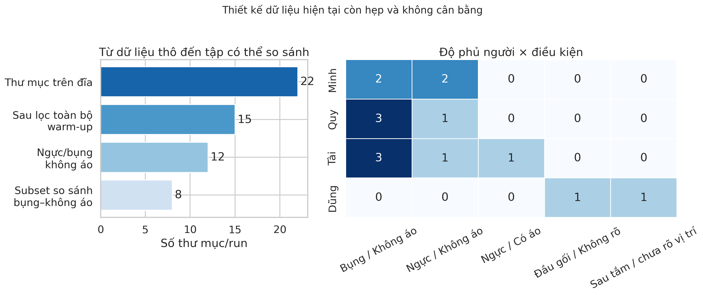

Điểm quan trọng nhất của biểu đồ:

- 22 thư mục không có nghĩa là 22 mẫu độc lập; chỉ 15 thư mục là run nghiên cứu.
- Toàn bộ 9.966 dòng của 15 run hợp lệ đã xuất hiện lại trong sáu file phiên/warm-up tên số.
- Nếu đưa các thư mục warm-up vào train/test, mô hình sẽ vừa nhận dữ liệu không có giá trị nghiên cứu, vừa nhìn thấy lại cùng chuỗi đo và tạo accuracy giả.
- Chỉ 8 run cuối cùng đủ gần nhau về vị trí, áo và trạng thái để thử bài toán người.

### 2.2. Phân bố theo người

| Người/nhãn | Tổng run | Run dùng phân loại | Điều kiện đã thu |
|---|---:|---:|---|
| Tài | 5 | 3 | Ngực có áo, ngực không áo, bụng không áo ×3 |
| Minh | 4 | 2 | Ngực không áo ×2, bụng không áo ×2 |
| Quy | 4 | 3 | Ngực không áo, bụng không áo ×3 |
| Dũng | 2 | 0 | Đầu gối; sau tắm không rõ vị trí |

Thiết kế đang mất cân bằng theo cả người lẫn điều kiện. Dữ liệu nhiều nhất không phải là 15 mẫu cho cùng một bài toán, mà là nhiều thí nghiệm nhỏ đang trộn trong một lô.

### 2.3. Năm phiên có mẫu nghiên cứu

| Phiên | Thời điểm bắt đầu | Run trong phiên | Giá trị đối với bài toán người |
|---|---|---|---|
| S2 | 13/10 21:03 | Dũng, Tài, Minh, Quy | Khác vị trí/áo; chỉ mô tả |
| S3 | 14/10 11:03 | Minh, Tài | Cùng ngực–không áo nhưng thiếu Quy |
| S4 | 14/10 23:52 | Quy, Tài | Cùng bụng–không áo nhưng thiếu Minh |
| S5 | 15/10 11:27 | Tài, Minh, Quy | Phiên kiểm soát đầy đủ thứ nhất |
| S6 | 15/10 21:03 | Dũng, Quy, Minh, Tài | Phiên kiểm soát đầy đủ thứ hai; Dũng không cùng điều kiện |

Tám dự đoán leave-one-session-out chỉ đến từ ba phiên S4–S6. Vì vậy số đơn vị môi trường độc lập gần với **3 phiên**, không phải 8 ngày độc lập.

---

## 3. Cấu trúc file và 50 trường raw

Mỗi thư mục có đủ sáu artifact bắt buộc:

```text
metadata.json     # cấu hình, nhãn, phase interval và thông tin phần cứng
summary.json      # thống kê từng tín hiệu và cảnh báo chất lượng
raw.csv           # chuỗi thời gian 1 Hz
events.csv        # lệnh và thời điểm chuyển pha
signals.png       # tín hiệu tuyệt đối
normalized.png    # tín hiệu chuẩn hóa theo baseline
```

Tất cả 22 thư mục trên đĩa đều có đủ file, JSON/CSV đọc được và PNG có header hợp lệ. Phân tích nội dung bên dưới chỉ dùng 15 run nghiên cứu; bảy thư mục warm-up chỉ được giữ trong bước kiểm kê để chứng minh việc lọc đúng.

### 3.1. Nhóm trường raw

| Nhóm | Số trường | Nội dung | Dùng trong phân tích |
|---|---:|---|---|
| Định danh/thời gian | 7 | `run_id`, `seq`, timestamp, elapsed, phase | Ghép run, kiểm tra trùng và căn pha |
| Timing đọc | 12 | loop, schedule lag, thời gian đọc từng cảm biến | Kiểm tra nhịp lấy mẫu và nghẽn đọc |
| Bơm | 3 | lệnh bơm, trạng thái ngoài, nguồn trạng thái | Audit chuyển nguồn khí |
| BME688 | 16 | nhiệt độ, RH, áp suất, gas, heater/status/register | Tín hiệu gas và kiểm soát môi trường |
| MQ135 | 6 | status, fresh, ADC, điện áp, AO estimate | Tín hiệu khí phụ và QC |
| MQ3 | 6 | status, fresh, ADC, điện áp, AO estimate | Tín hiệu khí phụ và QC |
| **Tổng** | **50** |  |  |

Audit chi tiết từng trường nằm tại [`field_audit_all_50_fields.csv`](data/chua_co_loc_khi_van_3_c/report_outputs/tables/field_audit_all_50_fields.csv).

### 3.2. Trường thiếu và cách diễn giải

| Trường | Mức thiếu | Diễn giải |
|---|---:|---|
| `bme_error`, `mq135_error`, `mq3_error` | 100% | Trống có chủ đích vì mọi lượt đọc đều có status `OK` |
| `mq135_ao_voltage_v`, `mq3_ao_voltage_v` | 100% | Hệ số chia áp chưa được xác nhận nên không thể suy ra điện áp AO |
| `loop_interval_s` | 5 dòng | Dòng đầu của năm phiên có mẫu nghiên cứu không có khoảng thời gian trước đó |
| `gas_resistance_ohm` sau lọc hợp lệ | 5 dòng | Năm dòng MONITOR đầu phiên có `heater_stable=False`; không nằm trong pha lõi |

Không nên tự động xóa cột chỉ vì 100% null. Ba cột `*_error` trống là dấu hiệu không có lỗi đọc; hai cột AO trống lại là lỗi thiếu cấu hình cần sửa.

### 3.3. Metadata có gì và thiếu gì?

Phần vận hành được ghi tương đối đầy đủ và nhất quán:

- 15/15 run có status `COMPLETE` và kết thúc bằng `user finish`.
- 15/15 ghi buồng đóng, hút khí qua ống và đổi nguồn khí bằng tay.
- 15/15 ghi purge bằng cách chuyển đầu lấy khí về vị trí khí phòng.
- Cấu hình chung: 1 Hz, baseline 60 giây, exposure 120 giây, recovery 60 giây.

Nhưng bốn trường quan trọng cho nghiên cứu đều trống 15/15:

- `person_code`;
- `source`;
- `distance_cm`;
- `notes`.

Nhãn hiện được suy ra từ tên folder. Đây là rủi ro lớn vì đổi tên folder có thể làm mất hoặc làm sai ground truth.

### 3.4. Dải giá trị raw trên toàn bộ 9.966 dòng hợp lệ

Các khoảng dưới đây tính trên tất cả pha, kể cả MONITOR và các pha chờ. Chúng dùng để audit phần cứng, không dùng trực tiếp làm fingerprint người.

| Trường | Min | Trung vị | Max | Nhận xét |
|---|---:|---:|---:|---|
| `temperature_c` | 30,395°C | 34,205°C | 37,170°C | Biên toàn log rộng hơn biên baseline pha lõi |
| `humidity_pct` | 53,257% | 61,521% | 77,096% | Chịu ảnh hưởng thời gian trong phiên |
| `pressure_hpa` | 1.010,724 | 1.012,537 | 1.015,455 | Dùng kiểm soát môi trường |
| `gas_resistance_ohm` | 5.685 Ω | 98.689 Ω | 108.682 Ω | Min nằm ở MONITOR đầu phiên, không dùng phân tích lõi |
| `mq135_adc_count` | 372 | 1.011,5 | 2.293 | Cách xa ngưỡng saturation 32.700 |
| `mq135_voltage_v` | 0,0465 V | 0,1264 V | 0,2866 V | Điện áp tại đầu vào ADS1115 |
| `mq3_adc_count` | 2.110 | 2.640 | 3.272 | Cách xa ngưỡng saturation 32.700 |
| `mq3_voltage_v` | 0,2638 V | 0,3300 V | 0,4090 V | Điện áp tại đầu vào ADS1115 |
| `sensor_uptime_s` | 0,20 s | 1.009,22 s | 2.774,20 s | Thời gian warm-up trước run không đồng nhất |

ADC không bão hòa, nhưng việc chưa xác nhận divider factor khiến điện áp AO thật của MQ135/MQ3 chưa biết. So sánh tương đối trong cùng cấu hình vẫn dùng được; so sánh tuyệt đối với datasheet hoặc thiết bị khác thì chưa.

### 3.5. Các cột trạng thái và cấu hình

- `bme_status`, `mq135_status`, `mq3_status` đều là `OK` trên 9.966 dòng.
- `gas_valid`, `new_data`, `bme_fresh`, `mq135_fresh`, `mq3_fresh` không có dòng `False`.
- `heater_stable=False` xuất hiện đúng 5 dòng đầu MONITOR của 5 phiên có mẫu nghiên cứu; pha lõi không có dòng heater lỗi.
- Các trường register như `bme_res_heat`, `bme_idac`, `bme_gas_wait`, status bits và gas index có giá trị audit cấu hình/driver, không phải đặc trưng mùi.
- Các timestamp đọc riêng từng cảm biến và `*_read_duration_s` dùng kiểm tra thứ tự/timing, không được đưa vào mô hình để tránh mô hình học dấu phiên hoặc tải hệ thống.

---

## 4. Protocol thu và pipeline xử lý

### 4.1. Các pha của một run

| Pha | Thời lượng | Có dùng tạo fingerprint? | Vai trò |
|---|---:|:---:|---|
| `MONITOR` | 9,51–1.614,97 giây | Không | Warm-up và quan sát trước khi bắt đầu |
| `BASELINE` | 60 giây | Có | Nền riêng của từng run |
| `WAIT_EXPOSURE` | 6,13–63,33 giây | Không | Chờ thao tác đưa nguồn mùi vào |
| `EXPOSURE` | 120 giây | Có | Đo đáp ứng với mẫu |
| `WAIT_RECOVERY` | 3,48–43,08 giây | Không | Chờ chuyển lại khí phòng |
| `RECOVERY` | 60 giây | Có cho QC | Kiểm tra hồi phục |
| `WAIT_FINISH` | 1,52–35,54 giây | Không | Chờ xác nhận kết thúc |

Trong 9.966 dòng của 15 run nghiên cứu:

- `MONITOR`: 5.642 dòng;
- `BASELINE`: 900 dòng;
- `EXPOSURE`: 1.800 dòng;
- `RECOVERY`: 900 dòng;
- các pha chờ: 724 dòng.

Ba pha lõi có 3.600 dòng, tương đương 36,1% dữ liệu hợp lệ. Mỗi run có đúng 60 baseline + 120 exposure + 60 recovery = 240 dòng lõi.

### 4.2. Lọc dữ liệu hợp lệ

BME688 chỉ được dùng khi đồng thời:

```text
bme_status == "OK"
bme_fresh == True
gas_valid == True
heater_stable == True
new_data == True
```

MQ135 và MQ3 được giữ khi status `OK` và `fresh=True`.

### 4.3. Chuẩn hóa theo baseline

Mỗi tín hiệu được chuẩn hóa riêng trong từng run:

```text
response_pct = 100 × (signal / median_baseline - 1)
```

- âm: tín hiệu thấp hơn nền;
- dương: tín hiệu cao hơn nền;
- gần 0: thay đổi nhỏ.

Chuẩn hóa theo run là cần thiết vì mức tuyệt đối thay đổi theo ngày, thời gian warm-up và môi trường. Nó không tự động loại bỏ mọi drift: nếu baseline đang dao động mạnh như MQ135 thì phần trăm chuẩn hóa vẫn không đáng tin.

### 4.4. Đặc trưng dùng cho mô hình

Mỗi cảm biến tạo năm đặc trưng từ 120 giây exposure:

| Đặc trưng | Ý nghĩa |
|---|---|
| `mean` | Mức đáp ứng trung bình |
| `late20` | Trung bình 20 giây cuối exposure |
| `min` | Cực tiểu |
| `max` | Cực đại |
| `slope` | Xu hướng tuyến tính theo thời gian |

Ba cảm biến tạo 15 đặc trưng. `early20`, AUC và recovery vẫn được tính để mô tả/QC nhưng không đưa vào bộ 15 đặc trưng chính.

---

## 5. Toàn bộ 15 run nghiên cứu

Bảng dưới đây dùng mean của toàn bộ exposure, theo phần trăm so với baseline của từng run.

| Ngày giờ | Người | Vị trí / áo / trạng thái | BME688 | MQ135 | MQ3 |
|---|---|---|---:|---:|---:|
| 13/10 21:03 | Dũng | Đầu gối | -2,13% | -0,35% | -0,11% |
| 13/10 21:29 | Tài | Ngực, có áo | -1,18% | +0,17% | -0,05% |
| 13/10 21:36 | Minh | Ngực, không áo | -1,14% | -0,04% | -0,08% |
| 13/10 21:44 | Quy | Ngực, không áo | -0,76% | -0,14% | +0,05% |
| 14/10 11:03 | Minh | Ngực, không áo | -2,98% | -22,26% | -7,85% |
| 14/10 11:37 | Tài | Ngực, không áo | -1,09% | +0,13% | +0,38% |
| 14/10 23:52 | Quy | Bụng, không áo | +0,78% | +10,48% | +0,28% |
| 15/10 00:11 | Tài | Bụng, không áo | -0,62% | +6,44% | +0,27% |
| 15/10 11:27 | Tài | Bụng, không áo | -0,76% | +1,50% | +0,25% |
| 15/10 11:49 | Minh | Bụng, không áo | -0,56% | -4,65% | +3,20% |
| 15/10 11:56 | Quy | Bụng, không áo | -0,68% | -1,77% | +0,69% |
| 15/10 21:03 | Dũng | Sau tắm, vị trí không rõ | +0,73% | +16,82% | +0,65% |
| 15/10 21:19 | Quy | Bụng, không áo | -1,10% | -0,32% | +0,48% |
| 15/10 21:25 | Minh | Bụng, không áo | -0,17% | +12,90% | +2,37% |
| 15/10 21:32 | Tài | Bụng, không áo | -0,95% | +5,04% | +0,10% |

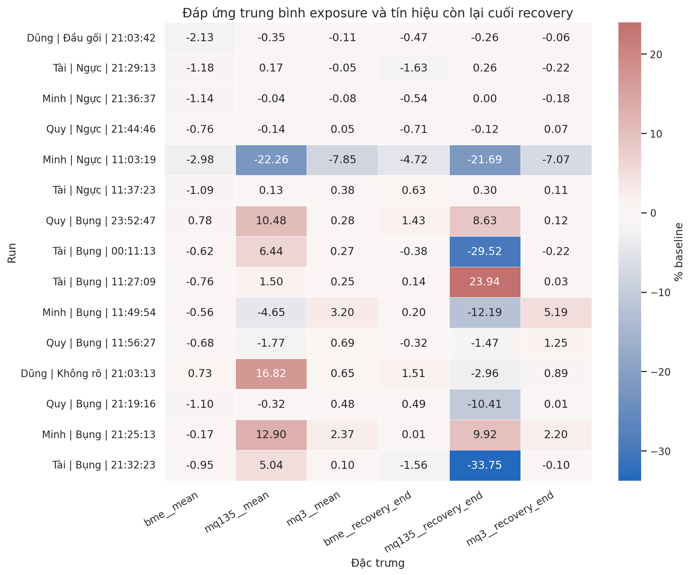

Đọc heatmap theo hai nửa:

- ba cột đầu là mean trong exposure;
- ba cột sau là tín hiệu còn lại ở cuối recovery;
- màu mạnh không đồng nghĩa với cảm biến tốt: MQ135 có biên độ lớn nhất nhưng chất lượng nền kém nhất.

Các outlier rõ nhất:

- Minh ngực ngày 14/10: cả MQ135 và MQ3 giảm rất mạnh;
- Dũng sau tắm: MQ135 +16,82%, nhưng chính run này có MQ135 baseline CV 47,16%;
- Minh bụng: MQ3 nổi bật ở cả hai phiên kiểm soát.

---

## 6. Chất lượng thu dữ liệu và timing

### 6.1. Tính toàn vẹn

| Kiểm tra | Kết quả |
|---|---:|
| Timestamp trùng | 0 |
| Cặp `run_id + seq` trùng | 0 |
| Heater bất ổn trong pha lõi | 0 dòng |
| ADC saturation MQ135/MQ3 | 0 dòng |
| Tỷ lệ hợp lệ thấp nhất của một kênh/run | 99,89% |
| Loop interval lớn nhất | 1,012 giây |
| Loop duration lớn nhất | 0,284 giây |
| Schedule lag lớn nhất | 0,015 giây |

Về mặt ghi file và nhịp lấy mẫu, bộ dữ liệu tốt. Vấn đề chính không nằm ở mất dòng hay trễ phần mềm mà nằm ở chất lượng tín hiệu MQ135, thao tác đổi nguồn khí và thiết kế thí nghiệm.

### 6.2. Timing đọc cảm biến

| Đại lượng | Min | Trung vị | Max |
|---|---:|---:|---:|
| Loop interval | 0,985 s | 1,000 s | 1,012 s |
| Loop duration | 0,251 s | 0,252 s | 0,284 s |
| BME read | 0,186 s | 0,186 s | 0,200 s |
| MQ135 read | 0,033 s | 0,033 s | 0,051 s |
| MQ3 read | 0,032 s | 0,033 s | 0,052 s |

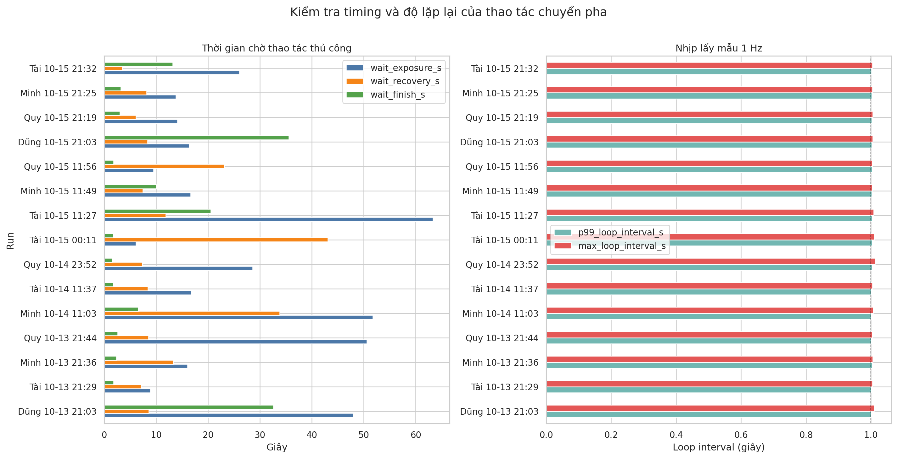

Nhịp 1 Hz lặp lại tốt. Ngược lại, thời gian chờ thao tác bằng tay thay đổi lớn. Event `EXPOSURE` biểu diễn thời điểm người vận hành gửi lệnh, chưa chắc là thời điểm luồng khí mới đến buồng cảm biến.

### 6.3. Trạng thái bơm

Trên toàn bộ 9.966 dòng hợp lệ:

- `pump_command = DISABLED`;
- `external_pump_state = unknown`;
- `external_pump_source = not_reported`.

Metadata nói có hút khí qua ống nhưng hệ thống không có feedback vật lý. Do đó chưa thể kiểm tra lưu lượng, độ trễ vận chuyển khí hoặc việc bơm có hoạt động giống nhau giữa các run.

---

## 7. Chất lượng từng cảm biến

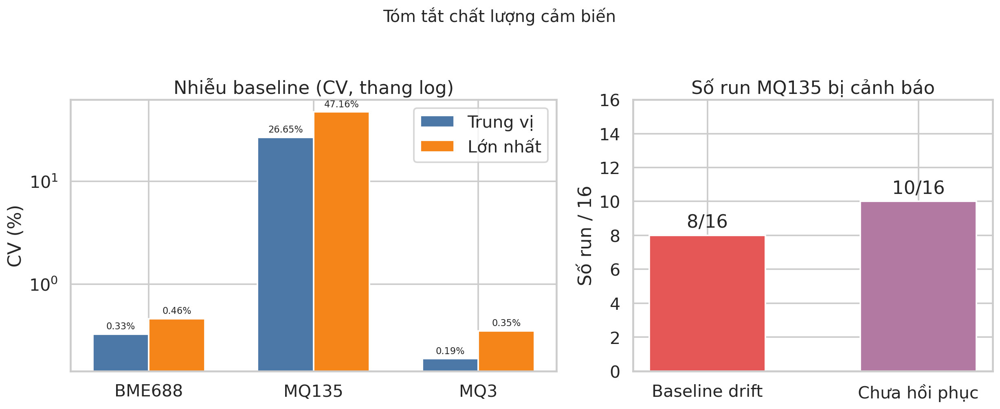

| Cảm biến | Baseline CV trung vị | CV lớn nhất | Drift warning | Recovery warning | Đánh giá |
|---|---:|---:|---:|---:|---|
| BME688 | 0,33% | 0,46% | 0 | 0 | Nền tốt |
| MQ135 | 26,65% | 47,16% | 8/15 | 10/15 | Không đạt ở nhiều run |
| MQ3 | 0,19% | 0,35% | 0 | 0 | Nền tốt |

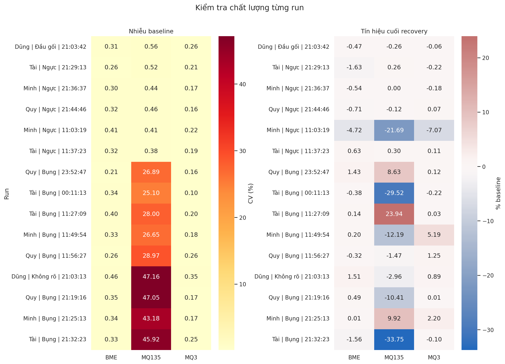

Biểu đồ QC cho thấy một điểm cấu trúc: MQ135 ổn định ở các phiên đầu, sau đó baseline CV đồng loạt tăng từ S4 trở đi. Vì Quy, Minh và Tài đều gặp cùng hiện tượng trong cùng giai đoạn, đây giống thay đổi chế độ phần cứng/phiên hơn là khác biệt người.

### 7.1. BME688 gas

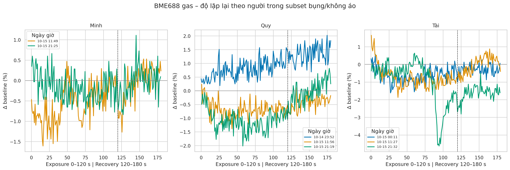

Trong 8 run kiểm soát:

| Người | n | Mean trung bình | Khoảng run |
|---|---:|---:|---:|
| Minh | 2 | -0,36% | -0,56 đến -0,17% |
| Quy | 3 | -0,33% | -1,10 đến +0,78% |
| Tài | 3 | -0,77% | -0,95 đến -0,62% |

Diễn giải:

- Tài tương đối ổn định về mean.
- Minh và Quy có mean trung bình gần nhau.
- Quy đổi dấu giữa các phiên nên khoảng của Quy chồng mạnh với Minh và Tài.
- BME688 đo sạch nhưng chỉ 14,3% phương sai mean trong subset gắn với nhãn người theo η² mô tả.

Kết luận cho BME688: phù hợp làm kênh ổn định và theo dõi nền, chưa đủ mạnh để nhận diện người độc lập.

### 7.2. MQ135

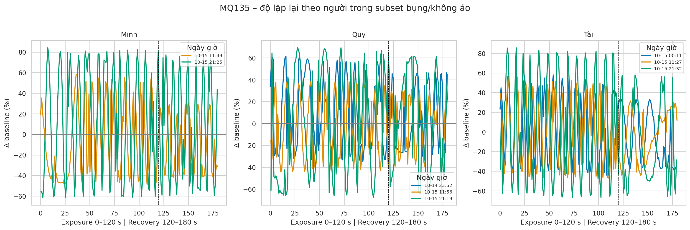

Trong 8 run kiểm soát:

| Người | n | Mean trung bình | Khoảng run |
|---|---:|---:|---:|
| Minh | 2 | +4,12% | -4,65 đến +12,90% |
| Quy | 3 | +2,80% | -1,77 đến +10,48% |
| Tài | 3 | +4,33% | +1,50 đến +6,44% |

Tín hiệu dao động chu kỳ lớn, nhiều lúc khoảng -60% đến +80% baseline. Khoảng của ba người chồng gần như hoàn toàn; η² theo nhãn người chỉ 1,5%.

Các khả năng cần kiểm tra trước khi dùng lại MQ135:

1. heater/sensor chưa đạt trạng thái nhiệt ổn định;
2. nguồn cấp hoặc ground không ổn định;
3. cách đọc single-shot qua ADS1115 tạo alias với chu kỳ dao động;
4. dây, chia áp hoặc tiếp xúc thay đổi;
5. lưu lượng khí tác động lên nhiệt độ heater;
6. baseline gate hiện chỉ kiểm tra BME gas, nhiệt độ và độ ẩm, không kiểm tra MQ135.

Không nên dùng mean nhỏ để kết luận MQ135 ổn định: dao động âm và dương có thể triệt tiêu nhau khi lấy trung bình.

### 7.3. MQ3

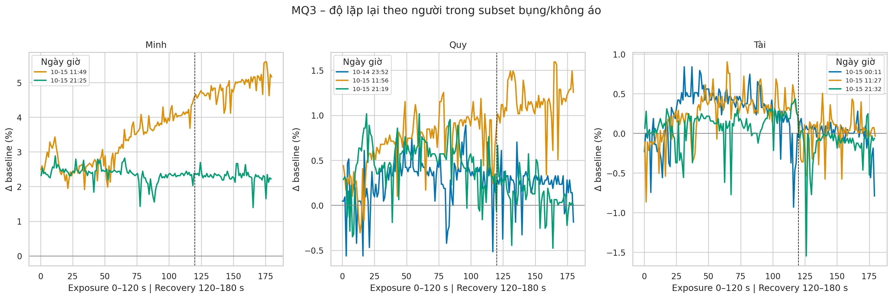

| Người | n | Mean trung bình | SD | Khoảng run |
|---|---:|---:|---:|---:|
| Minh | 2 | +2,79% | 0,59 | +2,37 đến +3,20% |
| Quy | 3 | +0,48% | 0,20 | +0,28 đến +0,69% |
| Tài | 3 | +0,21% | 0,09 | +0,10 đến +0,27% |

Ba khoảng mean không chồng lấn trong dữ liệu hiện tại. Khoảng cách nhỏ nhất là giữa run Tài cao nhất (+0,267%) và run Quy thấp nhất (+0,280%), chỉ khoảng 0,013 điểm phần trăm. Vì biên Quy–Tài rất hẹp, thay đổi môi trường nhỏ vẫn có thể làm hai lớp chồng lên nhau ở dữ liệu mới.

MQ3 có η² mô tả 95,3% cho mean theo nhãn người. Con số này không phải “95,3% độ chính xác”; nó chỉ nói rằng trong tám điểm hiện tại, phần lớn biến thiên mean nằm giữa ba nhóm người. Với n=8, chỉ số này dễ bị phóng đại.

---

## 8. Phân tích theo người, ngày và phiên

### 8.1. Mean theo người

Mỗi chấm là một run, đường đen là trung bình người.

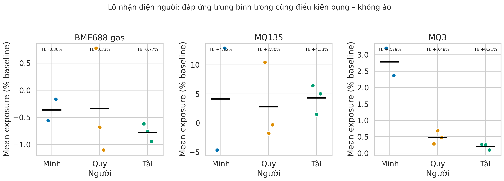

Nhìn đồng thời ba cảm biến:

- BME688: Tài có xu hướng âm hơn, nhưng Minh–Quy chồng nhau.
- MQ135: biến thiên trong cùng người lớn hơn khác biệt trung bình giữa người.
- MQ3: Minh tách xa; Quy và Tài gần hơn nhưng vẫn chưa chồng trong tập hiện tại.

### 8.2. Hai phiên đầy đủ S5 và S6

| Phiên | Người | BME688 | MQ135 | MQ3 | Nhiệt độ nền | RH nền |
|---|---|---:|---:|---:|---:|---:|
| S5 11:27 | Minh | -0,56% | -4,65% | +3,20% | 34,45°C | 57,83% |
| S5 11:27 | Quy | -0,68% | -1,77% | +0,69% | 34,51°C | 57,72% |
| S5 11:27 | Tài | -0,76% | +1,50% | +0,25% | 34,11°C | 59,10% |
| S6 21:03 | Minh | -0,17% | +12,90% | +2,37% | 33,90°C | 56,48% |
| S6 21:03 | Quy | -1,10% | -0,32% | +0,48% | 33,89°C | 56,66% |
| S6 21:03 | Tài | -0,95% | +5,04% | +0,10% | 34,01°C | 56,36% |

Trong cùng phiên:

- S5 có biên nhiệt độ 0,40°C, RH 1,38 điểm và áp suất 0,245 hPa giữa ba người.
- S6 có biên nhiệt độ 0,12°C, RH 0,30 điểm và áp suất 0,032 hPa.
- MQ3 vẫn giữ cùng thứ tự người ở cả hai phiên.

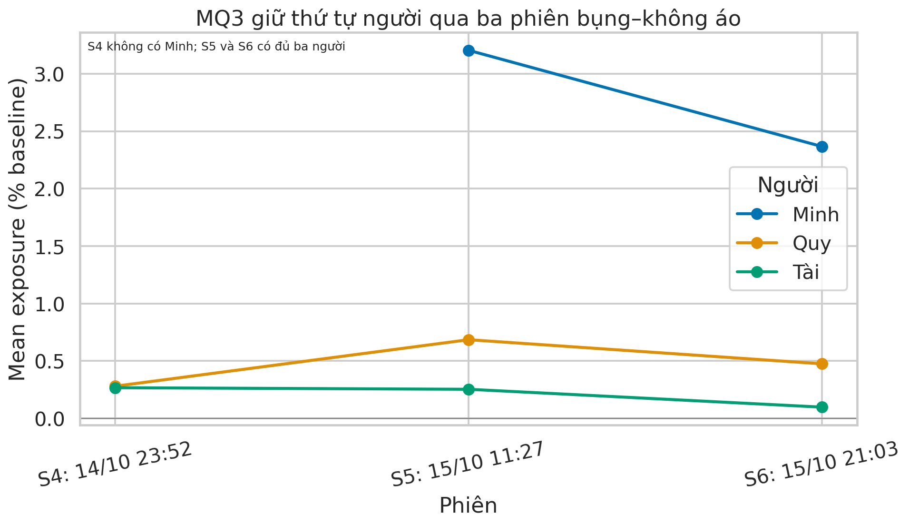

Từ S5 sang S6, MQ3 giảm ở cả ba người:

| Người | S5 | S6 | Thay đổi |
|---|---:|---:|---:|
| Minh | 3,20% | 2,37% | -26,1% |
| Quy | 0,69% | 0,48% | -30,6% |
| Tài | 0,25% | 0,10% | -61,4% |

Đây là bằng chứng hai chiều:

- tích cực: thứ tự người lặp lại dù thứ tự thu thay đổi;
- cảnh báo: mức tuyệt đối chịu hiệu ứng phiên khá lớn, đặc biệt với Tài.

### 8.3. Biến đổi tất cả người theo ngày

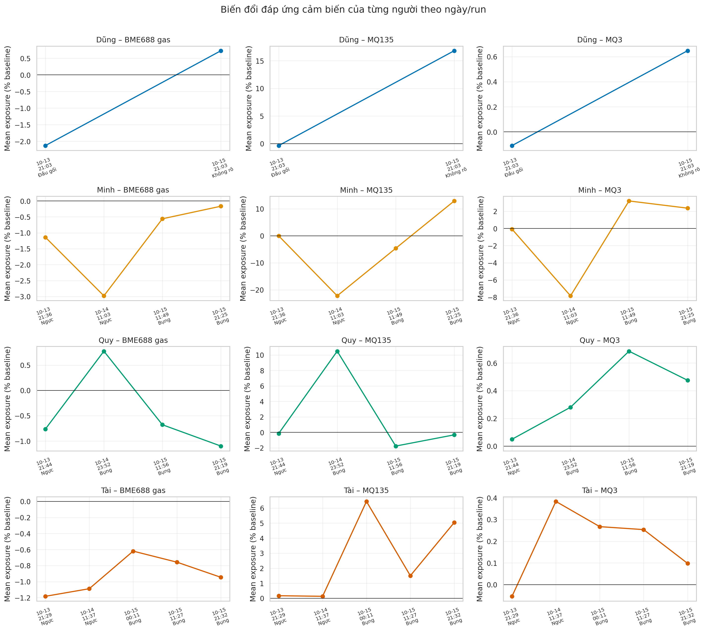

- Minh ngày 14/10 là outlier mạnh trên MQ135 và MQ3; run này không cùng vị trí với subset bụng.
- Quy có BME đổi dấu và MQ135 đổi lớn theo phiên, trong khi MQ3 bụng nằm trong khoảng +0,28 đến +0,69%.
- Tài có BME bụng tương đối ổn định nhưng MQ3 giảm dần trong ngày 15/10.
- Dũng chỉ có hai điểm không cùng điều kiện nên đường nối không thể được hiểu là biến đổi cá nhân theo ngày.

---

## 9. Ảnh hưởng của vị trí, áo và trạng thái sau tắm

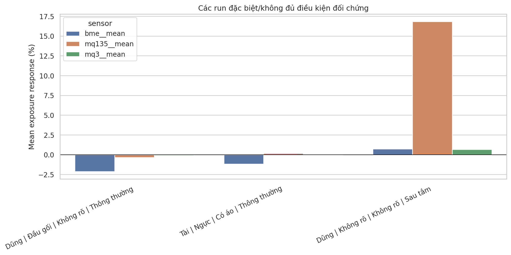

### 9.1. Ngực so với bụng

Minh, Quy và Tài đều có dữ liệu ngực và bụng, nhưng vị trí bị trộn với ngày và phiên:

- dữ liệu ngực chủ yếu nằm ngày 13–14/10;
- dữ liệu bụng chủ yếu nằm ngày 14–15/10;
- môi trường, trạng thái MQ135 và sensor uptime cùng thay đổi.

Ví dụ MQ3 của Minh chuyển từ -0,08% và -7,85% ở ngực sang +3,20% và +2,37% ở bụng. Không thể kết luận bụng “tốt hơn” vì run ngực ngày 14/10 là outlier toàn hệ thống.

### 9.2. Có áo so với không áo

Chỉ có một run Tài ngực–có áo và một run Tài ngực–không áo ở ngày khác:

| Điều kiện | BME688 | MQ135 | MQ3 |
|---|---:|---:|---:|
| Ngực có áo, 13/10 | -1,18% | +0,17% | -0,05% |
| Ngực không áo, 14/10 | -1,09% | +0,13% | +0,38% |

BME688 và MQ135 gần nhau, MQ3 khác hơn. Nhưng một cặp khác ngày không đủ tách ảnh hưởng của áo khỏi môi trường và trạng thái cơ thể.

### 9.3. Sau tắm

Dũng có hai run:

| Điều kiện | BME688 | MQ135 | MQ3 |
|---|---:|---:|---:|
| Đầu gối, 13/10 | -2,13% | -0,35% | -0,11% |
| Sau tắm, vị trí không rõ, 15/10 | +0,73% | +16,82% | +0,65% |

Khác biệt lớn nhưng bị confound bởi vị trí, ngày và lỗi MQ135. Run sau tắm có MQ135 baseline CV 47,16%, nên không thể dùng để nói tắm làm tín hiệu tăng.

---

## 10. Nhiệt độ, độ ẩm và áp suất

### 10.1. Mức nền giữa các run

| Biến | Min | Trung vị | Max |
|---|---:|---:|---:|
| Nhiệt độ nền | 32,57°C | 34,12°C | 34,67°C |
| Độ ẩm nền | 55,01% | 60,06% | 66,12% |
| Áp suất nền | 1.010,83 hPa | 1.012,35 hPa | 1.013,49 hPa |

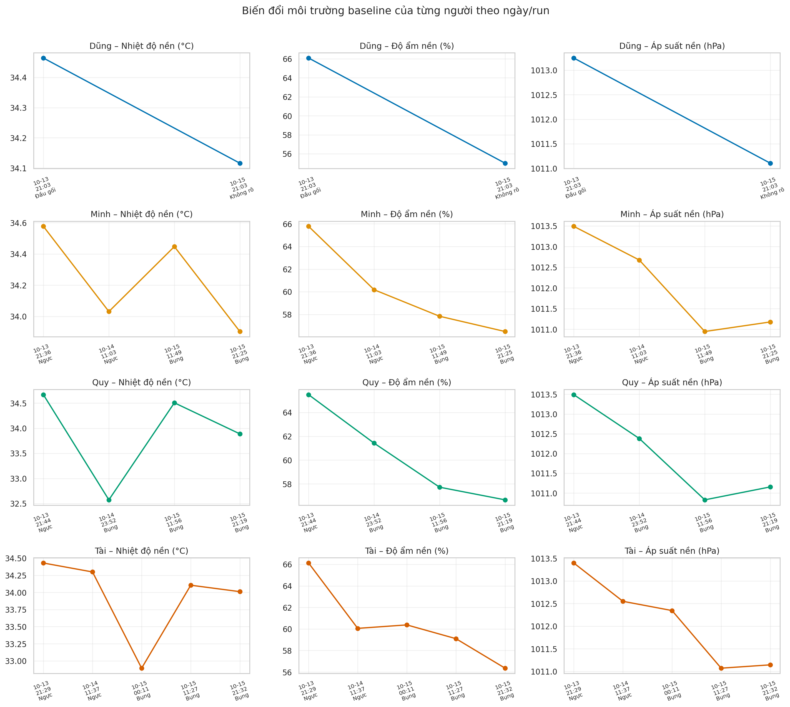

Độ ẩm và áp suất cùng giảm theo thời gian thu. Vì người và điều kiện cũng thay đổi theo ngày, đây là confounding theo thời gian.

### 10.2. Môi trường thay đổi trong exposure

| Biến | Min | Trung vị | Max |
|---|---:|---:|---:|
| Δ nhiệt độ mean exposure | -0,113°C | +0,089°C | +0,255°C |
| Δ RH mean exposure | -0,397 điểm | +0,238 điểm | +0,939 điểm |
| Δ áp suất mean exposure | -0,054 hPa | -0,011 hPa | +0,027 hPa |

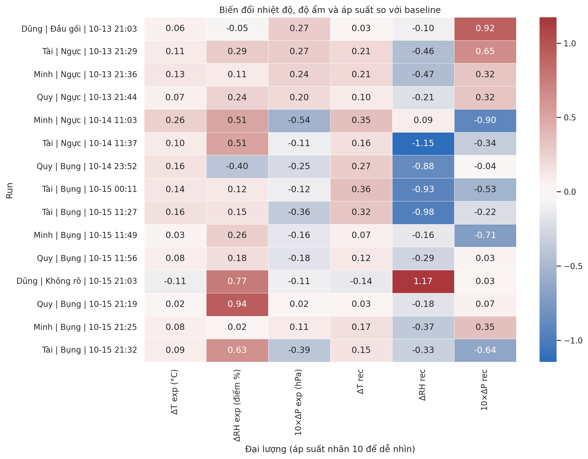

Trong một run, nhiệt độ/độ ẩm thường thay đổi ít hơn khác biệt nền giữa các phiên. Điều này ủng hộ cách dùng chúng như biến kiểm soát phiên thay vì fingerprint người.

### 10.3. Tương quan với cảm biến

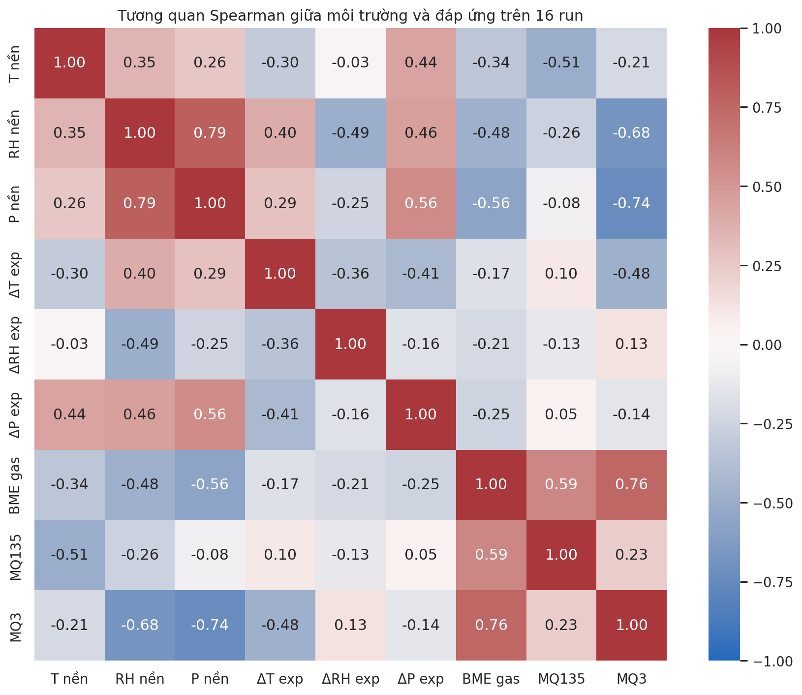

Spearman trên 15 run:

- MQ3 mean với RH nền: ρ = -0,68;
- MQ3 mean với áp suất nền: ρ = -0,74;
- MQ3 mean với nhiệt độ nền: ρ = -0,21;
- BME gas mean với nhiệt độ/RH/áp suất nền: từ -0,34 đến -0,56.

Không được hiểu các hệ số tương quan này là quan hệ nhân quả:

- RH nền và áp suất nền tương quan với nhau ρ = 0,79;
- người, vị trí và ngày không được random hóa;
- từ S5 sang S6, RH giảm nhưng MQ3 của cả ba người cũng giảm, ngược chiều quan hệ toàn cục.

Kết luận: môi trường là dấu hiệu của hiệu ứng phiên/confounding; chưa có bằng chứng để hiệu chỉnh tuyến tính MQ3 theo RH từ lô nhỏ này.

---

## 11. Recovery và nguy cơ carry-over

Recovery hiện cố định 60 giây.

### BME688

- Cuối recovery đa số gần baseline.
- Residual tuyệt đối lớn nhất là khoảng -4,72% ở run Minh ngực ngày 14/10; các run còn lại gần nền hơn.
- Tài phiên tối còn -1,56%.

### MQ135

- 10/15 run bị summary cảnh báo chưa hồi phục.
- Các residual lớn gồm -29,52%, +23,94%, -21,69% và -33,75%.
- Recovery cố định 60 giây không phù hợp với MQ135 ở chế độ hiện tại.

### MQ3

- Phần lớn residual nhỏ.
- Hai run Minh bụng còn +5,19% và +2,20% cuối recovery.
- Vì không có blank định kỳ giữa người, chưa loại trừ carry-over sau mẫu mạnh.

Thứ tự đo thay đổi giữa S5 và S6 mà thứ tự người trên MQ3 vẫn giữ, nên kết quả không giống một drift đơn điệu hoàn toàn. Tuy vậy, cần blank giữa người để kiểm tra trực tiếp.

---

## 12. Fingerprint đa biến, PCA và khoảng cách

### 12.1. PCA

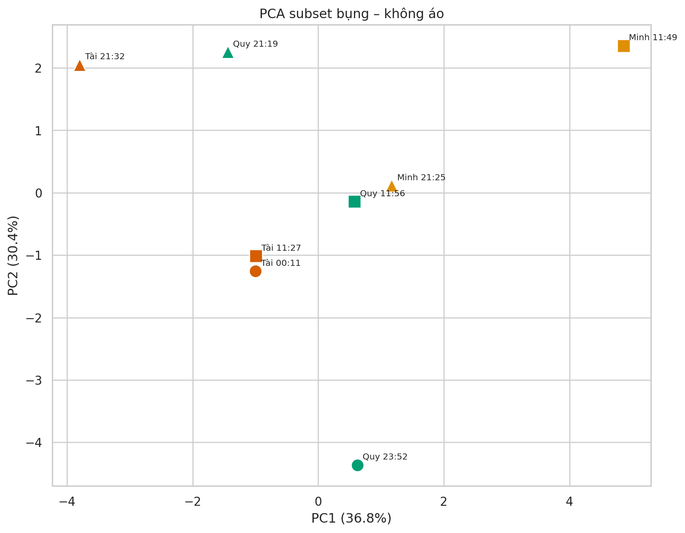

PC1 giải thích 36,8% và PC2 giải thích 30,4%; tổng cộng 67,2% phương sai. Các điểm cùng người không tạo thành ba cụm kín:

- hai điểm Minh nằm xa nhau;
- Quy 23:52 là outlier theo PC2;
- một số điểm khác người gần nhau hơn hai điểm cùng người.

PCA là phép chiếu không giám sát. 67,2% phương sai trên hai trục không có nghĩa là 67,2% thông tin danh tính.

### 12.2. Khoảng cách fingerprint

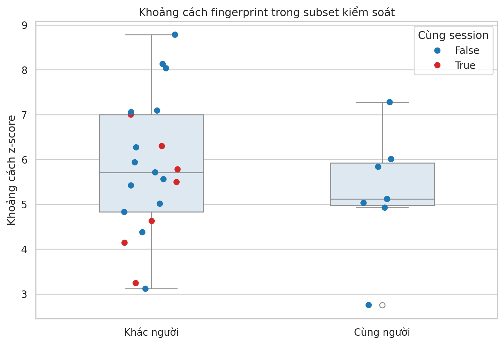

| Chỉ số | Giá trị |
|---|---:|
| Median khoảng cách cùng người | 5,12 |
| Median khoảng cách khác người | 5,71 |
| Tỷ lệ khác/cùng người | 1,116 |

Khoảng cách khác người chỉ lớn hơn cùng người khoảng 11,6% và hai phân bố chồng lấn mạnh. Fingerprint 15 đặc trưng chưa ổn định, dù riêng mean MQ3 nhìn có vẻ tách tốt.

### 12.3. Độ phân tách và dư thừa đặc trưng

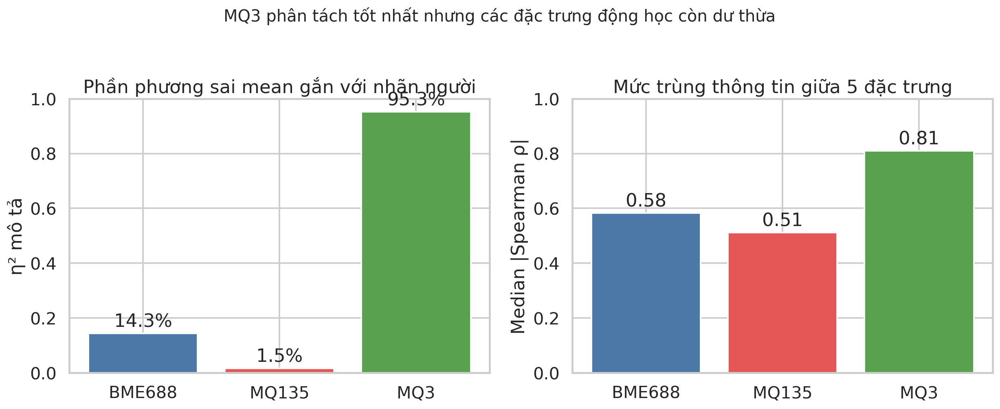

| Cảm biến | η² mean theo người | Median \|Spearman ρ\| giữa 5 đặc trưng |
|---|---:|---:|
| BME688 | 14,3% | 0,58 |
| MQ135 | 1,5% | 0,51 |
| MQ3 | 95,3% | 0,81 |

Năm đặc trưng MQ3 khá tương quan với nhau. Vì vậy việc dùng cả mean, late20, min, max và slope không tạo ra năm nguồn thông tin độc lập. Đây là một lý do mô hình ba mean có thể tốt hơn mô hình 15 đặc trưng.

---

## 13. Phân loại người và sensor ablation

### 13.1. Cách đánh giá

- Chỉ dùng 8 run bụng–không áo của Minh, Quy, Tài.
- Một run hoàn chỉnh là một mẫu.
- Giữ toàn bộ một session làm test; scaler và centroid chỉ fit trên session còn lại.
- So sánh 1-NN và nearest centroid.
- Báo balanced accuracy vì số run mỗi người không bằng nhau.

### 13.2. Kết quả theo nhóm đặc trưng

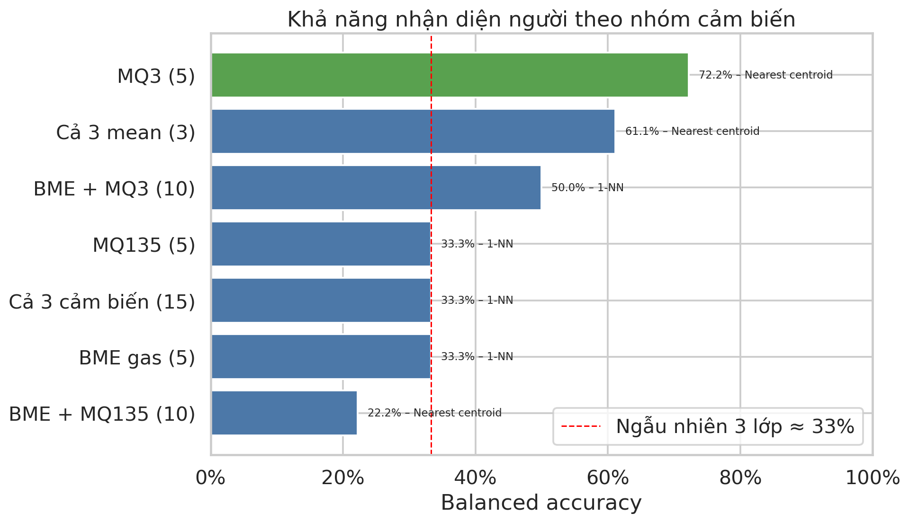

| Nhóm đặc trưng | Mô hình tốt nhất | Đúng | Accuracy | Balanced accuracy | Macro-F1 |
|---|---|---:|---:|---:|---:|
| BME688 gas, 5 đặc trưng | 1-NN | 3/8 | 37,5% | 33,3% | 30,0% |
| MQ135, 5 đặc trưng | Cả hai | 3/8 | 37,5% | 33,3% | 20,0% |
| MQ3, 5 đặc trưng | Nearest centroid | **6/8** | **75,0%** | **72,2%** | **73,0%** |
| BME688 + MQ3, 10 đặc trưng | Cả hai | 4/8 | 50,0% | 50,0% | 50,0% |
| BME688 + MQ135, 10 đặc trưng | Tốt nhất | 2/8 | 25,0% | 22,2% | 19,0% |
| Cả ba, 15 đặc trưng | 1-NN | 3/8 | 37,5% | 33,3% | 20,0% |
| Ba mean | Nearest centroid | 5/8 | 62,5% | 61,1% | 58,6% |

Kết luận ablation:

- MQ3 mang phần lớn tín hiệu phân biệt hiện tại.
- MQ135 làm kết quả BME688 + MQ135 giảm dưới mức ngẫu nhiên cân bằng.
- Thêm cảm biến và đặc trưng không tự động cải thiện kết quả.
- Với 8 mẫu và 15 đặc trưng, tỷ lệ `p/n = 15/8 = 1,875`; bài toán đang ở chế độ số chiều lớn hơn số mẫu.

### 13.3. Confusion matrix mô hình tốt nhất

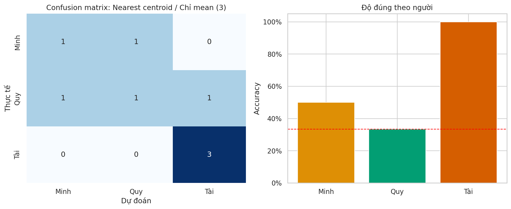

| Người | Đúng/Tổng | Recall mô tả |
|---|---:|---:|
| Minh | 1/2 | 50,0% |
| Quy | 2/3 | 66,7% |
| Tài | 3/3 | 100% |
| **Tổng** | **6/8** |  |

Mẫu ít khiến một dự đoán sai làm thay đổi mạnh metric: với Minh, một lỗi làm recall giảm từ 100% xuống 50%.

---

## 14. Bất định thống kê

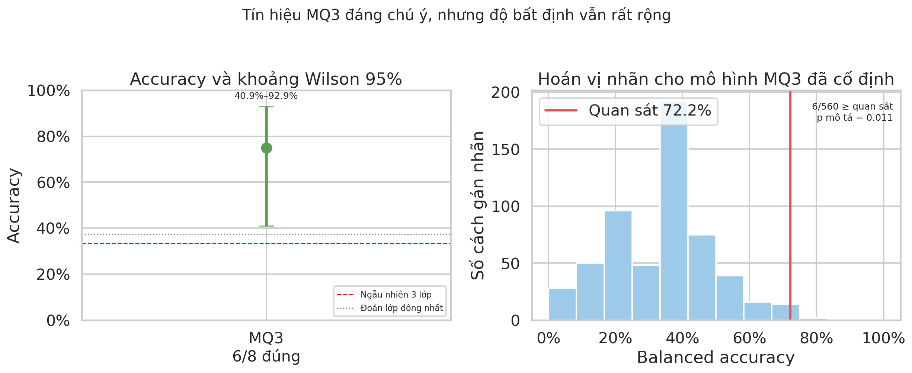

### 14.1. Khoảng tin cậy accuracy

Accuracy 6/8 = 75%, nhưng khoảng Wilson 95% là **40,9–92,9%**. Khoảng rộng cho thấy dữ liệu chưa đủ để nói hệ thống thực tế đạt khoảng 75%.

Khoảng Wilson này còn giả định các dự đoán Bernoulli độc lập. Vì 8 run nằm trong 3 phiên, bất định thực tế có thể lớn hơn.

### 14.2. Hoán vị nhãn

Với mô hình MQ3 nearest-centroid đã cố định:

- xét đủ 560 cách gán nhãn giữ nguyên số lượng Minh=2, Quy=3, Tài=3;
- 6/560 cách đạt balanced accuracy lớn hơn hoặc bằng 72,2%;
- tỷ lệ mô tả là 0,0107.

Đây **không phải p-value xác nhận** vì MQ3 và nearest-centroid được chọn sau khi đã xem kết quả của 14 tổ hợp mô hình–feature set. Con số chỉ cho biết cấu trúc MQ3 hiện tại khó xuất hiện dưới nhiều cách tráo nhãn, nhưng vẫn phải xác nhận trên lô mới chưa từng dùng để chọn mô hình.

### 14.3. Nguy cơ winner's curse

Đã thử 7 bộ đặc trưng × 2 mô hình = 14 cấu hình trên cùng 8 run. Cấu hình tốt nhất thường bị lạc quan do chọn theo chính tập đánh giá. Lần thu tiếp theo phải “đóng băng” pipeline MQ3 trước khi xem nhãn test.

---

## 15. Những nguồn sai lệch còn tồn tại

Không phải mọi vấn đề đều nghiêm trọng như nhau. Có thể chia thành ba mức:

- **Lỗi phải chặn trước khi phân tích:** đưa warm-up hoặc file phiên trùng lặp vào tập mẫu; chia các dòng của cùng một run sang cả train và test; thiếu nhãn người nhưng vẫn dùng supervised learning. Pipeline hiện tại đã chặn các trường hợp này.
- **Lỗi chất lượng cảm biến:** MQ135 drift/dao động lớn, không có feedback bơm, không biết divider factor và không có blank để đo carry-over. Các lỗi này làm tín hiệu đo không chắc chắn dù file vẫn hợp lệ.
- **Thiếu sót thiết kế thí nghiệm:** người, ngày, vị trí, áo và trạng thái sau tắm chưa cân bằng. Đây là trở ngại lớn nhất đối với kết luận “mùi nhận diện được người”, vì không thể tách riêng tác động của từng yếu tố.

| Nguồn sai lệch | Bằng chứng trong dữ liệu | Hậu quả |
|---|---|---|
| Warm-up lẫn với mẫu nghiên cứu | 7/22 thư mục chỉ dùng khởi động; một thư mục warm-up có tên chữ | Sai cỡ mẫu và tạo kết luận từ dữ liệu không có giá trị |
| Trùng dữ liệu run–session | 100% dòng của 15 run lặp trong file phiên số | Rò rỉ train/test nếu không loại |
| Ngày/phiên trộn với người | Chỉ S5, S6 đủ ba người | Mô hình có thể học phiên |
| Vị trí trộn với ngày | Ngực chủ yếu ngày 13–14, bụng ngày 14–15 | Không tách được body site |
| Áo không cân bằng | Chỉ một run Tài có áo | Không kết luận ảnh hưởng áo |
| Sau tắm không đối chứng | Một run Dũng, vị trí không rõ | Không kết luận ảnh hưởng tắm |
| Khoảng cách lấy mẫu trống | 15/15 thiếu | Biên độ có thể do khoảng cách |
| Không đo lưu lượng khí | Bơm unknown, không feedback | Exposure timing và nồng độ không chắc chắn |
| Không có blank giữa người | MQ3 Minh còn residual | Có nguy cơ carry-over |
| MQ135 đổi chế độ theo phiên | CV tăng đồng loạt sau S4 | Fusion bị nhiễu hệ thống |
| Mẫu quá ít | 8 run, 3 phiên, 15 features | Metric không ổn định, dễ overfit |
| Nhãn nằm trong tên folder | Metadata label trống | Dễ mất hoặc sai ground truth |

---

## 16. Trả lời các câu hỏi nghiên cứu

### Có đặc trưng của người dựa vào mùi không?

**Có tín hiệu ban đầu, chủ yếu ở MQ3.** Ba người tạo ba mức mean MQ3 khác nhau, giữ thứ tự qua hai phiên đầy đủ và mô hình MQ3 đạt 6/8. Tuy nhiên chưa đủ bằng chứng để gọi đây là biometric ổn định vì số phiên quá ít và biên Quy–Tài rất hẹp.

### BME688 có giúp nhận diện người không?

**Hiện chưa rõ.** BME688 đo ổn định nhưng balanced accuracy riêng chỉ 33,3%. Vai trò tốt nhất lúc này là kênh nền ổn định và bổ sung động học sau khi có nhiều dữ liệu hơn.

### MQ135 có nên dùng không?

**Không nên dùng trong nhánh chính ở trạng thái hiện tại.** Nó có drift theo phiên, dao động lớn, recovery kém và làm giảm kết quả fusion.

### Có nên kết hợp cả ba cảm biến không?

**Chưa.** Cả ba với 15 đặc trưng chỉ đạt balanced accuracy 33,3%; ba mean đạt 61,1%; MQ3 riêng đạt 72,2%. Chỉ nên fusion sau khi từng kênh vượt quality gate.

### Nhiệt độ và độ ẩm có cần bỏ không?

**Không dùng làm fingerprint, nhưng không được bỏ khỏi dữ liệu.** Chúng cần để kiểm soát phiên, audit drift và thiết kế split. Tương quan hiện tại chưa đủ để hiệu chỉnh cảm biến.

### Dữ liệu có khả thi để tiếp tục dự án không?

**Có.** Pipeline ghi dữ liệu tốt và MQ3 cho tín hiệu đáng để đầu tư thu tiếp. Điểm nghẽn hiện nay là thiết kế thí nghiệm và kiểm soát luồng khí, không phải thiếu một mô hình machine learning phức tạp.

---

## 17. Pipeline thu thập cho đợt tiếp theo

### Bước 1 – Khóa bài toán

Trong giai đoạn xác nhận người, chỉ dùng một protocol chính:

```text
vị trí: bụng
áo: không áo
baseline: 60 s
exposure: 120 s
recovery: thích ứng
khoảng cách: cố định và ghi bằng số
```

Các thí nghiệm áo/vị trí/sau tắm phải tách thành protocol phụ, không trộn vào bộ nhận diện chính.

### Bước 2 – Ghi metadata bắt buộc

Mỗi run phải có:

- `person_code` ẩn danh và ổn định;
- `session_id`, `sample_id`, `replicate_id`;
- vị trí, áo, trạng thái sau tắm;
- `distance_cm`;
- thứ tự người trong phiên;
- thời gian từ lúc tắm, vận động, ăn uống, hút thuốc hoặc dùng mỹ phẩm nếu liên quan;
- notes cho mọi bất thường.

Tên folder chỉ để đọc nhanh; metadata mới là nguồn ground truth.

### Bước 3 – Warm-up và quality gate riêng từng cảm biến

| Tiêu chí | Ngưỡng khởi đầu |
|---|---:|
| Dữ liệu hợp lệ | ≥95% |
| Gap lấy mẫu | ≤3 giây |
| BME688 baseline CV | ≤1% |
| MQ3 baseline CV | ≤1% |
| MQ135 baseline CV | ≤5% |
| ADC saturation | 0 dòng |
| Bơm/lưu lượng | Có feedback hoặc log đo được |

Baseline hiện chỉ đánh giá BME gas, nhiệt độ và RH. Cần bổ sung MQ135/MQ3 vào gate trước khi cho phép exposure.

### Bước 4 – Thiết kế phiên cân bằng

Mỗi phiên phải có đủ mọi người. Thứ tự người cần random hóa hoặc Latin square để mỗi người xuất hiện ở đầu/giữa/cuối gần như nhau.

Ví dụ với Minh–Quy–Tài:

```text
Ngày 1: Minh → Quy → Tài
Ngày 2: Quy → Tài → Minh
Ngày 3: Tài → Minh → Quy
```

### Bước 5 – Blank và recovery thích ứng

1. Thu blank khí phòng đầu phiên.
2. Thu blank giữa hai người.
3. Chỉ kết thúc recovery khi từng cảm biến trở về trong ±5–10% baseline hoặc đạt timeout đã định.
4. Nếu blank sau một người vẫn lệch, đánh dấu run kế tiếp có nguy cơ carry-over.

### Bước 6 – Kiểm soát dòng khí

- Đo hoặc xác nhận trạng thái bơm thực tế.
- Cố định lưu lượng.
- Đo thời gian trễ từ đầu ống đến buồng cảm biến.
- Ghi event exposure theo thời điểm khí đến buồng, không chỉ theo lúc nhấn lệnh.

### Bước 7 – Quy mô dữ liệu

Mức tối thiểu thực dụng cho vòng tiếp theo:

- 3 người;
- 5 ngày độc lập;
- 2–4 run/người/ngày;
- 10–20 run/người;
- tổng 30–60 run người;
- khoảng 30 blank/control run bổ sung.

Nếu mở rộng số người, ưu tiên tăng số ngày và session trước khi tăng nhiều lần lặp liên tiếp trong cùng một phiên.

---

## 18. Pipeline phân tích cho dữ liệu mới

1. Kiểm tra đủ sáu artifact và đúng schema.
2. Dùng quy tắc tường minh để loại cả thư mục tên số và `hihi_...` như warm-up; không suy đoán chỉ từ việc tên có chữ.
3. Phát hiện và loại dữ liệu trùng bằng `run_id`, `seq`, timestamp hoặc hash.
4. Kiểm tra metadata bắt buộc; run thiếu nhãn chỉ dùng QC.
5. Kiểm tra timing, status, fresh, heater và ADC.
6. Tính quality gate riêng BME688, MQ135, MQ3.
7. Tách baseline/exposure/recovery từ event log.
8. Chuẩn hóa theo median baseline từng run.
9. Tính mean, early20, late20, min, max, slope, AUC, time-to-peak và recovery.
10. Kiểm tra blank/carry-over trước khi dùng run.
11. Chạy BME-only, MQ3-only, BME+MQ3 và all-sensor ablation.
12. Chia train/test theo ngày hoặc session chưa thấy.
13. Fit scaler, imputer và feature selection chỉ trên train fold.
14. Báo confusion matrix, balanced accuracy, macro-F1 và khoảng tin cậy.
15. Đóng băng pipeline tốt nhất rồi xác nhận một lần trên lô mới hoàn toàn.

Không được chia ngẫu nhiên 240 dòng của cùng run vào cả train và test. Làm như vậy chỉ đo khả năng nhận lại cùng chuỗi thời gian, không đo khả năng nhận diện người ở lần thu mới.

---

## 19. Thứ tự ưu tiên phát triển

### Ưu tiên 1 – Sửa thiết kế thu

- metadata đầy đủ;
- cùng người, cùng vị trí, cùng protocol;
- đủ mọi người trong mỗi phiên;
- random hóa thứ tự;
- blank giữa người.

### Ưu tiên 2 – Xử lý MQ135

Kiểm tra nguồn, ground, heater, chia áp, ADS1115 và tần số dao động. Nếu baseline CV vẫn trên 5%, loại kênh này khỏi mô hình nhưng vẫn log để chẩn đoán.

### Ưu tiên 3 – Xác nhận MQ3

Giữ nguyên pipeline MQ3 hiện tại và kiểm tra trên ít nhất năm ngày mới. Mục tiêu quan trọng không phải tăng accuracy train, mà là giữ thứ tự/ngưỡng người qua ngày và môi trường.

### Ưu tiên 4 – Sau đó mới tăng độ phức tạp mô hình

Chỉ thử LDA, logistic regression, SVM hoặc time-series model khi số run độc lập đủ lớn. Với dữ liệu hiện tại, mô hình đơn giản dễ kiểm tra và đáng tin hơn.

---

## 20. Tái lập kết quả

Cài thư viện:

```powershell
python -m pip install -r requirements.txt
```

Chạy phân tích toàn bộ lô:

```powershell
python analysis/analyze_new_batch.py
```

Tạo biểu đồ tổng hợp dễ đọc và các thống kê mở rộng:

```powershell
python analysis/generate_readme_summary_figures.py
```

Các file chính:

- [Script phân tích toàn bộ lô](analysis/analyze_new_batch.py)
- [Script biểu đồ và thống kê README](analysis/generate_readme_summary_figures.py)
- [Manifest 15 run hợp lệ](data/chua_co_loc_khi_van_3_c/report_outputs/tables/run_manifest.csv)
- [Audit từng run](data/chua_co_loc_khi_van_3_c/report_outputs/tables/run_audit.csv)
- [Đặc trưng từng run](data/chua_co_loc_khi_van_3_c/report_outputs/tables/run_features.csv)
- [Subset kiểm soát](data/chua_co_loc_khi_van_3_c/report_outputs/tables/controlled_subset.csv)
- [Kết quả sensor ablation](data/chua_co_loc_khi_van_3_c/report_outputs/tables/sensor_ablation_scores.csv)
- [Thống kê từng người–cảm biến](data/chua_co_loc_khi_van_3_c/report_outputs/tables/controlled_person_sensor_stats.csv)
- [Chỉ số phân tách cảm biến](data/chua_co_loc_khi_van_3_c/report_outputs/tables/controlled_sensor_discrimination.csv)
- [Bất định và hoán vị nhãn](data/chua_co_loc_khi_van_3_c/report_outputs/tables/controlled_uncertainty.json)
- [Audit đủ 50 trường raw](data/chua_co_loc_khi_van_3_c/report_outputs/tables/field_audit_all_50_fields.csv)
- [Toàn bộ bảng kết quả](data/chua_co_loc_khi_van_3_c/report_outputs/tables/)
- [Toàn bộ biểu đồ chẩn đoán](data/chua_co_loc_khi_van_3_c/report_outputs/figures/)

---

## 21. Kết luận cuối cùng

Lô `chua_co_loc_khi_van_3_c` đủ tốt để xác định hướng tiếp theo của dự án:

1. **Phần mềm thu và cấu trúc file hoạt động tốt.** Dữ liệu đủ pha, timing ổn định và không có lỗi toàn vẹn đáng kể.
2. **BME688 và MQ3 đáng tin về chất lượng nền.** BME688 ổn định nhưng chưa phân tách người; MQ3 vừa ổn định vừa có tín hiệu người rõ nhất.
3. **MQ135 hiện là nguồn nhiễu.** Cần sửa phần cứng hoặc tạm loại khỏi mô hình chính.
4. **Dấu hiệu nhận diện người là có thật ở mức thăm dò, nhưng chưa được xác nhận.** MQ3 đạt 6/8 và giữ thứ tự người qua hai phiên đầy đủ, song khoảng bất định còn rất rộng.
5. **Bước tiếp theo phải là thu dữ liệu cân bằng và kiểm soát tốt hơn, không phải đổi sang mô hình phức tạp hơn.**

Mốc để chuyển từ proof-of-concept sang kết luận khả thi là: MQ3 hoặc BME688+MQ3 tiếp tục phân biệt người trên các ngày/session hoàn toàn mới, khi vị trí, khoảng cách, thứ tự, blank và môi trường đã được kiểm soát.
