# Mô tả bộ dữ liệu mùi ngày 2026-10-25

Tài liệu này chỉ mô tả dữ liệu gốc, chất lượng từng phiên, đáp ứng cảm biến, các biểu đồ phân tích và những biến đổi đã áp dụng khi tạo bộ augmented. Hướng dẫn chạy pipeline và nhận diện mẫu mới nằm ở [`README.md`](../../README.md) tại thư mục gốc của repository.

## Phân tích bộ dữ liệu

### Tóm tắt

Bộ dữ liệu gồm **7 phiên đo của 4 người**: Dung, Minh, Quy và Tai. Sau kiểm tra chất lượng, **6 phiên đạt** và **1 phiên bị loại khỏi pipeline làm giàu**. Dữ liệu này phù hợp để thử nghiệm pipeline tín hiệu và cosine similarity, nhưng chưa đủ để kết luận hệ thống nhận diện ổn định bốn người vì Dung, Minh và Quy mới có một phiên thật/người.

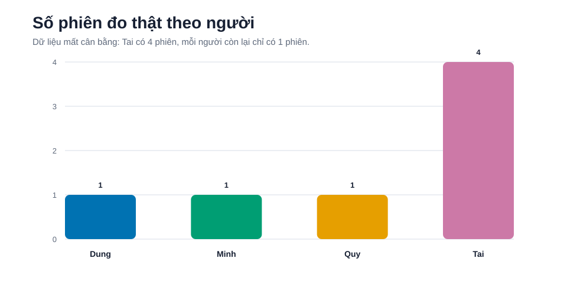

### Danh sách phiên đo

| Phiên | Người | Bắt đầu | Dòng | Cảnh báo | Trạng thái |
|---|---:|---:|---:|---:|---|
| `aDung_20261025_212248_38b6e5b5a8e84de3a5cf01c3155b99bf` | Dung | 21:22:48 | 380 | 1 | **Đạt** |
| `aMinh_20261025_213826_48c413b66db34045b65795e09d60e541` | Minh | 21:38:26 | 326 | 3 | **Đạt** |
| `aQuy_20261025_215448_79f35cc752414bfe9ba9250f45238dd0` | Quy | 21:54:48 | 326 | 3 | **Đạt** |
| `Tai_20261025_205139_5d2a3c167fa0485eb88cc20949bc6e22` | Tai | 20:51:39 | 1814 | 7 | **Loại khỏi augmentation** |
| `Tai_20261025_213104_8f5aaa8d5eed44809636777749e2335a` | Tai | 21:31:04 | 370 | 4 | **Đạt** |
| `Tai_20261025_214756_62ac6185c4014cefa6dec64c07ea2291` | Tai | 21:47:56 | 316 | 0 | **Đạt** |
| `Tai_20261025_220130_c0ab68689fb4440793fb4dd54164ad8a` | Tai | 22:01:30 | 368 | 2 | **Đạt** |

Phiên `Tai_20261025_205139_5d2a3c167fa0485eb88cc20949bc6e22` bị loại vì tỷ lệ BME hợp lệ trong EXPOSURE chỉ khoảng **3,3%** và trong RECOVERY khoảng **80%**. Phiên này cũng có thời gian MONITOR rất dài và bước nhảy tín hiệu khác hẳn các phiên còn lại.

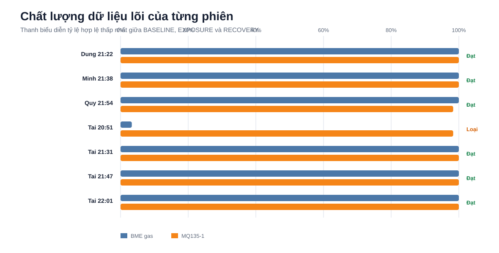

### Đáp ứng của từng cảm biến

Heatmap dưới đây biểu diễn mức thay đổi trung bình trong EXPOSURE so với median BASELINE. Dấu âm nghĩa là tín hiệu thấp hơn baseline; không phải điện áp hay điện trở vật lý âm.

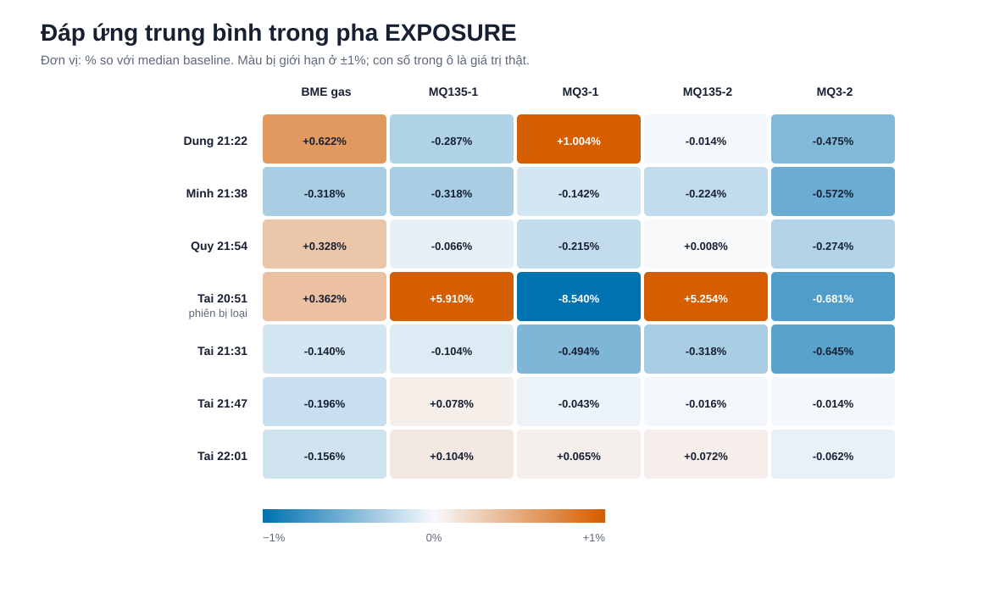

#### Đánh giá cảm biến

| Cảm biến | Tỷ lệ tách biệt/lặp lại | Tai có láng giềng gần nhất là Tai | Quyết định |
|---|---:|---:|---|
| BME gas resistance | 1.49 | 2/3 | **Giữ** |
| MQ135-1 | 1.60 | 2/3 | **Giữ** |
| MQ3-1 | 1.13 | 2/3 | Kênh phụ, chưa đưa vào vector chính |
| MQ135-2 | 1.01 | 0/3 | Tạm loại khỏi vector |
| MQ3-2 | 0.94 | 2/3 | Tạm loại khỏi vector |

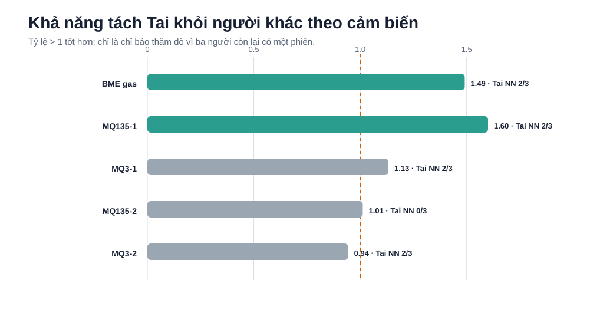

Tỷ lệ lớn hơn 1 nghĩa là khoảng cách Tai–người khác lớn hơn khoảng cách giữa các phiên Tai. Đây chỉ là đánh giá thăm dò vì chỉ Tai có dữ liệu lặp.

### Mức giống nhau giữa các phiên thật

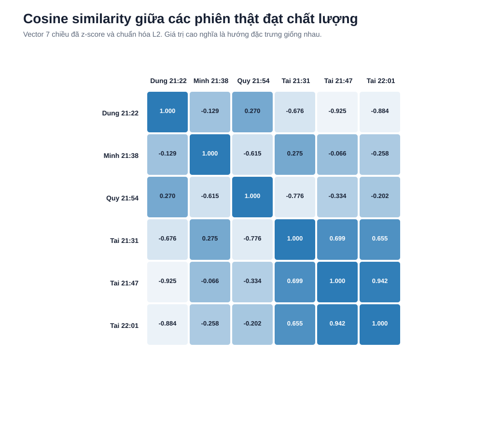

Ma trận dùng vector bảy chiều từ BME gas và MQ135-1. Một số phiên khác người vẫn có cosine cao, vì vậy chưa nên đặt ngưỡng nhận diện chính thức từ bộ dữ liệu này.

### Tín hiệu chuẩn hóa của từng phiên

Các hình dưới đây là biểu đồ có sẵn của từng phiên, hiển thị toàn bộ MONITOR, BASELINE, EXPOSURE và RECOVERY.

<details>
<summary><strong>Dung 21:22</strong></summary>

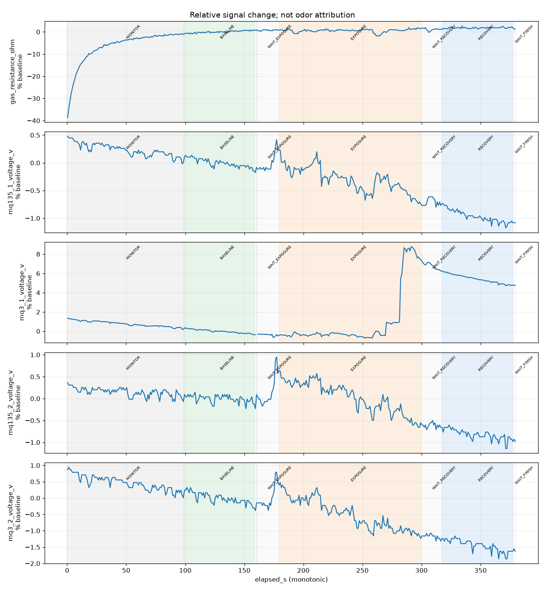

</details>

<details>
<summary><strong>Minh 21:38</strong></summary>

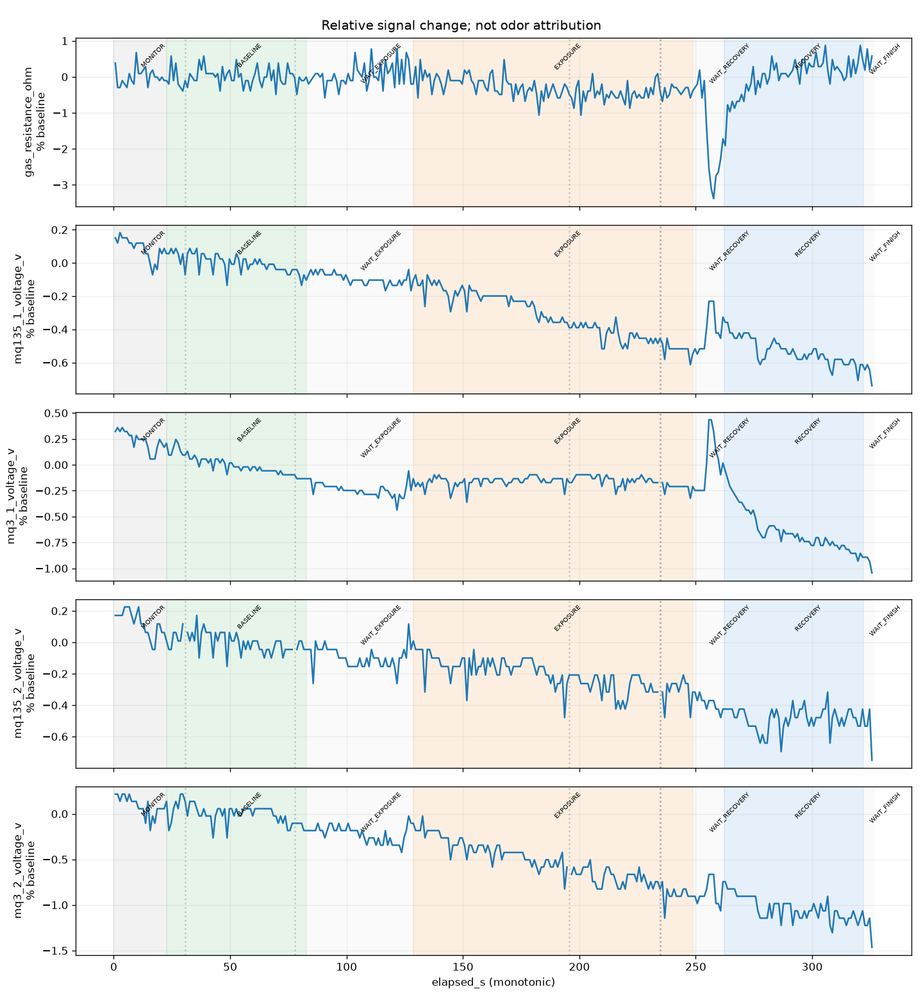

</details>

<details>
<summary><strong>Quy 21:54</strong></summary>

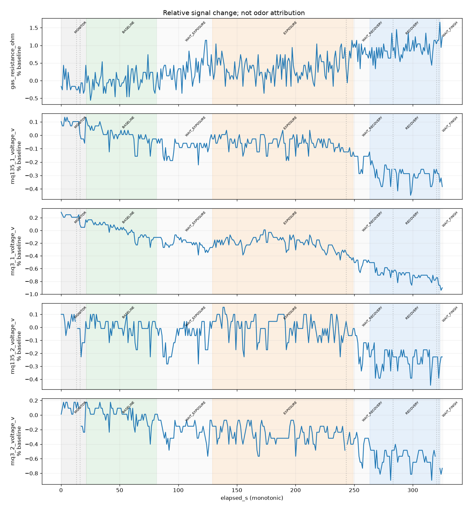

</details>

<details>
<summary><strong>Tai 20:51</strong> — phiên bị loại do thiếu dữ liệu BME</summary>

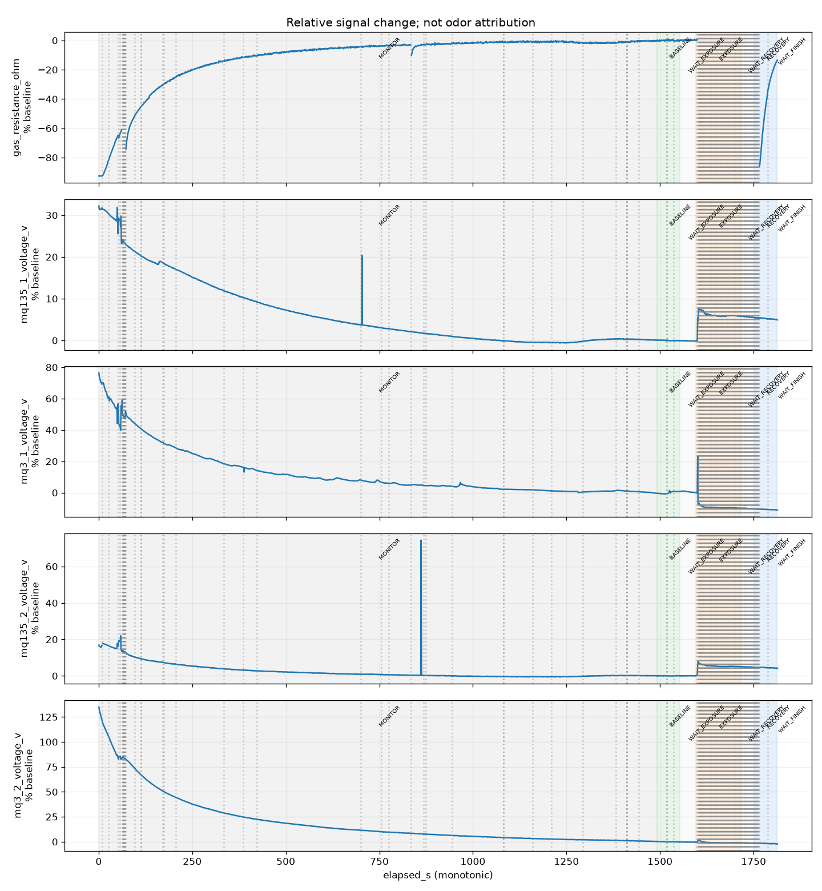

</details>

<details>
<summary><strong>Tai 21:31</strong></summary>

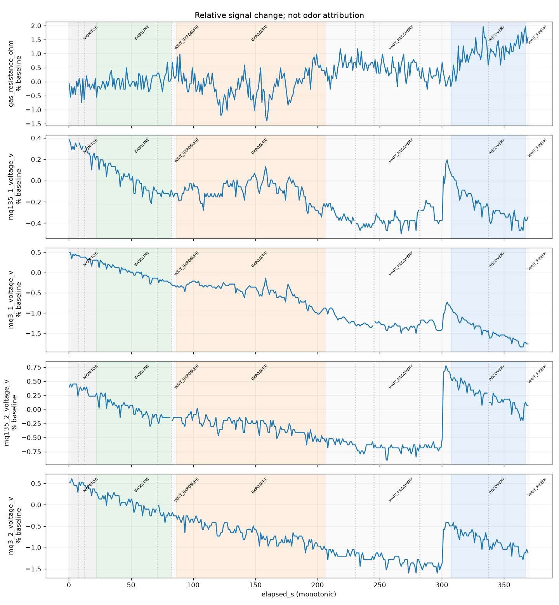

</details>

<details>
<summary><strong>Tai 21:47</strong></summary>

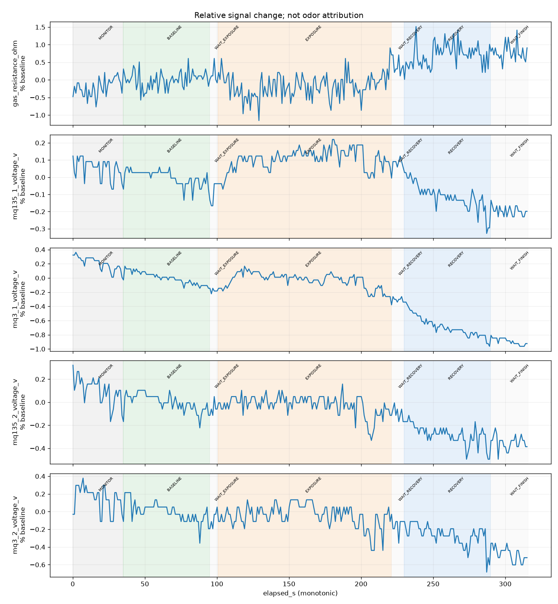

</details>

<details>
<summary><strong>Tai 22:01</strong></summary>

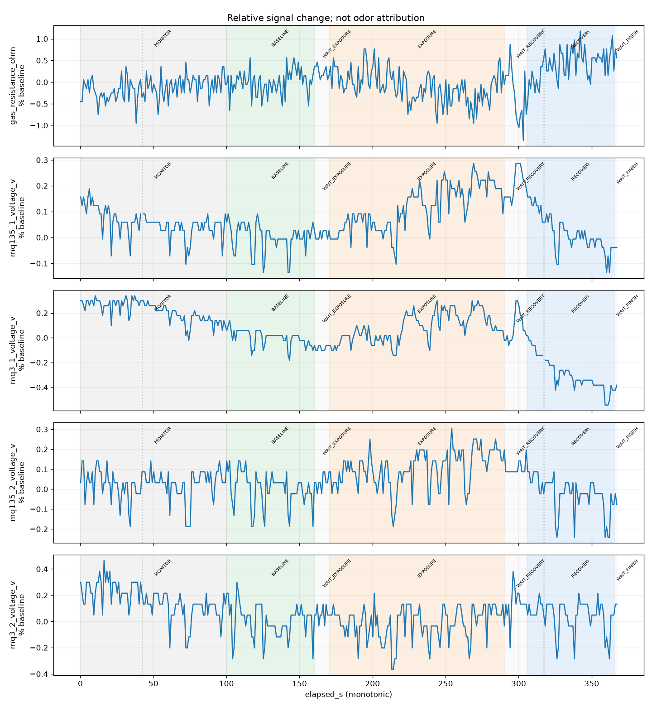

</details>

### Dữ liệu đã được làm giàu như thế nào

Pipeline nằm tại `../../analysis/augment_and_extract_odor_features.py`. Kết quả nằm trong `../2026-10-25_augmented/`.

#### Lọc và chuẩn hóa

1. Chỉ giữ sáu phiên có ít nhất 90% mẫu hợp lệ trong từng pha lõi.
2. Chỉ dùng `gas_resistance_ohm` và `mq135_1_voltage_v` cho vector chính.
3. Nội suy mỗi phiên về độ dài cố định: BASELINE 60 mẫu, EXPOSURE 120 mẫu, RECOVERY 60 mẫu.
4. Chuẩn hóa từng cảm biến theo median baseline:

```text
response_pct = 100 × (signal - baseline_median) / abs(baseline_median)
```

#### Augmentation

Từ mỗi phiên thật đạt chất lượng, pipeline tạo 20 biến thể. Mọi phép biến đổi đều giữ nguyên thứ tự pha và áp dụng cùng tham số thời gian/biên độ cho hai cảm biến:

- Nhân biên độ toàn cục: `0.97–1.03`.
- Co giãn thời gian nhẹ: `0.98–1.02`.
- Dịch thời gian: `−2..+2` mẫu.
- Cộng `0.10–0.30` lần residual noise lấy từ baseline thật.
- Không trộn dữ liệu giữa hai người, không đảo dấu và không xáo trộn các pha.

Kết quả gồm **126 mẫu**: 6 mẫu thật và 120 mẫu augmented, tương ứng **30.240 dòng tín hiệu**.

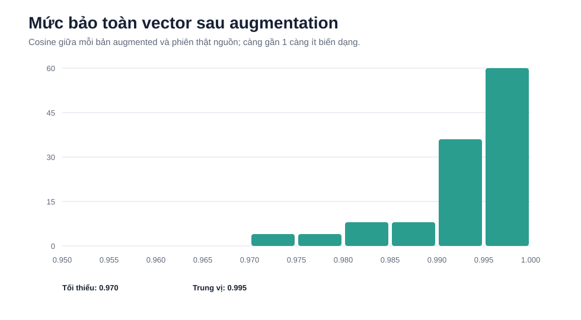

Cosine giữa bản augmented và phiên nguồn có giá trị tối thiểu **0.970**, trung vị **0.995**. Điều này cho thấy augmentation hiện tại chỉ tạo nhiễu/biến dạng nhẹ và không làm đổi mạnh hướng vector đặc trưng.

#### Vector đặc trưng

Mỗi mẫu được nén thành vector bảy đặc trưng:

1. Trung bình BME gas trong EXPOSURE.
2. Trung bình BME gas ở một phần ba giữa EXPOSURE.
3. Phân vị 10% của BME gas trong EXPOSURE.
4. Phân vị 90% của BME gas trong EXPOSURE.
5. Trung bình MQ135-1 ở một phần ba giữa EXPOSURE.
6. Slope MQ135-1 trong EXPOSURE.
7. Trung bình 10 giây cuối RECOVERY của MQ135-1.

Các đặc trưng được z-score bằng mean/std của **sáu phiên thật**, sau đó chuẩn hóa L2 thành `v_01..v_07`. Ngoài prototype chỉ dùng phiên thật, pipeline còn tạo profile augmented theo cách: trung bình các biến thể trong từng `source_run`, chuẩn hóa L2, rồi trung bình các centroid phiên với trọng số bằng nhau. Vì vậy một người có nhiều phiên không làm một phiên cụ thể bị nhân trọng số bởi augmentation.

### Các tệp kết quả

- `../2026-10-25_augmented/augmented_signals.csv`: bảng tín hiệu đã làm giàu.
- `../2026-10-25_augmented/feature_vectors.csv`: đặc trưng gốc, z-score và vector cosine-ready.
- `../2026-10-25_augmented/person_prototypes.csv`: prototype của bốn người.
- `../2026-10-25_augmented/identity_profiles.csv`: vector và ngưỡng tương thích của từng người.
- `../2026-10-25_augmented/identity_model.json`: model vector dùng để kiểm tra mẫu mới.
- `../2026-10-25_augmented/run_quality.csv`: kiểm tra chất lượng từng phiên.
- `../2026-10-25_augmented/scaler.json`: tham số chuẩn hóa để xử lý mẫu mới.

### Kết luận

- Pipeline hiện tại bảo toàn tốt vector nguồn và phù hợp để thử nghiệm cosine similarity.
- BME gas và MQ135-1 là hai kênh nên ưu tiên ở phiên bản đầu.
- Augmentation không giải quyết được việc Dung, Minh và Quy chỉ có một phiên thật.
- Khi đánh giá mô hình, tất cả biến thể có cùng `source_run` phải nằm cùng một phía train hoặc test để tránh rò rỉ dữ liệu.

