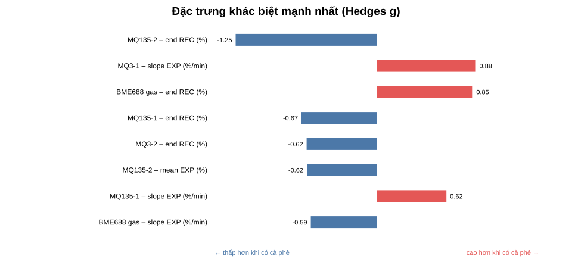
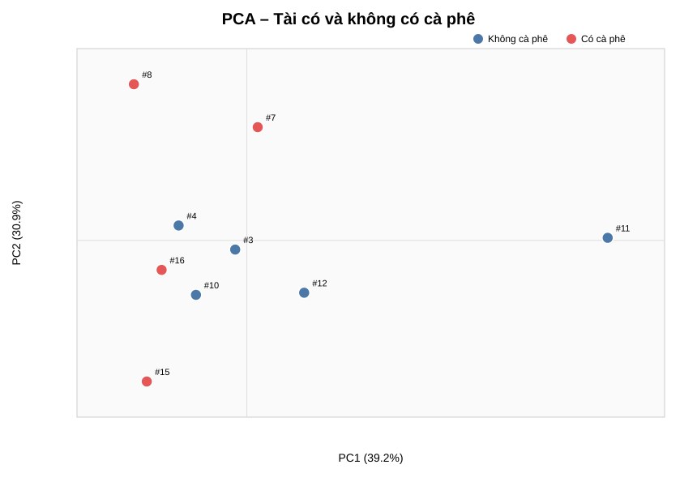

# Khác biệt giữa mẫu có và không có cà phê

## Kết luận nhanh

Phân tích chính dùng **9 phiên của riêng Tài**: 5 không cà phê và 4 có cà phê. Đây là lựa chọn quan trọng để giảm nguy cơ mô hình học danh tính người thay vì học cà phê.

- Khác biệt chuẩn hóa lớn nhất là **MQ135-2 cuối RECOVERY** (`g=-1,25`), nhưng đây có thể là dấu vết purge/carry-over chứ không phải fingerprint cà phê trực tiếp.
- Trong EXPOSURE, hướng dễ diễn giải nhất vẫn là **BME688 giảm thêm 0,89 điểm %** và **MQ3-1 tăng thêm 0,51 điểm %** khi có cà phê; effect size chỉ nhỏ–vừa và hai nhóm còn chồng lấn.
- Đặc trưng động học nổi bật nhất là slope MQ3-1 (`g=0,88`): nhóm có cà phê tăng theo thời gian, còn nhóm không cà phê giảm nhẹ.
- PCA: PC1 giải thích **39.2%**, PC2 giải thích **30.9%** phương sai. PCA chỉ mô tả cấu trúc, không dùng nhãn để tìm trục.
- Bộ phân loại nearest-centroid LOOCV đạt balanced accuracy **32.5%**, nhưng kiểm định hoán vị cho `p=0.762`; chỉ nên xem là kiểm tra thăm dò.
- Với 9 phiên, không có đủ lực thống kê để tuyên bố một biomarker chắc chắn hoặc hiệu năng triển khai.

## Thiết kế phân tích

Mỗi phiên là một mẫu độc lập. Tín hiệu hợp lệ được lọc và chuẩn hóa bằng median BASELINE giống `README_PHAN_TICH.md`. Với mỗi cảm biến, ba đặc trưng được dùng:

1. Trung bình đáp ứng trong EXPOSURE.
2. Slope EXPOSURE, đổi sang `%/phút`.
3. Trung bình 10 điểm cuối RECOVERY.

Tổng cộng có 15 đặc trưng. Mỗi đặc trưng được mô tả bằng chênh lệch trung bình, Hedges g, Cliff's delta và kiểm định hoán vị chính xác hai phía. Giá trị q dùng hiệu chỉnh Benjamini–Hochberg trên 15 phép so sánh.

## Đặc trưng khác biệt nhất

| Đặc trưng | Không CF | Có CF | Chênh lệch | Hedges g | Cliff δ | p exact | q BH |
|---|---:|---:|---:|---:|---:|---:|---:|
| MQ135-2 – end REC (%) | 0.17 | -0.32 | -0.49 | -1.25 | -0.70 | 0.095 | 0.655 |
| MQ3-1 – slope EXP (%/min) | -0.25 | 0.27 | 0.52 | 0.88 | 0.40 | 0.190 | 0.655 |
| BME688 gas – end REC (%) | -0.50 | 0.22 | 0.72 | 0.85 | 0.50 | 0.206 | 0.655 |
| MQ135-1 – end REC (%) | 0.38 | -0.10 | -0.48 | -0.67 | -0.60 | 0.333 | 0.655 |
| MQ3-2 – end REC (%) | -0.13 | -0.44 | -0.31 | -0.62 | -0.40 | 0.373 | 0.655 |
| MQ135-2 – mean EXP (%) | 0.44 | 0.08 | -0.36 | -0.62 | -0.20 | 0.381 | 0.655 |
| MQ135-1 – slope EXP (%/min) | -0.34 | 0.01 | 0.35 | 0.62 | 0.30 | 0.397 | 0.655 |
| BME688 gas – slope EXP (%/min) | 0.51 | 0.18 | -0.33 | -0.59 | -0.50 | 0.341 | 0.655 |

Với 5 mẫu âm và 4 mẫu dương, độ phân giải nhỏ nhất của kiểm định hoán vị là `0.0079`. Sau hiệu chỉnh đa kiểm định, kết quả không nên được diễn giải theo cách nhị phân ‘có/không có ý nghĩa’; effect size và độ ổn định qua lần đo quan trọng hơn.

## PCA

Các trục PCA chịu ảnh hưởng mạnh nhất bởi:

| PC1 | Loading | PC2 | Loading |
|---|---:|---|---:|
| MQ135-1 – slope EXP (%/min) | -0.390 | MQ3-1 – mean EXP (%) | 0.454 |
| MQ135-1 – mean EXP (%) | 0.363 | MQ3-1 – slope EXP (%/min) | 0.434 |
| MQ135-2 – mean EXP (%) | 0.351 | BME688 gas – mean EXP (%) | -0.433 |
| MQ3-2 – end REC (%) | 0.344 | MQ3-1 – end REC (%) | 0.422 |
| MQ135-1 – end REC (%) | 0.332 | MQ135-2 – end REC (%) | -0.258 |

Hai phiên có cà phê buổi chiều (#7, #8) nằm cao trên PC2, nhưng hai phiên có cà phê buổi tối (#15, #16) lại chồng với vùng của nhóm không cà phê. Đây là dấu hiệu batch/thời gian mạnh hơn một ranh giới cà phê ổn định.

PCA không chứng minh khả năng phân loại. Các trục tối đa hóa phương sai chung, bao gồm cả drift theo thời gian, khác biệt môi trường và nhiễu cảm biến.

## Phân tích độ nhạy

Khi thêm Minh và Quy vào nhóm không cà phê (7 âm so với 4 dương), hướng của các đặc trưng mạnh nhất được kiểm tra lại:

| Đặc trưng | Hedges g – chỉ Tài | Hedges g – mọi người | Cùng hướng |
|---|---:|---:|:---:|
| MQ135-2 – end REC (%) | -1.25 | -0.36 | Có |
| MQ3-1 – slope EXP (%/min) | 0.88 | 0.14 | Có |
| BME688 gas – end REC (%) | 0.85 | 0.53 | Có |
| MQ135-1 – end REC (%) | -0.67 | -0.67 | Có |
| MQ3-2 – end REC (%) | -0.62 | 0.06 | Không |
| MQ135-2 – mean EXP (%) | -0.62 | -0.27 | Có |

Phân tích mọi người bị confound vì nhóm có cà phê chỉ có Tài. Vì vậy bảng này chỉ kiểm tra độ nhạy, không thay thế phân tích chính.

## Diễn giải thực nghiệm

- **BME688:** mean EXP giảm từ `-1,04%` xuống `-1,94%` khi có cà phê, đúng hướng kỳ vọng nhưng Hedges g chỉ `-0,43`.
- **MQ3-1:** mean EXP tăng từ `0,47%` lên `0,98%`; slope thay đổi rõ hơn mean, song MQ3-2 không lặp lại cùng hành vi.
- **MQ135-2:** cuối RECOVERY có effect size lớn nhất, nhưng mean EXP chỉ khác `-0,36` điểm %, nên không nên dùng recovery làm dấu hiệu cà phê nếu purge chưa chuẩn hóa.
- **Thống kê:** không đặc trưng nào còn nổi bật sau hiệu chỉnh đa kiểm định (`q` nhỏ nhất `0,655`).

## Hạn chế

1. Chỉ có 9 phiên trong so sánh chính và tất cả cùng một ngày.
2. Nhóm dương chỉ có Tài; chưa kiểm tra tổng quát hóa sang người khác.
3. Nhãn vẫn là `PROVISIONAL_NAME_ONLY`, suy ra từ tên phiên.
4. Hai khối giờ có điều kiện môi trường khác nhau; PCA có thể phản ánh drift.
5. Feature selection trong LOOCV giúp giảm chiều nhưng không loại bỏ độ bất định do mẫu nhỏ.

## File đầu ra

- `session_features.csv`: 15 đặc trưng của 11 phiên binary eligible.
- `univariate_tai.csv`: so sánh chính 5 Tài không cà phê và 4 Tài có cà phê.
- `univariate_all_people.csv`: phân tích độ nhạy 7 âm và 4 dương.
- `pca_scores.csv`, `pca_loadings.csv`: dữ liệu PCA của 9 phiên Tài.
- Script tái lập: `analysis/analyze_2026_10_28_coffee_difference.py`.
