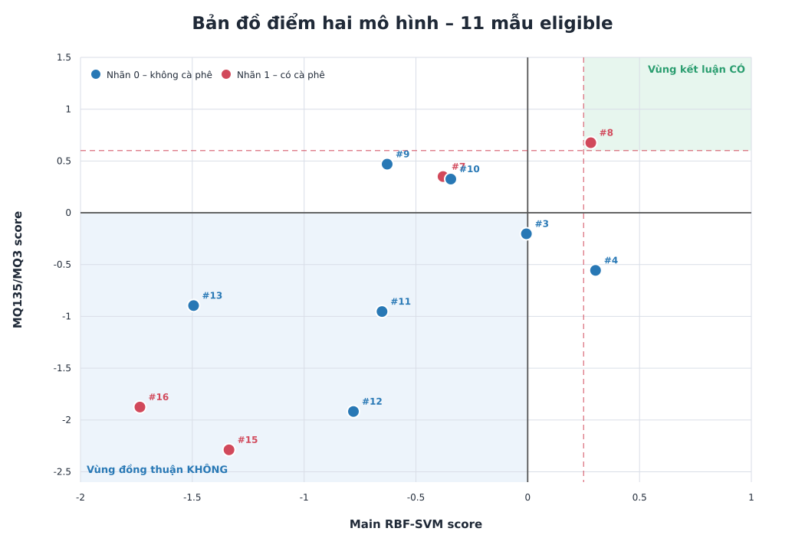
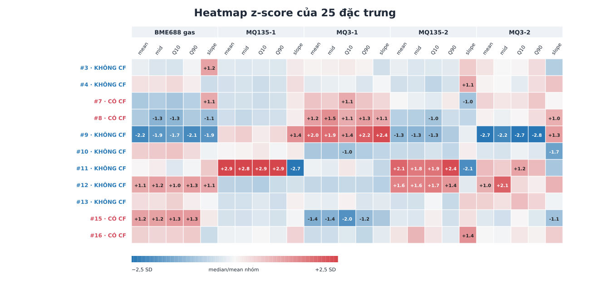
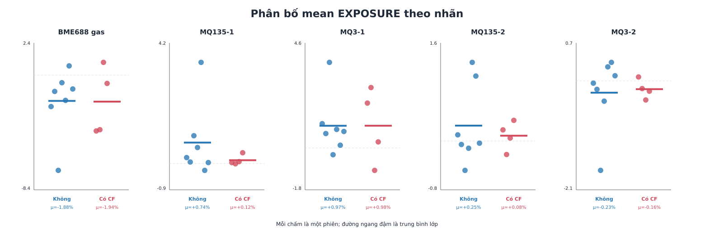
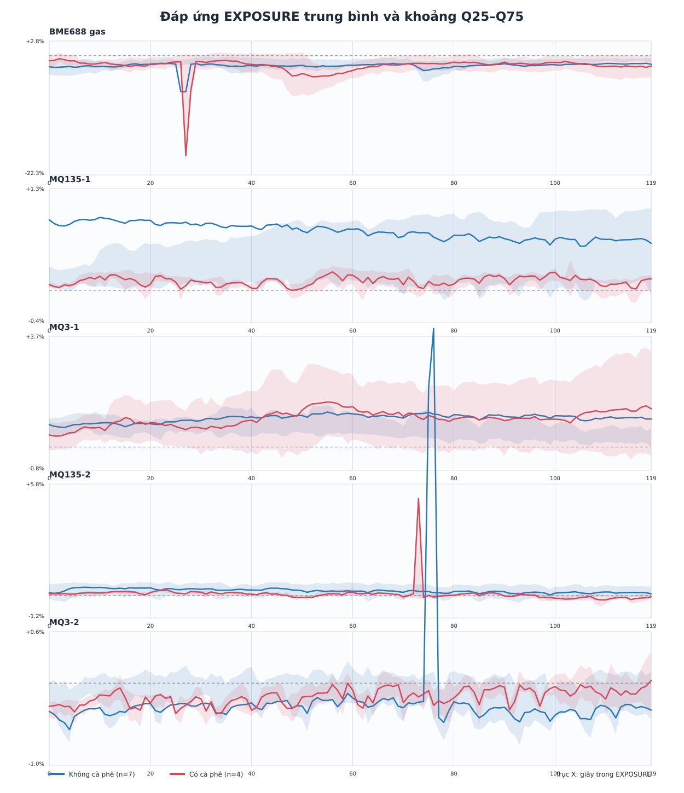
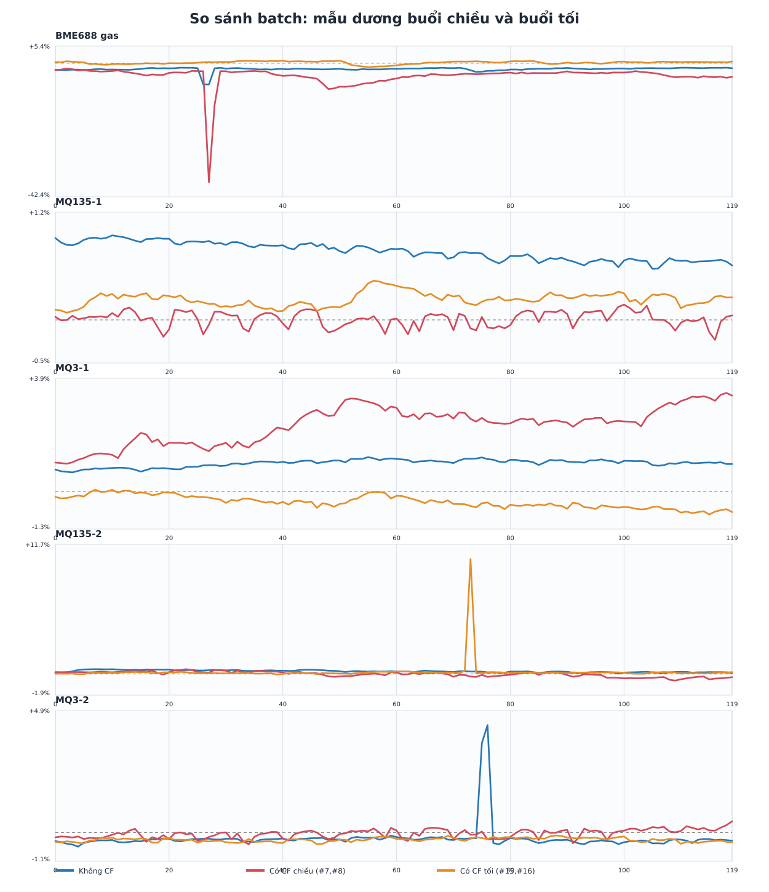
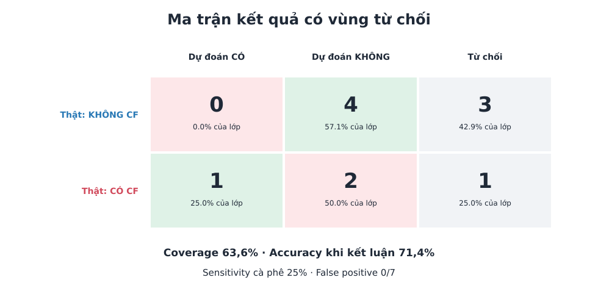
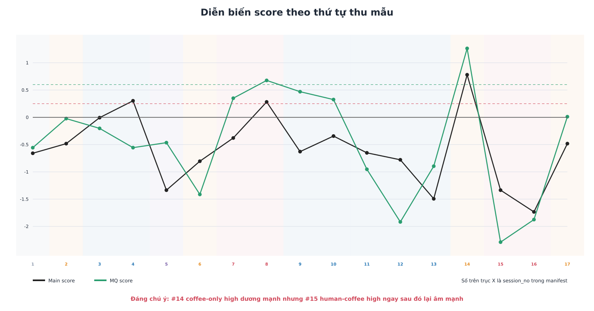
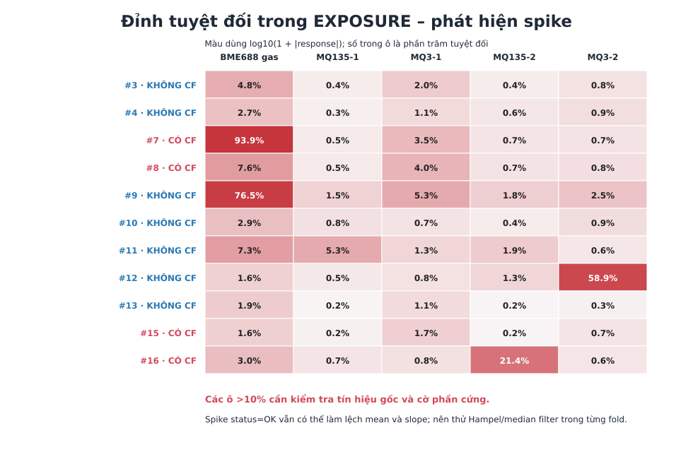

# Phân tích trực quan chi tiết dữ liệu cà phê ngày 2026-10-28

Bộ hình này tập trung vào 11 phiên `ELIGIBLE` có nhãn nhị phân và liên kết thêm các biểu đồ chất lượng/môi trường của toàn bộ 17 phiên.

## 1. Bản đồ điểm mô hình



Vùng trái-dưới là nơi cả hai mô hình cùng âm và được kết luận KHÔNG. Vùng phải-trên sau hai ngưỡng 0,25 và 0,60 được kết luận CÓ. Bốn mẫu còn từ chối nằm ở hai góc bất đồng. Mẫu dương #7 nằm cùng kiểu bất đồng với hai mẫu âm #9 và #10, nên không thể giải quyết an toàn chỉ bằng một ngưỡng score.

## 2. Heatmap 25 đặc trưng



Màu biểu diễn z-score theo từng cột feature. Hai mẫu dương buổi chiều (#7, #8) có cụm BME688 và MQ3-1 khác rõ hơn, trong khi hai mẫu dương buổi tối (#15, #16) không lặp lại cùng fingerprint.

## 3. Phân bố đáp ứng trung bình từng cảm biến



Các lớp chồng lấn ở cả năm kênh. Vì vậy không có một cảm biến đơn lẻ đủ tạo ranh giới ổn định. BME688 và MQ3-1 cung cấp tín hiệu hữu ích nhất ở một số phiên nhưng vẫn chịu batch effect.

## 4. Chuỗi thời gian theo lớp



Đường đậm là trung bình lớp; vùng mờ là Q25–Q75. Khoảng chồng lấn lớn cho thấy biến thiên giữa các phiên đang cùng cỡ hoặc lớn hơn khác biệt do cà phê.

## 5. So sánh mẫu dương chiều và tối



Đây là biểu đồ quan trọng nhất. Hai mẫu dương chiều (#7, #8) và hai mẫu dương tối (#15, #16) có hướng đáp ứng khác nhau trên nhiều kênh. Điều này giải thích vì sao mô hình nhận được #8 nhưng phân loại sai #15 và #16.

## 6. Ma trận kết quả có vùng từ chối



Mô hình không tạo false positive trên bảy mẫu âm, nhưng sensitivity dương chỉ đạt 25%. Accuracy 71,4% chỉ áp dụng trên bảy mẫu mà hệ thống dám kết luận; coverage là 63,6%.

## 7. Drift theo thứ tự thu mẫu



Score thay đổi mạnh giữa khối đo chiều và tối. Đặc biệt #14 coffee-only high được nhận dương mạnh, nhưng #15 human-coffee high ngay sau đó lại âm mạnh. Cần kiểm tra thao tác đưa mùi từ cà phê lên người, vị trí đầu hút, thời gian recovery và khả năng baseline còn carry-over.

## 8. Spike và ngoại lệ trong chuỗi



Bốn ngoại lệ nổi bật là BME688 #7 (`−93,9%` tại khoảng giây 27), BME688 #9 (`−76,5%` tại khoảng giây 26), MQ135-2 #16 (`+21,4%` tại khoảng giây 73) và MQ3-2 #12 (`+58,9%` tại khoảng giây 76). Các điểm này vẫn vượt quality gate vì cờ phần cứng hợp lệ, nhưng có thể làm lệch feature mean và slope. Đây là cơ sở để thử lọc Hampel, median filter hoặc winsorization; mọi tham số lọc phải được chọn trong train fold để tránh làm đẹp riêng tập test.

## 9. Biểu đồ chất lượng và môi trường đã có


PCA cũng cho thấy hai mẫu dương buổi tối chồng lên vùng âm. PCA chỉ mô tả phương sai và không chứng minh khả năng phân loại.

## Kết luận trực quan

1. Không có một feature hoặc cảm biến đơn lẻ tách sạch hai lớp.
2. Hai mẫu dương buổi chiều tạo tín hiệu BME688/MQ3-1 rõ hơn hai mẫu dương buổi tối.
3. Batch effect theo thời gian thu mẫu là rất mạnh.
4. Các mẫu `UNCERTAIN` thực sự nằm ở vùng hai mô hình bất đồng, không chỉ thiếu một chút ngưỡng.
5. Ưu tiên tiếp theo nên là chuẩn hóa quy trình đo và thu thêm positive độc lập ở nhiều ngày, thay vì tăng độ phức tạp mô hình ngay lập tức.

## Tái tạo biểu đồ

```powershell
python analysis\visualize_2026_10_28_coffee.py
```
