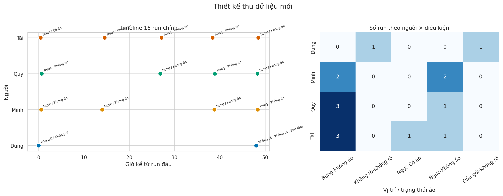
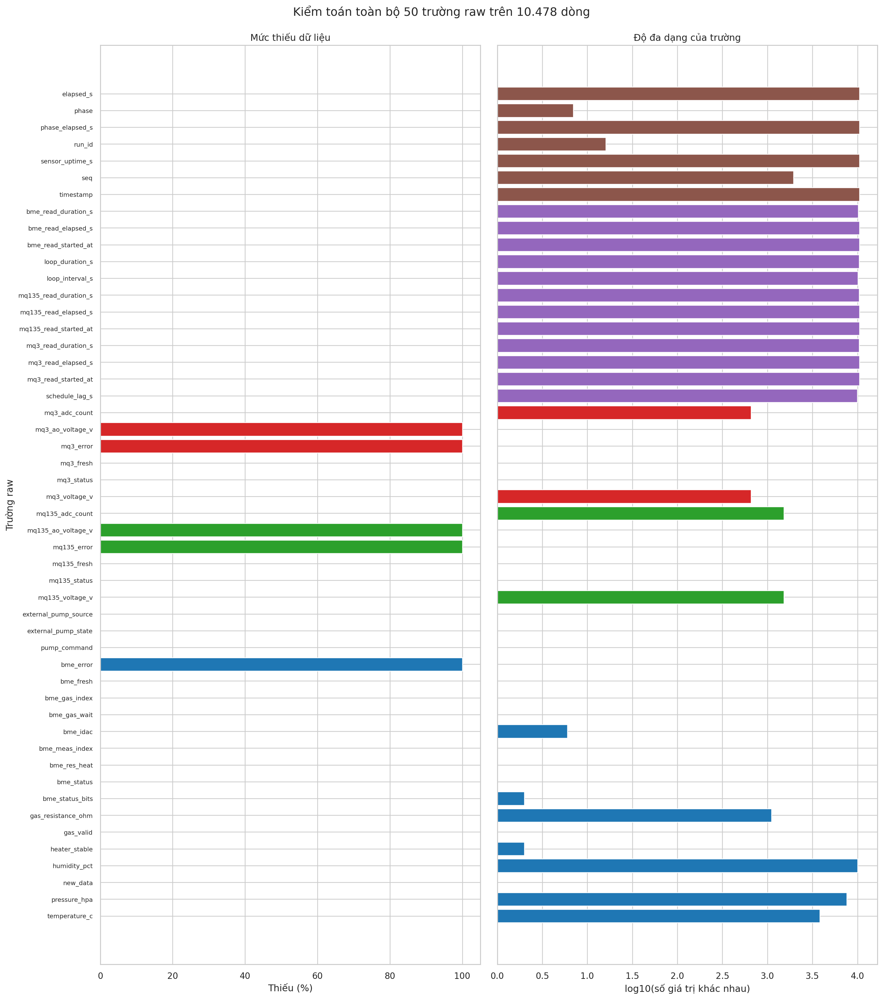
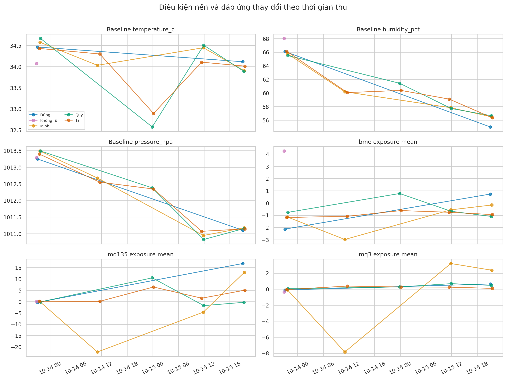
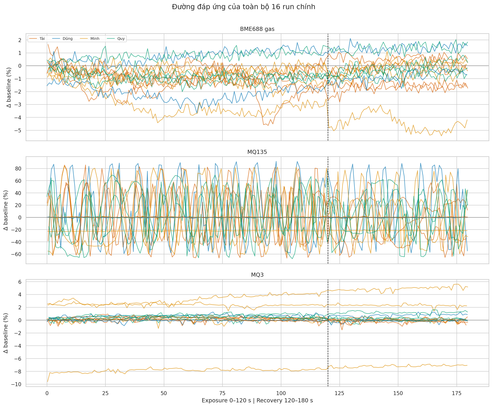
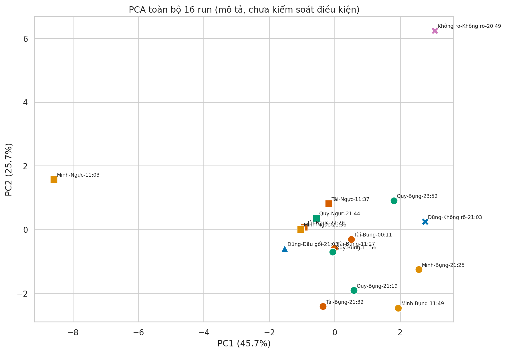
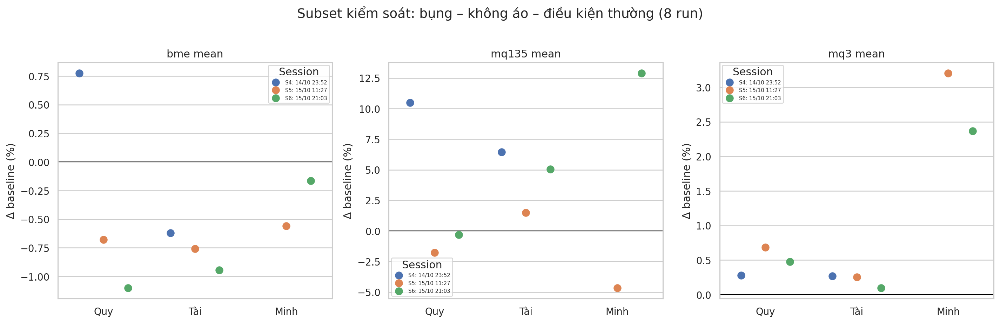
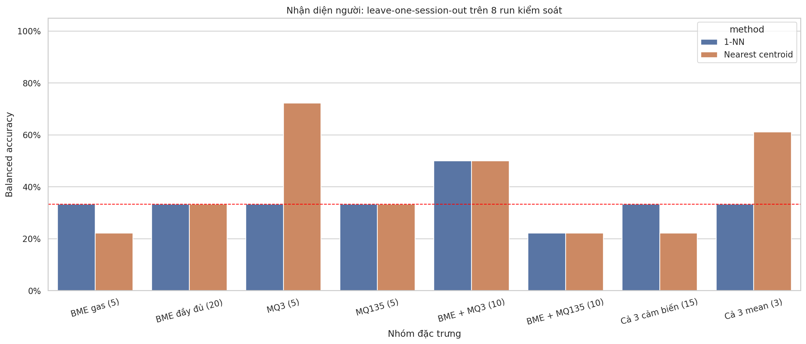

# Báo cáo kiểm định toàn bộ lô dữ liệu `chua_co_loc_khi_van_3_c`

## 1. Mục tiêu của báo cáo

Báo cáo này không chỉ thử phân loại người. Mục tiêu là tạo một bản kiểm định nền cho các đợt thu sau, gồm năm phần:

1. Phân tích toàn bộ 50 trường trong `raw.csv`, từ nhiệt độ, độ ẩm, áp suất đến timing và trạng thái đọc cảm biến.
2. Theo dõi sự biến đổi của từng người theo ngày, giờ, vị trí và điều kiện đo.
3. Chỉ ra phần dữ liệu sạch, phần thiếu có chủ đích, phần thiếu do cấu hình và phần chưa sạch về mặt thí nghiệm.
4. Đánh giá riêng BME688 là cảm biến chính và đánh giá khi kết hợp BME688, MQ135, MQ3.
5. Đúc kết lại pipeline thu thập, kiểm tra và phân tích mùi để những kết quả về sau có thể so sánh được.

Phần cứng chỉ được dùng để hiểu ý nghĩa trường dữ liệu. Đối tượng chính của báo cáo vẫn là dữ liệu đã thu.

---

## 2. Kết luận quan trọng nhất

Lô dữ liệu **sạch về mặt file, timing và tính liên tục**, nhưng **chưa sạch về nhãn thí nghiệm và độ ổn định của một số cảm biến**.

- Có 22 thư mục: 16 lần đo chính mang tên bằng chữ và 6 thư mục số là warm-up/phiên chạy.
- 100% dòng của 16 run chính đã xuất hiện trong file phiên tương ứng. Vì vậy, thư mục số không phải mẫu mới và không được đếm lần hai.
- Tổng cộng có 10.478 dòng raw. Mỗi run đều có đúng 60 mẫu baseline, 120 mẫu exposure và 60 mẫu recovery, tức 240 mẫu lõi/run và 3.840 mẫu lõi.
- Không có timestamp trùng, không có cặp `run_id + seq` trùng, không có ADC bão hòa và không có mẫu heater bất ổn trong ba pha lõi.
- Nhịp lấy mẫu 1 Hz tốt: loop interval lớn nhất 1,012 giây, loop duration lớn nhất 0,284 giây và schedule lag lớn nhất 0,015 giây.
- BME688 và MQ3 có baseline ổn định. MQ135 bị trôi mạnh: 8/16 run vượt ngưỡng drift và 10/16 run chưa hồi phục về nền.
- Dữ liệu định danh chưa được lưu đúng chỗ: `person_code`, `source`, `distance_cm`, `notes` đều trống ở 16/16 run. Người, vị trí và áo hiện chỉ được suy ra từ tên thư mục.
- Kết quả nhận diện theo phiên chưa thấy:
  - BME688 riêng: balanced accuracy cao nhất chỉ 33,3%.
  - Kết hợp cả ba cảm biến bằng 15 đặc trưng động học: cao nhất 33,3%.
  - Kết hợp ba giá trị mean: 61,1%.
  - Phân tích ablation cho thấy MQ3 riêng đạt 72,2% (6/8 run), nhưng số mẫu còn quá nhỏ và MQ3 có tương quan với môi trường nền.

**Kết luận hiện tại:** đã có tín hiệu hứa hẹn, đặc biệt ở MQ3, nhưng chưa đủ chứng cứ để khẳng định nhận diện người ổn định. MQ135 không nên được tin ngang BME688/MQ3 cho đến khi xử lý được drift và recovery.

---

## 3. Kiểm kê dữ liệu và thiết kế thí nghiệm

### 3.1. Quy ước đọc thư mục

- Thư mục mang tên chữ là lần đo chính, ví dụ `Tai_bung_khongao_...`.
- Thư mục chỉ có timestamp và UUID là warm-up/phiên phần cứng.
- Tên thư mục được tách thành người, vị trí, tình trạng áo và thời gian.
- `aDung_moitamxonggg_...` là mẫu sau tắm, không có vị trí.
- `hihi_...` không đủ thông tin để xác định người, vị trí và tình trạng áo.

### 3.2. Phân bố mẫu

| Người/nhãn | Số run | Điều kiện |
|---|---:|---|
| Tài | 5 | Ngực có áo, ngực không áo, bụng không áo × 3 |
| Minh | 4 | Ngực không áo × 2, bụng không áo × 2 |
| Quy | 4 | Ngực không áo, bụng không áo × 3 |
| Dũng | 2 | Đầu gối, sau tắm không ghi vị trí |
| `hihi` | 1 | Không rõ người/vị trí/áo |



**Cách đọc:** bên trái là thời điểm của từng run; bên phải là số mẫu theo người và điều kiện.

**Nhận xét:** thiết kế đang lệch. Chỉ nhóm Minh–Quy–Tài ở điều kiện bụng–không áo có đủ mẫu lặp để tạo subset tương đối kiểm soát. Dũng, `hihi`, mẫu có áo và mẫu sau tắm chỉ được dùng để mô tả, không dùng để kết luận nhận diện người.

---

## 4. Phân tích toàn bộ 50 trường raw

### 4.1. Cách sử dụng từng nhóm trường

| Nhóm | Số trường | Vai trò trong phân tích | Kết quả kiểm tra |
|---|---:|---|---|
| Định danh/thời gian | 7 | Sắp thứ tự, tách pha, tìm trùng lặp | Đầy đủ; không trùng timestamp hay `run_id + seq` |
| Timing đọc | 12 | Kiểm tra nhịp lấy mẫu và thời gian đọc | Ổn định; chỉ 6 `loop_interval_s` trống ở mẫu đầu phiên |
| Bơm | 3 | Xác định trạng thái hút/chuyển nguồn khí | Có dữ liệu nhưng toàn bộ là `DISABLED/unknown/not_reported` |
| BME688 | 16 | Gas, nhiệt độ, độ ẩm, áp suất và cờ chất lượng | Pha lõi hợp lệ; 6 mẫu MONITOR đầu phiên bị loại do heater chưa ổn định |
| MQ135 | 6 | Kênh điện áp/ADC bổ sung | Đọc đủ nhưng drift lớn; AO voltage không tính được |
| MQ3 | 6 | Kênh điện áp/ADC bổ sung | Đọc đủ, baseline ổn hơn MQ135; AO voltage không tính được |

Danh sách đầy đủ từng trường, kiểu dữ liệu, tỷ lệ thiếu, số giá trị khác nhau và khoảng giá trị nằm trong [`field_audit_all_50_fields.csv`](report_outputs/tables/field_audit_all_50_fields.csv).



**Phương pháp:** tính số dòng có dữ liệu, tỷ lệ thiếu và số giá trị khác nhau cho từng trường trên 10.478 dòng.

**Kết quả:**

- `bme_error`, `mq135_error`, `mq3_error` trống 100% là hợp lệ vì tất cả trạng thái đọc đều `OK`.
- `mq135_ao_voltage_v`, `mq3_ao_voltage_v` trống 100% là thiếu thật về cấu hình: hệ số chia áp chưa được xác nhận.
- `loop_interval_s` thiếu 6 dòng, tương ứng mẫu đầu của 6 phiên phần cứng; đây là thiếu có chủ đích vì chưa có mẫu trước để tính khoảng cách.
- Sáu giá trị gas resistance ở mẫu MONITOR đầu phiên bị loại khỏi dữ liệu phân tích vì `heater_stable=False`. Không có trường hợp này trong baseline, exposure hoặc recovery.
- ADC count và voltage của MQ là hai biểu diễn tuyến tính của cùng một phép đọc, không được coi là hai cảm biến độc lập.
- Nhiều cột trạng thái/hardware là cột hằng. Chúng hữu ích cho audit nhưng không được dùng làm đặc trưng nhận diện.

### 4.2. Khoảng giá trị quan sát được

| Trường chính | Toàn bộ raw | Trong ba pha lõi | Nhận xét |
|---|---:|---:|---|
| Nhiệt độ | 30,39–37,17°C | 32,53–34,86°C | Giá trị cực trị nằm ở MONITOR/warm-up |
| Độ ẩm | 53,26–77,10% | 54,84–68,09% | Thay đổi lớn giữa ngày/phiên |
| Áp suất | 1.010,72–1.015,45 hPa | 1.010,73–1.013,58 hPa | Có xu hướng giảm qua các ngày |
| BME gas resistance | 5.684–108.682 Ω | 78.769–108.682 Ω | Giá trị rất thấp chủ yếu ở lúc heater mới khởi động |
| MQ135 voltage | 0,0465–0,2866 V | 0,0476–0,2818 V | Không bão hòa ADC nhưng drift mạnh |
| MQ3 voltage | 0,2638–0,4090 V | 0,2638–0,4059 V | Không bão hòa ADC |

### 4.3. Timing và thao tác chuyển pha


**Phương pháp:** kiểm tra loop interval từng run và thời gian chờ giữa các lệnh `start`, `expose`, `recover`, `finish`.

**Kết quả:** phần lấy mẫu tự động rất ổn định, nhưng thao tác thủ công chưa đồng nhất:

- `WAIT_EXPOSURE`: 6,13–63,33 giây.
- `WAIT_RECOVERY`: 2,40–43,08 giây.
- `WAIT_FINISH`: 1,52–35,54 giây.
- Trạng thái bơm luôn `DISABLED`, external pump luôn `unknown`, không có phản hồi vật lý.

**Ý nghĩa:** dữ liệu phase có đủ 60–120–60 giây, nhưng thời điểm nguồn mùi thực sự được đưa vào hoặc lấy ra có thể lệch so với event được ghi. Đây là nguồn sai số thí nghiệm cần sửa, đặc biệt khi trích đặc trưng 10–20 giây đầu exposure.

---

## 5. Phân tích nhiệt độ, độ ẩm và áp suất



Baseline giữa các run thay đổi trong các khoảng:

- Nhiệt độ: 32,57–34,67°C.
- Độ ẩm: 55,01–68,02%.
- Áp suất: 1.010,83–1.013,49 hPa.

Trong exposure, so với baseline riêng từng run:

- Nhiệt độ trung bình thay đổi từ -0,113 đến +0,255°C; trung vị +0,086°C.
- Độ ẩm thay đổi từ -0,397 đến +0,939 điểm phần trăm; trung vị +0,210.
- Áp suất thay đổi từ -0,054 đến +0,027 hPa; trung vị -0,012 hPa.


**Ý nghĩa:** nguồn khí/mẫu không chỉ mang thành phần mùi mà còn làm thay đổi nhiệt độ và độ ẩm. Các biến này phải được theo dõi như biến gây nhiễu hoặc dùng để hiệu chỉnh, không nên đưa thẳng giá trị nền tuyệt đối vào mô hình nhận diện người.


Tương quan Spearman trên 16 run cho thấy:

- MQ3 mean tương quan với độ ẩm nền khoảng **-0,72** và áp suất nền khoảng **-0,74**.
- BME gas mean và MQ135 mean tương quan khoảng **+0,51**.
- Độ ẩm và áp suất nền tương quan khoảng **+0,80**, phản ánh hiệu ứng ngày/phiên.

Các hệ số này chỉ mang tính mô tả vì n=16. Tuy nhiên, chúng cảnh báo rằng kết quả tốt của MQ3 có thể chứa cả thông tin người lẫn thông tin môi trường/ngày đo.

---

## 6. Chất lượng tín hiệu của ba cảm biến

### 6.1. Đường đáp ứng



Các đường được chuẩn hóa theo trung vị baseline riêng của run. BME688 và MQ3 có biên độ gọn hơn; MQ135 dao động lớn và nhiều run không về lại 0% sau recovery.

### 6.2. Đáp ứng và recovery từng run


| Tín hiệu | Min mean exposure | Trung vị | Max mean exposure |
|---|---:|---:|---:|
| BME688 gas | -2,98% | -0,76% | +4,25% |
| MQ135 | -22,26% | +0,09% | +16,82% |
| MQ3 | -7,85% | +0,26% | +3,20% |

Biên độ MQ135 lớn nhất nhưng không đồng nghĩa nhiều thông tin mùi nhất; phần lớn biên độ đi kèm baseline drift và recovery kém.

### 6.3. Baseline và recovery


| Cảm biến | Baseline CV nhỏ nhất | Trung vị | Lớn nhất | Đánh giá |
|---|---:|---:|---:|---|
| BME688 | 0,21% | 0,33% | 0,86% | Ổn định |
| MQ135 | 0,38% | 25,87% | 47,16% | Không ổn định ở nhiều phiên |
| MQ3 | 0,10% | 0,19% | 0,35% | Ổn định |

Metadata báo baseline chung ổn định vì tiêu chí hiện chủ yếu kiểm tra BME gas, nhiệt độ và độ ẩm. Điều đó không đảm bảo MQ135 ổn định. Quality gate phải được tính riêng cho từng cảm biến.

### 6.4. PCA toàn bộ 16 run



PC1 và PC2 giải thích 71,4% phương sai, nhưng các điểm không gom thành cụm rõ theo người. Mẫu `hihi`, vị trí đo, ngày đo và các run có MQ135 bất thường ảnh hưởng mạnh đến cấu trúc PCA. PCA toàn bộ chỉ dùng để phát hiện outlier, không dùng làm bằng chứng nhận diện người.

---

## 7. Biến đổi của từng người theo ngày

### 7.1. Môi trường nền của từng người


Biểu đồ tách từng người thành một hàng, theo đúng thứ tự ngày–giờ–vị trí. Có thể thấy giá trị của các người trong cùng phiên gần nhau hơn so với cùng một người ở hai ngày khác nhau. Đây là dấu hiệu rõ của hiệu ứng phiên/ngày.

### 7.2. Đáp ứng cảm biến của từng người


Các giá trị dưới đây là mean exposure sau khi chuẩn hóa baseline từng run:

| Người | Ngày giờ | Vị trí/điều kiện | BME | MQ135 | MQ3 |
|---|---|---|---:|---:|---:|
| Dũng | 13/10 21:03 | Đầu gối | -2,13% | -0,35% | -0,11% |
| Dũng | 15/10 21:03 | Sau tắm, không rõ vị trí | +0,73% | +16,82% | +0,65% |
| Minh | 13/10 21:36 | Ngực, không áo | -1,14% | -0,04% | -0,08% |
| Minh | 14/10 11:03 | Ngực, không áo | -2,98% | -22,26% | -7,85% |
| Minh | 15/10 11:49 | Bụng, không áo | -0,56% | -4,65% | +3,20% |
| Minh | 15/10 21:25 | Bụng, không áo | -0,17% | +12,90% | +2,37% |
| Quy | 13/10 21:44 | Ngực, không áo | -0,76% | -0,14% | +0,05% |
| Quy | 14/10 23:52 | Bụng, không áo | +0,78% | +10,48% | +0,28% |
| Quy | 15/10 11:56 | Bụng, không áo | -0,68% | -1,77% | +0,69% |
| Quy | 15/10 21:19 | Bụng, không áo | -1,10% | -0,32% | +0,48% |
| Tài | 13/10 21:29 | Ngực, có áo | -1,18% | +0,17% | -0,05% |
| Tài | 14/10 11:37 | Ngực, không áo | -1,09% | +0,13% | +0,38% |
| Tài | 15/10 00:11 | Bụng, không áo | -0,62% | +6,44% | +0,27% |
| Tài | 15/10 11:27 | Bụng, không áo | -0,76% | +1,50% | +0,25% |
| Tài | 15/10 21:32 | Bụng, không áo | -0,95% | +5,04% | +0,10% |

### 7.3. Nhận xét theo từng người

**Dũng:** hai run khác cả vị trí lẫn trạng thái sau tắm, do đó không thể dùng để đo độ lặp lại cá nhân. MQ135 +16,82% ở mẫu sau tắm không đáng tin để kết luận vì baseline CV của MQ135 run đó là 47,16%.

**Minh:** hai run ngực cùng trạng thái áo ở 13–14/10 khác nhau rất mạnh trên cả ba kênh, cho thấy hiệu ứng ngày/phiên hoặc trạng thái cảm biến lớn. Trong hai run bụng ngày 15/10, MQ3 vẫn duy trì cao 2,37–3,20%, BME tương đối gần nhau, còn MQ135 đổi dấu từ -4,65% sang +12,90%.

**Quy:** ba run bụng có MQ3 nằm trong khoảng 0,28–0,69%, tương đối lặp lại. BME thay đổi từ +0,78% xuống -1,10%; MQ135 đổi từ +10,48% xuống gần 0, tiếp tục cho thấy ảnh hưởng phiên.

**Tài:** ba run bụng lặp lại tốt nhất trên BME (-0,62 đến -0,95%) và MQ3 (+0,10 đến +0,27%). MQ135 luôn dương nhưng biên độ thay đổi 1,50–6,44%.

**Nhận xét chung:** trong điều kiện bụng–không áo, MQ3 đang cho thứ tự khá nhất quán: Minh cao, Quy ở giữa, Tài thấp. Đây là tín hiệu hứa hẹn nhất của lô hiện tại, nhưng cần lặp lại qua nhiều ngày với môi trường cân bằng trước khi coi là fingerprint cá nhân.

---

## 8. Đánh giá trên subset kiểm soát

Subset gồm 8 run bụng–không áo–điều kiện thường: Minh 2, Quy 3, Tài 3, thuộc ba phiên S4–S6.




PCA subset giải thích 67,2% phương sai trên hai trục đầu nhưng các điểm cùng người chưa tạo cụm kín.


- Trung vị khoảng cách cùng người: 5,12.
- Trung vị khoảng cách khác người: 5,71.
- Khác người chỉ xa hơn cùng người khoảng 11,6%; hai phân bố còn chồng lấn mạnh.

Phép kiểm tra mô hình dùng leave-one-session-out: giữ toàn bộ một phiên làm test, chỉ fit scaler, median và tâm lớp trên các phiên còn lại. Cách này khó hơn nhưng đúng với mục tiêu dự đoán một phiên/ngày chưa từng thấy.

### 8.1. Bảng A – Chỉ dùng cảm biến chính BME688

`BME gas (5)` gồm mean, late-20-second mean, min, max và slope của gas resistance. `BME đầy đủ (20)` thêm năm đặc trưng biến đổi cho mỗi kênh nhiệt độ, độ ẩm và áp suất.

| Bộ đặc trưng | Mô hình | Đúng | Accuracy | Balanced accuracy | Macro-F1 |
|---|---|---:|---:|---:|---:|
| BME gas (5) | 1-NN | 3/8 | 37,5% | 33,3% | 30,0% |
| BME gas (5) | Nearest centroid | 2/8 | 25,0% | 22,2% | 22,2% |
| BME đầy đủ (20) | 1-NN | 3/8 | 37,5% | 33,3% | 36,2% |
| BME đầy đủ (20) | Nearest centroid | 3/8 | 37,5% | 33,3% | 37,8% |

**Kết luận bảng A:** với dữ liệu hiện tại, BME688 riêng chưa tổng quát được danh tính sang phiên mới. Thêm nhiệt độ/độ ẩm/áp suất không tăng balanced accuracy, cho thấy các kênh môi trường chưa tạo được fingerprint người độc lập.

### 8.2. Bảng B – Kết hợp cả ba cảm biến

| Bộ đặc trưng | Mô hình | Đúng | Accuracy | Balanced accuracy | Macro-F1 |
|---|---|---:|---:|---:|---:|
| 15 đặc trưng động học | 1-NN | 3/8 | 37,5% | 33,3% | 20,0% |
| 15 đặc trưng động học | Nearest centroid | 2/8 | 25,0% | 22,2% | 16,7% |
| Chỉ ba mean exposure | 1-NN | 3/8 | 37,5% | 33,3% | 30,2% |
| **Chỉ ba mean exposure** | **Nearest centroid** | **5/8** | **62,5%** | **61,1%** | **58,6%** |

**Kết luận bảng B:** ghép càng nhiều đặc trưng không làm kết quả tốt hơn. Bộ ba mean đơn giản tốt hơn 15 đặc trưng, cho thấy dữ liệu còn quá ít để học hình dạng động học phức tạp và các đặc trưng MQ135 đang đưa thêm nhiễu.

### 8.3. Ablation để đánh giá cảm biến yếu

- MQ3 riêng + nearest centroid: **6/8**, balanced accuracy **72,2%**.
- MQ135 riêng: **3/8**, balanced accuracy **33,3%**, ngang mức ngẫu nhiên ba lớp.
- BME + MQ3: **4/8**, balanced accuracy **50,0%**.
- BME + MQ135: chỉ **2/8**, balanced accuracy **22,2%**.

Kết quả này cho thấy MQ3 đóng góp rõ nhất trong lô hiện tại, còn MQ135 làm giảm độ ổn định khi dùng đặc trưng động học. Tuy nhiên, không được chọn MQ3 làm “mô hình thắng” chỉ từ 8 run; MQ3 còn tương quan với môi trường và Minh chỉ có hai mẫu.




Mô hình MQ3 tốt nhất nhận đúng Tài 3/3, Quy 2/3 và Minh 1/2. Hai lỗi xảy ra ở Quy phiên S4 và Minh phiên S6. Đây là kết quả thăm dò, chưa phải độ chính xác cuối.

---

## 9. Những mẫu không đủ điều kiện kết luận


- `hihi`: dùng để kiểm tra hệ thống và outlier, không dùng cho bài toán người vì thiếu nhãn.
- Dũng–đầu gối và Dũng–sau tắm: không phải cặp đối chứng vì khác vị trí, ngày và trạng thái.
- Tài–có áo: chỉ có một mẫu và không có mẫu không áo được thu cặp ngay cùng phiên.
- Các run ngực và bụng không nên gộp để học người nếu mô hình chưa được kiểm soát vị trí.

---

## 10. Dữ liệu đang chưa sạch hoặc thiếu ở đâu?

### 10.1. Phần đạt yêu cầu

- File đầy đủ, đọc được và đúng cấu trúc.
- Mỗi run có đủ ba pha lõi.
- Timestamp, sequence và timing tốt.
- Trạng thái đọc của ba cảm biến đều `OK`; không bão hòa ADC.
- BME688 và MQ3 có baseline ổn định.

### 10.2. Thiếu có chủ đích, không phải lỗi

- Ba cột `*_error` trống vì không có lỗi đọc.
- Sáu `loop_interval_s` trống ở mẫu đầu phiên.
- Sáu mẫu BME gas MONITOR đầu phiên bị loại vì heater chưa ổn định; pha lõi không bị ảnh hưởng.

### 10.3. Thiếu do cấu hình/hardware

- `mq135_ao_voltage_v` và `mq3_ao_voltage_v` trống vì chưa xác nhận voltage-divider factor.
- Không thể chuyển điện áp ADS1115 thành điện áp AO thực hoặc nồng độ. Hiện chỉ nên dùng như tín hiệu tương đối.
- Bơm GPIO bị tắt và không có feedback; không xác nhận được thời điểm dòng khí thực sự đổi nguồn.
- BME688 đang dùng một heater setting cố định (`res_heat`, `gas_wait` hầu như hằng), chưa có heater profile nhiều mức như định hướng phần cứng.

### 10.4. Thiếu về nhãn và quy trình thí nghiệm

- `person_code`, `source`, `distance_cm`, `notes` trống 16/16 run.
- Vị trí, áo và điều kiện sau tắm chỉ tồn tại trong tên thư mục, dễ sai chính tả và khó parse.
- `hihi` không thể khôi phục nhãn từ metadata.
- Số mẫu giữa người và điều kiện không cân bằng.
- Chưa có blank/khí phòng được lưu thành một sample ID riêng trước và sau từng run.
- Thứ tự người, thời gian từ lần tắm/vận động, mỹ phẩm và khoảng cách đầu lấy mẫu chưa được ghi có cấu trúc.
- Recovery 60 giây là cố định dù MQ135 ở 10/16 run chưa về nền.

### 10.5. Quy tắc sử dụng lô hiện tại

- Toàn bộ 16 run: dùng cho QC, mô tả cảm biến và phát hiện lỗi pipeline.
- `hihi`: loại khỏi mọi phân tích có nhãn.
- Dũng, mẫu có áo, mẫu sau tắm: chỉ mô tả hoặc dùng khi đã có cặp đối chứng tương ứng.
- Tám run bụng–không áo: chỉ dùng cho đánh giá nhận diện thăm dò.
- Với MQ135: gắn cờ chất lượng theo từng run; không loại cả run nếu BME/MQ3 vẫn tốt, nhưng loại đặc trưng MQ135 khi baseline hoặc recovery không đạt.

---

## 11. Pipeline thu thập mùi đề xuất

### Giai đoạn A – Tạo phiên và warm-up

1. Tạo `session_id`, ghi người vận hành, ngày giờ, cấu hình phần cứng và phiên bản chương trình.
2. Warm-up cả ba cảm biến; không dùng thời gian cố định làm tiêu chí duy nhất.
3. Chỉ cho phép bắt đầu run khi từng cảm biến đạt quality gate baseline riêng.
4. Ghi một run blank/khí phòng đầu phiên để theo dõi drift giữa các phiên.

### Giai đoạn B – Ghi nhãn mẫu trước khi đo

Không chỉ đặt tên thư mục. Các trường sau phải nằm trong `metadata.json` và không được để trống:

- `person_code`, `sample_id`, `replicate_id`.
- `location`, `clothing`, `condition`.
- `distance_cm`, tư thế và thời lượng giữ đầu lấy mẫu.
- Có/không vừa tắm, thời gian từ lúc tắm, loại xà phòng/nước hoa/mỹ phẩm.
- Thời gian từ vận động, ăn uống hoặc uống rượu/bia nếu có liên quan.
- `session_id`, thứ tự mẫu trong phiên và người vận hành.

Tên thư mục chỉ là bản sao dễ đọc; metadata mới là nguồn nhãn chính.

### Giai đoạn C – Chuẩn hóa điều kiện thu

1. Chọn một vị trí chuẩn cho bài toán nhận diện người; không trộn ngực, bụng và đầu gối trong mô hình ban đầu.
2. Giữ khoảng cách, buồng, nắp, ống và hướng khí giống nhau.
3. Thu mỗi người nhiều lần trong cùng ngày và lặp lại qua nhiều ngày.
4. Xáo trộn thứ tự người trong mỗi phiên để người không bị gắn với thời gian hoặc drift cảm biến.
5. Với nghiên cứu áo/sau tắm, thiết kế cặp đối chứng cùng người–cùng vị trí–cùng phiên và chỉ thay một yếu tố.

### Giai đoạn D – Baseline

1. Thu baseline tối thiểu 60 giây.
2. Kiểm tra riêng từng cảm biến:
   - tỷ lệ giá trị hợp lệ;
   - baseline CV;
   - slope và range;
   - heater/fresh/status;
   - ADC saturation.
3. Ngưỡng khởi đầu đề xuất từ lô hiện tại:
   - BME688 CV ≤ 1%;
   - MQ3 CV ≤ 1%;
   - MQ135 CV hoặc drift ≤ 5%;
   - dữ liệu hợp lệ ≥ 95%;
   - không có gap > 3 giây.
4. Nếu không đạt, tiếp tục warm-up/purge và không ghi run chính.

Các ngưỡng trên là quality gate thực dụng ban đầu, cần hiệu chỉnh khi có nhiều dữ liệu hơn.

### Giai đoạn E – Exposure

1. Đồng bộ event `expose` với thời điểm nguồn khí thực sự đổi, tốt nhất bằng van/bơm có feedback.
2. Nếu vẫn thao tác tay, bấm event ngay tại thời điểm đổi nguồn và ghi operator delay.
3. Giữ exposure 120 giây cho các run so sánh trực tiếp.
4. Không đổi khoảng cách hoặc vị trí đầu lấy mẫu trong khi đo.

### Giai đoạn F – Recovery và blank

1. Chuyển về khí phòng/blank và ghi event đúng thời điểm.
2. Không dừng recovery chỉ vì đã đủ 60 giây. Tiếp tục cho tới khi từng cảm biến về trong ngưỡng, ví dụ ±5–10% baseline trong một cửa sổ liên tục.
3. Nếu MQ135 không hồi phục, đánh dấu run MQ135 không đạt và tiếp tục purge trước mẫu sau.
4. Thu blank giữa các người để phát hiện carry-over.

### Giai đoạn G – Quy mô dữ liệu

Cho giai đoạn khả thi tiếp theo:

- Ít nhất 10–20 run/người.
- Ít nhất 5 ngày khác nhau.
- Mỗi ngày có tối thiểu 2 run/người ở cùng điều kiện chuẩn.
- Mỗi phiên có đủ tất cả người cần so sánh và có blank đầu/cuối phiên.

---

## 12. Pipeline làm sạch và phân tích sau khi thu

1. **Inventory:** kiểm tra đủ file, schema version và cấu hình.
2. **Phân loại thư mục:** tách run chính khỏi warm-up/session.
3. **Chống đếm trùng:** không coi raw của thư mục phiên và raw của run chính là hai mẫu.
4. **Kiểm tra nhãn:** từ chối phân tích có giám sát nếu thiếu `person_code`, vị trí hoặc điều kiện.
5. **Kiểm tra hàng:** status, fresh, heater, new-data, timing gap và ADC saturation.
6. **Tách pha:** chỉ dùng baseline/exposure/recovery; MONITOR dùng cho warm-up QC.
7. **Quality gate từng cảm biến:** một cảm biến lỗi không bắt buộc làm mất toàn bộ run.
8. **Chuẩn hóa baseline:** dùng median baseline riêng của run và lưu cả giá trị tuyệt đối lẫn phần trăm thay đổi.
9. **Trích đặc trưng:** mean, early/late response, min, max, slope, AUC, recovery; đồng thời lưu delta nhiệt độ/độ ẩm/áp suất.
10. **Hai nhánh đánh giá:**
    - nhánh A: BME688 chính;
    - nhánh B: fusion BME688 + MQ135 + MQ3;
    - luôn chạy ablation từng cảm biến để biết cảm biến nào thực sự đóng góp.
11. **Chia dữ liệu:** chia theo ngày/phiên/người đo, không chia ngẫu nhiên từng dòng thời gian.
12. **Báo cáo:** confusion matrix, balanced accuracy, macro-F1, khoảng cách cùng/khác người, số mẫu và khoảng tin cậy.

Không được coi 240 dòng của một run là 240 mẫu độc lập. Đơn vị mẫu của bài toán nhận diện là **một run hoàn chỉnh**.

---

## 13. Kết luận dùng cho các bước tiếp theo

1. Hệ thống thu dữ liệu ổn định về timing và cấu trúc; chưa cần ưu tiên sửa phần ghi file.
2. Việc cần sửa ngay là metadata, đồng bộ chuyển nguồn khí, recovery thích ứng và quality gate riêng từng cảm biến.
3. BME688 là cảm biến chính ổn định nhưng một mình chưa phân biệt được người trên phiên mới.
4. MQ3 là cảm biến hứa hẹn nhất trong lô này, cần được kiểm chứng bằng nhiều ngày và môi trường cân bằng.
5. MQ135 hiện là kênh thử nghiệm: baseline drift cao, recovery kém và làm giảm kết quả ở nhiều bộ đặc trưng. Chỉ sử dụng khi run đạt QC riêng.
6. Không nên tăng độ phức tạp mô hình lúc này. Ưu tiên tăng số run lặp, cân bằng thiết kế và giảm confounding; sau đó mới đánh giá mô hình nâng cao.
7. Mốc 62,5% hoặc 72,2% hiện tại chỉ là kết quả thăm dò trên 8 run, không phải độ chính xác vận hành.

---

## 14. Tệp kết quả

- Script tái tạo: [`../../analysis/analyze_new_batch.py`](../../analysis/analyze_new_batch.py)
- Tóm tắt: [`report_outputs/summary.json`](report_outputs/summary.json)
- Audit toàn bộ trường: [`report_outputs/tables/field_audit_all_50_fields.csv`](report_outputs/tables/field_audit_all_50_fields.csv)
- Audit metadata: [`report_outputs/tables/metadata_audit.csv`](report_outputs/tables/metadata_audit.csv)
- Audit từng run: [`report_outputs/tables/run_audit.csv`](report_outputs/tables/run_audit.csv)
- Biến đổi người/ngày: [`report_outputs/tables/person_day_changes.csv`](report_outputs/tables/person_day_changes.csv)
- Bảng BME688: [`report_outputs/tables/model_table_main_bme688.csv`](report_outputs/tables/model_table_main_bme688.csv)
- Bảng ba cảm biến: [`report_outputs/tables/model_table_all_3_sensors.csv`](report_outputs/tables/model_table_all_3_sensors.csv)
- Ablation cảm biến: [`report_outputs/tables/sensor_ablation_scores.csv`](report_outputs/tables/sensor_ablation_scores.csv)
- Dự đoán từng run: [`report_outputs/tables/controlled_predictions.csv`](report_outputs/tables/controlled_predictions.csv)

Chạy lại từ thư mục gốc dự án:

```powershell
& 'C:\Users\ADMIN\AppData\Local\Programs\Python\Python311\python.exe' 'analysis\analyze_new_batch.py'
```
