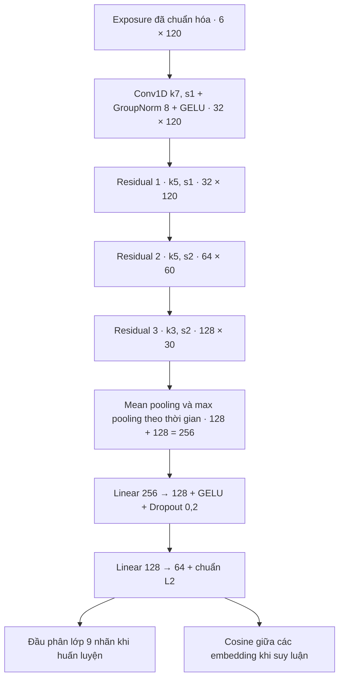

# Tiền xử lý và kiến trúc ResCNN64 gốc

Tài liệu này mô tả đường suy luận của artifact `rescnn64:20261119_053351_6b8717`. Báo cáo tổng hợp ở [thư mục gốc](../BAO_CAO_AI_ROBONOSE.md). Bộ hiệu chỉnh dùng toàn bộ baseline được mô tả trong [báo cáo V2](../models_v2/BAO_CAO_KY_THUAT_V2.md).

## 1. Đầu vào và cách loại mẫu không tương thích

Một lượt đo cung cấp `metadata.json` và `raw.csv`. Host tra lượt theo UUID trong các thư mục dữ liệu đã cấu hình. Mã tiền xử lý kiểm tra trạng thái `COMPLETE`, schema `robonose.dataset.v1`, `trial_id`, `session_id` và `started_at`. Thông số quan trọng được đối chiếu với artifact.

| Điều kiện kiểm tra | Quy tắc đang dùng |
| --- | --- |
| Tương thích phần cứng | 1 Hz, PWM 80%, ADS1115 có LSB 0,0001875 V/count và hệ số chia 1. Map A0–A3 lần lượt là TGS2602, MQ3 #1, MQ135 #2, MQ3 #2. Profile BME là `s3_bringup_300_100_t2h2p4.v1`, 300 °C/100 ms, oversampling T2/H2/P4. |
| Pha dùng làm đầu vào | Đúng 60 dòng `BASELINE` và 120 dòng `EXPOSURE`. Trong mỗi pha, khoảng cách hai mốc `mono_s` liên tiếp phải lệch 1 giây tối đa 0,1 giây. Timestamp monotonic của toàn bộ CSV phải hữu hạn và tăng nghiêm ngặt. |
| Giá trị và cờ dữ liệu | Yêu cầu số hữu hạn, trạng thái `OK`, cờ `fresh` và `valid` đúng. Kênh gas cần thêm `gas_valid`, `heater_stable` và `new_data`. Bốn điện áp và điện trở gas phải dương, độ ẩm nằm trong 0–100% RH. |
| Tín hiệu hỏng | Từ chối lượt nếu thiếu điểm hợp lệ, sai cấu hình hoặc một trong năm kênh mùi đứng yên suốt exposure. Không điền 0, nội suy điểm thiếu hoặc loại đỉnh theo heuristic để ép đủ 120 điểm. |
| Cảnh báo chất lượng | Với năm kênh mùi, lấy giá trị lớn hơn giữa độ trôi ước lượng theo phút và biên độ đỉnh–đỉnh ở 30 giây cuối, quy về phần trăm trung vị. Nếu vượt 5%, artifact hiện tại ghi cảnh báo vì `baseline_warn=true`. Khi có ít nhất 24 dòng baseline/chờ ngay trước exposure, kiểm tra thêm độ trôi và chênh mức nền. Cờ đo cắt qua chuyển pha trong exposure cũng tạo cảnh báo. |

Raw chứa cả ADC count, điện áp và tín hiệu môi trường. CNN lấy **điện áp đã ghi**, điện trở gas và độ ẩm. Nhiệt độ, áp suất, `WAIT_*` và `RECOVERY` nằm ngoài tensor đầu vào. [Kiểm tra cấu hình](../robonose_s3/rescnn64.py#L87) · [Cờ hợp lệ](../robonose_s3/signals.py#L46) · [Artifact](rescnn64/20261119_053351_6b8717/artifact.json)

## 2. Từ mẫu thời gian đến tensor 6 × 120

1. Tách `B[6,60]` và `E[6,120]` theo pha. Thứ tự kênh cố định là **A0, A1, A2, A3, BME688 gas, BME688 RH**.
2. Với kênh `c`, lấy `b[c] = median(B[c,30:60])`, dùng chỉ số bắt đầu từ 0. Trung vị tạo mốc ít nhạy với vài điểm cực trị của baseline.
3. Tại mỗi thời điểm exposure `t`, tính `d[c,t] = E[c,t] − b[c]` với điện áp và độ ẩm. Với điện trở gas, tính `d[gas,t] = ln(E[gas,t] / b[gas])`.
4. Tính `X[c,t] = (d[c,t] − center[c]) / scale[c]` bằng các tham số đã lưu trong `model.json`. Bộ chuẩn hóa này không fit lại theo mẫu đang chấm.
5. Chuyển tensor sang `float32` và thêm chiều batch, tạo đầu vào `[1,6,120]`. Mỗi bước xử lý diễn ra trong bộ nhớ. `raw.csv` giữ nguyên.

**Ví dụ trên kênh MQ3 #2 A3.** Ở lượt có UUID bắt đầu bằng `0e3e2d1a`, trung vị 30 điểm cuối là **0,60675 V** và exposure đầu là **0,61200 V**. Hiệu là **0,00525 V**. Với `center = 0,00815625` và `scale = 0,012984375` của A3, giá trị CNN nhận tại thời điểm đó xấp xỉ **−0,22383**. Giá trị có dấu âm do phép chuẩn hóa theo artifact. [Mã tiền xử lý](../robonose_s3/rescnn64.py#L117) · [Tham số chuẩn hóa](rescnn64/20261119_053351_6b8717/model.json)

## 3. Sơ đồ ResCNN64

Trong hình, kích thước tensor bỏ chiều batch. `k` là kích thước kernel và `s` là stride.

Mỗi khối residual có hai Conv1D. Conv đầu dùng stride của khối, sau đó GroupNorm và GELU. Conv thứ hai dùng stride 1 và GroupNorm. Nhánh skip dùng identity khi giữ kích thước, hoặc Conv1D kernel 1 khi đổi kênh hay stride. Sau khi cộng hai nhánh, áp dụng GELU. Mạng có **168.960 tham số**, gồm đầu phân lớp 9 nhãn. Dropout tắt ở chế độ đánh giá.

Model đã huấn luyện trên **77 lượt thuộc 9 nhãn**, theo báo cáo artifact. Mục 03 lấy cosine giữa truy vấn và kho embedding, bỏ bản trùng UUID hoặc raw hash, rồi giữ lượt có điểm cao nhất cho từng nhãn. Mục 04 xếp hạng từng lượt do người dùng chọn. Với hai embedding đã chuẩn L2, cosine là tích vô hướng. Cấu hình hiện tại chưa có ngưỡng Unknown đã hiệu chuẩn, nên thứ hạng dùng để tham khảo. [Kiến trúc PyTorch](../robonose_s3/rescnn64.py#L217) · [Báo cáo huấn luyện gốc](rescnn64/20261119_053351_6b8717/report.json)
