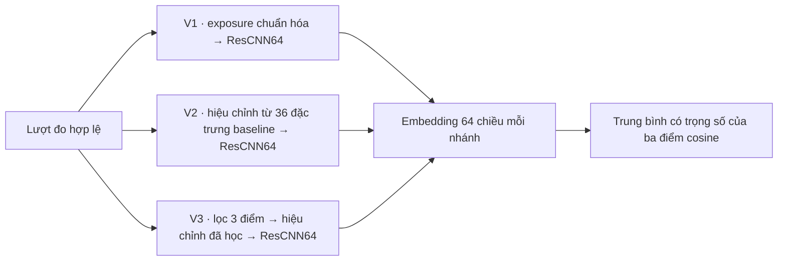

# RoboNose V4 · Kết hợp V1, V2 và V3

V4 là hai mô hình thử nghiệm chạy trên dữ liệu đã thu. Thư mục này chứa code huấn luyện, artifact và báo cáo. ResCNN64 gốc và các artifact trong `models`, `models_v2` và `models_v3` được dùng lại theo từng nhánh. Checkpoint ResCNN64 được khóa khi huấn luyện.

## Kiến trúc



**Đối sánh người.** V4 dùng cùng một CNN gốc cho ba nhánh. Nhánh V1 nhận exposure đi qua tiền xử lý chuẩn. Nhánh V2 thêm bộ hiệu chỉnh học từ toàn bộ 60 giây baseline, giữ hàm mất mát cross-entropy, phạt mức chỉnh và contrastive khác ngày. Nhánh V3 làm mịn exposure bằng bộ lọc `[1,6,1]/8` rồi áp dụng bộ hiệu chỉnh huấn luyện riêng cho dữ liệu làm mịn. Sau khi tạo từng embedding chuẩn L2, V4 kết hợp các điểm cosine. Trong code, nối ba vector sau khi nhân căn bậc hai trọng số cho phép tính cùng kết quả bằng một tích vô hướng trên vector 192 chiều.

**Phát hiện cà phê.** Mỗi nhánh học scaler và Logistic Regression từ đầu với `C = 0,1` và cân bằng lớp. Nhánh V1 dùng BME688 gas và A1. Nhánh V2 dùng A1–A3. Nhánh V3 dùng A1–A3 đã làm mịn riêng baseline và exposure. V4 còn thử một nhánh thêm đặc trưng đầu/cuối exposure và độ dao động nền trên A0–A3. Cấu hình được chọn kết hợp logit của ba nhánh chính với trọng số **0,10 / 0,45 / 0,45**. Logit tổng lớn hơn 0 cho kết quả có cà phê. Nhánh đặc trưng động học được giữ trong phép so sánh, với trọng số 0 ở cấu hình cuối.

Các nhánh dùng bộ lọc chất lượng của phiên bản trước và chỉ đọc raw. Những thử nghiệm đối chứng trước đây như Extra Trees, SVM, LDA, CNN cà phê và bù blank theo công thức vẫn được ghi trong báo cáo V2. Hai ensemble V4 tập trung kết hợp các đường xử lý chính. [Kỹ thuật V2](../models_v2/BAO_CAO_KY_THUAT_V2.md) · [Kỹ thuật V3](../models_v3/README.md)

## Dữ liệu và cách chọn

Tập archive ngày **09–20/11/2026** dùng để huấn luyện và so các tổ hợp trọng số. Mỗi lần giữ riêng một ngày rồi fit lại các nhánh cần học bằng những ngày còn lại. Chọn tổ hợp người theo top 1 trung bình theo lớp, dùng MRR để phân xử. Chọn tổ hợp cà phê theo balanced accuracy, dùng điểm trên mẫu cà phê và không khí để phân xử.

Sau khi chọn trọng số, các nhánh được fit lại trên archive và chấm trên tập đối chiếu khác ngày hoặc phiên. Nguồn archive có **93 lượt, 9 nhãn** cho người và **141 lượt** cho cà phê, gồm 32 mẫu cà phê, 16 đối chứng không khí và 93 mẫu tên người làm nhãn âm quy ước. Các bảng archive phản ánh kết quả dùng để chọn trọng số tổ hợp. Những tập đối chiếu đã được dùng ở các thử nghiệm trước, nên mức thay đổi nhỏ cần được xác nhận trên phiên mới.

## Kết quả đối sánh người

| Bản | Top 1 khác ngày trên archive | Top 1 trung bình theo lớp trên archive | Top 1 khác phiên trên hardware | MRR hardware |
| --- | ---: | ---: | ---: | ---: |
| V1 · ResCNN64 | 48/76 | 60,70% | 7/13 | 0,6692 |
| V2 · Hiệu chỉnh baseline | 50/76 | 66,09% | **8/13** | 0,7333 |
| V3 · Làm mịn và hiệu chỉnh | 47/76 | 63,27% | **8/13** | **0,7372** |
| V4 · Kết hợp 60% V1, 20% V2, 20% V3 | **54/76** | **71,14%** | 7/13 | 0,6859 |

V4 đứng đầu ở vòng chọn cấu hình trên archive. Khi dùng cùng 13 lượt từ 4 phiên hardware và chỉ đối sánh khác phiên, V4 đúng 7 lượt, thấp hơn một lượt so với V2 và V3. [Số liệu từng tổ hợp và từng nhãn](identity_report.json)

## Kết quả phát hiện cà phê

| Bản | Balanced accuracy khác ngày | Bắt đúng cà phê khác ngày | Bắt đúng ngày 07/11 | Báo dương trên 13 lượt hardware mang tên người |
| --- | ---: | ---: | ---: | ---: |
| Bộ kênh V1 được fit lại | 62,9% | 15/32 | 1/8 | 2/13 |
| V2 · Logistic ba kênh được fit lại | **71,8%** | **21/32** | 1/8 | 1/13 |
| V3 · Logistic làm mịn được fit lại | **71,8%** | **21/32** | 1/8 | 1/13 |
| V4 · Kết hợp 10% V1, 45% V2, 45% V3 | 69,8% | 20/32 | 1/8 | 1/13 |

Đối chứng chỉ dùng bộ kênh V1 và cùng tập train với các nhánh khác. Tập hardware gồm tên người quy ước nên cột cuối chỉ báo số lượt dương. Bản V4 chưa vượt Logistic V2 hoặc V3 trong lần thử này. [Số liệu và ma trận nhầm lẫn](coffee_report.json)

## Cách chạy

Trên dashboard, chọn **ResCNN64 V4 · Kết hợp ba nhánh** ở **04 · Đối sánh**
hoặc **Logistic V4 · Kết hợp ba nhánh** ở **06 · Phát hiện cà phê**. V4 là
tùy chọn thử nghiệm. Có thể dùng lại cùng mẫu với các bản trước để đối chiếu.

Chạy lại huấn luyện từ thư mục gốc bằng Python có PyTorch và scikit-learn. Lệnh chỉ ghi artifact trong `models_v4`.

```powershell
& D:/PBL6/.venv/Scripts/python.exe -m models_v4.train identity
& D:/PBL6/.venv/Scripts/python.exe -m models_v4.train coffee --nov07-root D:/PBL6/curated_raw
```

Chấm một CSV cà phê bằng Python của dự án:

```powershell
.\.venv\Scripts\python.exe -m models_v4.predict coffee "D:\duong-dan-den-luot\raw.csv"
```

Đối sánh các lượt hardware theo UUID đầy đủ. Có thể chỉ định thêm `--sample-root` để chọn cây dữ liệu khác.

```powershell
& D:/PBL6/.venv/Scripts/python.exe -m models_v4.predict identity UUID_THAM_CHIEU UUID_UNG_VIEN_1 UUID_UNG_VIEN_2
```
