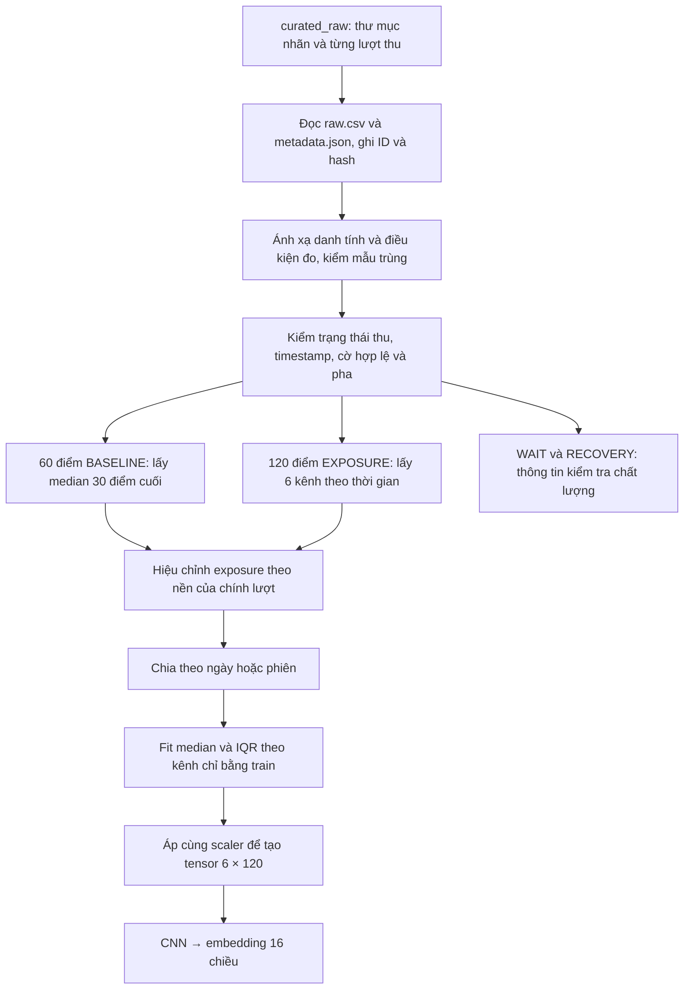
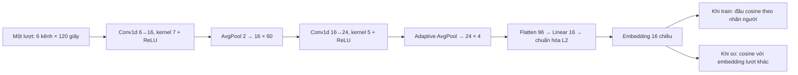
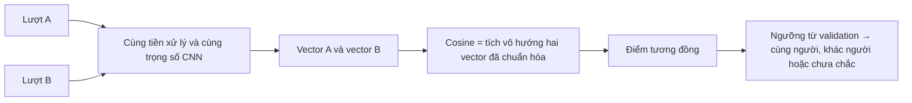

# RoboNose — duyệt raw và gán nhãn bằng tay

Cập nhật 18/11/2026: đã triển khai Python + HTML để chạy thử. Đây là **file Markdown duy nhất của processing**, chứa yêu cầu, hướng dẫn, tiến độ và hướng phát triển. Cập nhật trực tiếp file này khi sửa code.

Cập nhật giao diện: khi mở mẫu, hiện đồng thời toàn bộ biểu đồ các kênh còn lại, bao gồm độ ẩm; bỏ nhiệt độ và áp suất khỏi danh sách kênh và biểu đồ hiển thị. Bấm một biểu đồ để xem lớn ở vùng zoom/pan. Dữ liệu gốc, phần đọc dữ liệu và nội dung sao chép vẫn giữ nguyên.

## Chạy ứng dụng

Từ PowerShell tại `D:\PBL6`:

```powershell
.\.venv\Scripts\python.exe processing\app.py
```

Mở **http://127.0.0.1:8765/** trong trình duyệt. Dừng bằng `Ctrl+C`. Có thể chạy `python -m processing` hoặc đổi cổng bằng `python processing/app.py --port 8766`.

Cần Python 3.11 trở lên. Không cần npm, Flask, pandas, matplotlib hay cài thêm thư viện để chạy. Không mở index.html trực tiếp vì giao diện cần API Python.

Python xử lý đọc dữ liệu, chỉ số QC, registry, gán nhãn, sao chép, SHA-256 và xuất SVG/CSV. Giao diện dùng HTML/CSS và JavaScript thuần để vẽ canvas, gọi API, zoom/pan và kéo thả. Không TypeScript, React hoặc bước build. Frontend hiện có không bị thay đổi.

## Cách sử dụng

### Chia sẻ qua ngrok

App mặc định chỉ nhận localhost. Để chia sẻ, giữ cửa sổ ngrok chạy, lấy đúng HTTPS URL từ dòng Forwarding, dừng app bằng Ctrl+C rồi khởi động lại:

```powershell
.\.venv\Scripts\python.exe processing\app.py --public-url https://prowling-kerchief-unstirred.ngrok-free.dev
```

Theo yêu cầu, chế độ chia sẻ **mặc định không hỏi mật khẩu**: ai có link đều vào và thao tác được ngay. Chỉ cho phép đúng domain đã khai báo; URL ngrok đổi thì khởi động lại với URL mới. App vẫn bind 127.0.0.1; ngrok chuyển tiếp về cổng 8765. Nếu sau này cần mật khẩu, thêm `--require-password`; khi đó terminal hỏi mật khẩu ít nhất 12 ký tự và username mặc định là **reviewer** (đổi bằng `--share-user`).

Đây là chế độ truy cập chung, chưa phải tài khoản riêng từng người hoặc chống xung đột khi hai người sửa cùng mẫu. Hai người cần chia lượt để tránh ghi đè đánh giá. Nguồn/đích và hộp chọn thư mục đều thuộc máy chạy Python; chưa có upload thư mục từ máy người dùng từ xa.

Đã kiểm thử chế độ không mật khẩu, Host/Origin/token, cùng chế độ mật khẩu tùy chọn bảo vệ HTML/static/API. Chưa tự khởi động lại app đang chạy hoặc truy cập dataset qua tunnel để kiểm tra.

### Duyệt mẫu

1. Nhập nguồn như `D:\PBL6\data`, một ngày/phiên hoặc thư mục lượt thu rồi bấm **Nạp thư mục**. Nút **Chọn…** mở hộp chọn thư mục trên máy; sau đó vẫn cần bấm Nạp. Nếu máy không có Tkinter, nhập đường dẫn trực tiếp.
2. Chọn một lượt để xem raw. Đổi kênh/pha, mở tổng quan, cuộn để zoom, kéo để pan, bấm đúp reset hoặc nhập khoảng thời gian. Điểm có cờ lỗi màu đỏ; cờ chưa biết màu vàng. Không nối đường qua khoảng thiếu lớn, thời gian lùi hoặc biên đoạn/pha.
3. Xem sampling, thời lượng, gap/seq, coverage, min/max và baseline. Metadata, hash và các đoạn pha nằm trong phần bằng chứng. Có thể xuất SVG toàn tín hiệu, PNG vùng đang xem hoặc in biểu đồ.
4. Chọn **Giữ / Cần xem lại / Loại**, ghi chú rồi **Lưu đánh giá**. Cần xem lại/Loại bắt buộc có lý do. Loại chỉ lưu quyết định, không xóa file. Không tự loại bằng ngưỡng.
5. Chọn đích riêng như `D:\PBL6\curated_raw`, bấm **Dùng đích này**. Đích chưa có có thể được tạo. Nguồn và đích phải tách nhau, không trùng hoặc lồng nhau; không dùng thư mục chứa registry làm đích.
6. Tạo thư mục người. Có nút tạo nhanh **Nguyễn Văn Tài, Nguyễn Văn Dương, Lưu Hoàng Phúc**, hoặc nhập tên thư mục mới.
7. Kéo thẻ mẫu vào thư mục người để **COPY ngay toàn bộ thư mục lượt thu**, đồng thời ghi nhãn tay theo đích. Có nút **Sao chép mẫu đang xem** thay thế kéo thả. Không cần bước export riêng mới copy.
8. Xem lịch sử và đường dẫn copy. **Danh mục CSV** xuất quyết định/nhãn/trạng thái. Nạp lại cùng nguồn để khôi phục tiến độ; ô nguồn nhớ đường dẫn gần nhất.

Chất lượng và nhãn người độc lập. Copy không tự đánh dấu Giữ. Đổi nhãn giữ bản sao cũ và tạo bản mới. CSV chứa cả mẫu chưa duyệt/cần xem lại/loại, không tự coi tất cả là Clean Dataset. Không suy danh tính từ biểu đồ hoặc tên thư mục nguồn.

## Trạng thái triển khai

| Hạng mục | Kết quả |
| --- | --- |
| Nạp một lượt hoặc cây thư mục | Tìm raw.csv/metadata.json; bỏ qua link/junction và output PREPROCESSED |
| Log phiên tổng | Nhận diện riêng, ẩn mặc định; có tùy chọn hiển thị |
| Legacy v1, legacy v2 và S3 | Kênh/đơn vị thực tế; không đổi MQ135 thành TGS2602 |
| Biểu đồ | Raw từng kênh, T/RH/P, pha sẵn có, zoom/pan, tooltip, tổng quan |
| Chỉ số | Sampling theo thời gian thực, missing/validity, gap/seq, coverage, baseline slope và robust CV khi đủ điều kiện |
| Review/nhãn | Quyết định tay, ghi chú, lịch sử, fingerprint raw/metadata |
| Copy nguyên cây | Giữ bytes từng file và thư mục con/rỗng, kiểm SHA-256 |
| Copy lặp | Kiểm cả cây; bản đã có khớp hash được nhận lại, không tạo thêm |
| Trùng tên khác nội dung | Thêm hậu tố, không ghi đè |
| Lỗi copy | Lưu incomplete và giữ bản dở; không ghi nhãn thành công giả |
| Nguồn thay đổi | Chặn lưu/copy bằng hash cũ; QC và nhãn có dấu vết riêng, cần xem lại |
| Xuất | CSV danh mục, SVG toàn raw bằng Python, PNG vùng đang xem |
| Dịch vụ local | Bind 127.0.0.1; kiểm Host/Origin và token phiên cho API |

Các chỉ số hỗ trợ kiểm tra bằng mắt, chưa phải ngưỡng QC đã hiệu chuẩn. Coverage tính theo thời gian và đoạn liên tục, không đồng nghĩa tỷ lệ số dòng. Cờ thiếu được giữ là chưa biết. Giá trị thiếu/không hữu hạn không thay bằng 0; số hữu hạn có cờ lỗi vẫn được giữ để xem. Không sort thời gian để che reset. File không có tín hiệu vẫn xem được thông tin để ghi đánh giá lỗi.

## Bảo toàn nguồn và lưu tiến độ

- Không sửa, xóa, đổi tên hoặc di chuyển nguồn. Chỉ ghi registry riêng và cây đích đã chọn.
- Trước copy/lưu quyết định, kiểm hash raw/metadata so với bản đã xem. Copy kiểm từng file và kiểm lại toàn cây nguồn. Từ chối link/junction; không ghi đè đích.
- Copy lỗi có thể để lại thư mục dở với trạng thái incomplete. Không tự dọn bản dở. Kiểm lịch sử trước khi sử dụng.
- Nếu file đã copy và kiểm hash nhưng lưu provenance lỗi, ứng dụng báo rõ thay vì khẳng định toàn bộ thao tác hoàn tất.
- Registry: `processing/reviews/sessions/<id-nguồn>.json` và `processing/reviews/last.json`. Không xóa reviews nếu cần giữ tiến độ. Registry sai định dạng không tự ghi đè.
- Biên nhận: `<đích>/_robonose/copy_<id>.json`, ngoài thư mục mẫu. Metadata gốc trong bản sao không bị chèn nhãn hoặc sửa nội dung.
- Nhãn/QC nằm ở registry và báo cáo. Không đếm nhiều bản copy cùng lượt thành nhiều mẫu độc lập khi huấn luyện.
- Đây là ứng dụng local cho một người vận hành, chưa có đăng nhập/role nhiều người hoặc triển khai server công khai. Dataset không gửi ra dịch vụ ngoài.

```text
curated_raw/
├── Nguyễn Văn Tài/
│   └── <tên-lượt>/          # nguyên cây lượt thu
├── Nguyễn Văn Dương/
├── Lưu Hoàng Phúc/
└── _robonose/
    └── copy_<id>.json       # nguồn, đích, hash, người thao tác
```

## Cấu trúc code thực tế

```text
processing/
├── README.md               # tài liệu duy nhất
├── .gitignore
├── __init__.py
├── __main__.py
├── app.py                  # HTTP/API local, token, hộp chọn thư mục
├── core/
│   ├── __init__.py
│   ├── signals.py          # đọc raw, validity, timing, pha, chỉ số
│   ├── workspace.py        # registry, khám phá mẫu, review, copy kiểm hash
│   └── plots.py            # SVG bằng Python
├── web/
│   ├── index.html
│   ├── style.css
│   └── app.js              # JavaScript thuần cho tương tác trình duyệt
├── tests/
│   └── test_review.py
├── reviews/                # sinh khi sử dụng, bỏ qua Git
└── .checks/                # fixture tạm, bỏ qua Git
```

## Kiểm tra đã thực hiện

```powershell
.\.venv\Scripts\python.exe -m unittest discover -s processing/tests -v
```

**19/19 test qua** ngày 18/11/2026: raw/validity/timing, container, copy nguyên cây/thư mục rỗng, SHA-256, không ghi đè, copy lặp, nguồn đổi, lỗi copy mô phỏng, QC/nhãn độc lập, lưu/khôi phục, tên thư mục, escape SVG/CSV và API HTTP kiểm token/Origin. Fixture nằm trong processing/.checks; test không sửa/copy dữ liệu thật.

Đọc thử ba lượt thực tế: legacy v1 **2.895 dòng/6 kênh**, legacy v2 **3.475 dòng/8 kênh**, S3 **2.868 dòng/8 kênh**. Cả ba không lỗi đọc và hash raw/metadata trước/sau giữ nguyên. Đây là kiểm tra mẫu đại diện, chưa phải đánh giá toàn dataset. File rỗng/toàn thiếu số đo có thể hiện 0 kênh và cần xem riêng.

Đã kiểm cú pháp Python/JavaScript và đối chiếu ID giao diện. **Chưa kiểm render/thao tác bằng trình duyệt và hộp chọn thư mục thực tế**, vì công cụ hiện không có trình duyệt kết nối. Khi chạy thử cần kiểm layout, kéo thả, zoom và xuất ảnh trên máy người dùng; API/copy đã có test tích hợp tự động.

## Báo cáo để duyệt — từ đồ thị E-NOSE đến embedding

**Ngày 19/11/2026.** Mục tiêu là đưa hai lượt thu qua **cùng một bộ tiền xử lý và cùng một encoder**, rồi so hai vector để ước lượng chúng có cùng người hay không. Một lượt là một đồ thị đa kênh theo thời gian. CNN nhận **các giá trị số trong CSV** để học hình dạng đáp ứng, tốc độ tăng/giảm và quan hệ giữa các cảm biến.

Cần phân biệt hai câu hỏi. **Hai đường cong giống nhau đến đâu?** Có thể kiểm bằng đồ thị chồng và khoảng cách tín hiệu sau căn pha. **Hai lượt có cùng người không?** Đây là điều embedding cần học. Lượt cùng người có thể khác độ ẩm hoặc biên độ giữa hai ngày. Lượt khác người có thể cùng tăng trên TGS vì chung điều kiện đo. Vì vậy, đánh giá embedding phải dùng **cặp cùng người và khác người ở những phiên độc lập**.

### Dữ liệu đã được xử lý thế nào



| Thành phần | Bản đã chạy thử |
| --- | --- |
| Nhãn | Đọc nhãn từ thư mục. Gộp Phúc và các nhóm Phúc có cà phê về cùng danh tính. Hậu tố cà phê được lưu thành điều kiện. `CF` là đối chứng cà phê trong exposure, `kk_baseline` là đối chứng chỉ không khí. Hai nhóm dùng để chấm điểm đối chứng. |
| QC kỹ thuật | Yêu cầu lượt S3 `COMPLETE`, 60 điểm baseline và 120 điểm exposure gần 1 Hz, cờ hợp lệ trên 6 kênh. Kiểm trùng trial ID/hash, thứ tự thời gian và kênh khí đứng suốt exposure. |
| QC ổn định | Bản thử tự đưa cả lượt ra khỏi tập nếu một kênh khí có độ dốc tuyệt đối trên 5%/phút hoặc biên độ trên 5% trong 30 điểm cuối baseline. Trôi sát exposure, sai lệch giữa baseline và trước exposure, hoặc điểm sát chuyển ngữ cảnh chỉ được ghi WARN. Các lượt WARN vẫn có thể vào train. Hai cách xử lý này cần duyệt lại trước lần train tiếp. |
| TGS và MQ | Giữ TGS2602, MQ3 #1, MQ135 #2 và MQ3 #2. Mỗi điểm exposure lấy điện áp trừ median nền của chính kênh. |
| BME gas và RH | BME gas dùng `log(R / R₀)`. Độ ẩm dùng `RH − RH₀`, đơn vị điểm phần trăm RH. Giữ hai kênh riêng để CNN có thể học quan hệ theo thời gian. Nhiệt độ và áp suất nằm ngoài đầu vào. |
| Phạm vi biến đổi | Tensor chỉ chứa exposure. WAIT giúp phát hiện đáp ứng có thể bắt đầu sớm. Recovery hiện dài 2–60 điểm tùy lượt nên dùng để kiểm tra, chưa đưa vào tensor. Chưa smoothing, nội suy hoặc bù drift bằng mô hình riêng. |
| Lưu kết quả | Biến đổi trên bản đọc trong bộ nhớ. Manifest, báo cáo, điểm cosine và model ghi vào `odor_embed/runs/`. Đã đối chiếu lại SHA-256 của cả 100 file raw, đều khớp với lúc đọc. |

**Kết quả QC của bản thử:** 100 lượt → 63 PASS, 33 WARN, 4 REJECT. Bốn lượt ra khỏi tập gồm `anhDuong_phongTai_100728` bị ABORTED và `Chau_phongTai_165004`, `Son_175047`, `Tuan_phongTai_210818` vượt ngưỡng nền. Lần tiếp theo đề xuất tách rõ **lỗi kỹ thuật bắt buộc loại** và **cảnh báo chất lượng cần duyệt**. Với MQ3, MQ135 hoặc BME đang trôi nhưng vẫn có dữ liệu hợp lệ, ghi tên kênh, pha và chỉ số rồi xem lại lượt trước khi quyết định giữ hay loại. Giữ sáu kênh cho cấu hình chính và dùng thử nghiệm bỏ riêng RH để kiểm tra lợi ích của nó qua các phiên.

### Kiến trúc encoder đang có và đề xuất cho vòng tiếp theo



Hai lớp tích chập học mẫu biến thiên cục bộ trên nhiều cảm biến. Pooling giữ bốn vùng thời gian của exposure để đáp ứng sớm và muộn còn phân biệt được. Lớp linear gom 96 giá trị thành 16 thành phần. Chuẩn hóa L2 đưa vector về độ dài 1 để so cosine. Kiến trúc này đã có trong [model.py](../odor_embed/model.py). Bản thử train bằng cross-entropy với đầu phân loại cosine có trọng số theo số mẫu mỗi lớp. Đầu phân loại cung cấp tín hiệu học, còn **vector 16 chiều** là đầu ra dùng để so sánh.



- **So 1:1:** lấy hai vector và trả điểm cosine. Cần bổ sung lệnh so cặp dùng cùng pipeline hiện tại. Lệnh `predict` hiện so lượt mới với các vector đăng ký theo người.
- **Tìm 1:N:** lấy trung bình các embedding đã đăng ký của mỗi người, chuẩn hóa lại và tìm người có cosine cao nhất. Chỉ trả danh tính khi điểm đạt ngưỡng đã hiệu chuẩn. Các mẫu không khí, cà phê và người ngoài danh sách giúp đo tỷ lệ nhận nhầm.
- **Train vòng đầu sau khi duyệt:** giữ CNN nhỏ và dùng nhãn người để học encoder. Đánh giá chất lượng embedding trực tiếp từ phân bố điểm của cặp cùng người/khác người. Chỉ cân nhắc loss contrastive theo cặp nếu đã có đủ cặp cùng người **khác phiên** và cách train bằng nhãn chưa tách được hai nhóm điểm.

### Kết quả thử và phần cần duyệt

Lần chạy trước dùng **59 lượt train và 15 lượt test theo ngày**. Kết quả nhận diện 1:N đứng đầu đúng **5/15**. Tập test chỉ có Tài và Dương, còn Phúc có sáu lượt từ một phiên. Kết quả này kiểm được luồng chạy, chưa xác nhận chất lượng so cặp hay khả năng nhận ra Phúc ở buổi khác. Chưa có ngưỡng cosine được hiệu chuẩn.

Đề xuất vòng tiếp theo gồm ba quyết định để duyệt:

1. **Tiền xử lý:** exposure 120 điểm × 6 kênh, median 30 điểm cuối BASELINE, giữ RH và BME riêng. Sửa quy tắc để trôi nền thành cảnh báo cần duyệt, còn lượt ABORTED, mất kênh hoặc sai thời gian vẫn loại bằng lỗi kỹ thuật.
2. **Model:** giữ CNN 16 chiều ở sơ đồ trên, thêm so cặp 1:1 và xuất điểm theo từng cặp. Chạy thêm một cấu hình bỏ RH với cùng cách chia để xem độ ẩm thực sự giúp trên phiên độc lập hay chỉ giúp nhận điều kiện đo.
3. **Đánh giá:** chia ngày/phiên trước khi tạo cặp. Dùng validation độc lập để chọn ngưỡng, giữ test cho báo cáo cuối. Báo tỷ lệ nhận nhầm người khác và bỏ sót người đúng cùng kết quả đối chứng. Thu thêm phiên trước khi đánh giá những người hiện chỉ có một phiên.

Các mục trên là đề xuất để duyệt. Phần bên dưới ghi lệnh và hành vi của bản thử hiện có.

### ResCNN-64 và lệnh huấn luyện

Trong VS Code, mở [train_rescnn64.ipynb](../odor_embed/train_rescnn64.ipynb), chọn kernel `.venv\Scripts\python.exe` và bấm **Run All**. Notebook mặc định chạy ResCNN-64 trên toàn bộ lượt người hợp lệ trong 40 epoch. Mỗi epoch in loss trung bình, thời gian đã chạy và thời gian còn lại dự kiến. Sau khi lưu, notebook in đường dẫn model, embedding và `training_history.json` để xem lại loss từng epoch. Nếu kernel chưa có Jupyter, cài `ipykernel` trong cùng venv.

Phần **Random Forest · Cà phê và không khí** ở cuối notebook có thể chạy riêng. Phần này đọc hai nhóm đối chứng, dùng 10 đặc trưng BME gas/MQ3 #1 của `coffee_ml` và đánh giá theo ngày đo giữ riêng. Notebook hiện ma trận nhầm lẫn, tầm quan trọng của đặc trưng và bảng dự đoán từng lượt. Có thể điền `RF_SAMPLE` để thử một lượt đối chứng mới. Bài thử chỉ có hai nhãn CF và kk_baseline.

Đã thêm kiến trúc trong tài liệu bạn gửi. Input **6 × 120** → stem Conv1d **32 × 120** → ba residual block lần lượt **32 × 120**, **64 × 60**, **128 × 30** → global average và max pooling **256** → linear **128 → 64** → chuẩn hóa L2. Dùng GroupNorm cho batch nhỏ, GELU và dropout 0.2 ở embedding head. Vòng thử này dùng cross-entropy với đầu cosine, AdamW và 40 epoch cố định. SupCon là thử nghiệm tiếp theo cần batch có cặp cùng người, ưu tiên khác phiên.

Để train và tạo gallery từ **toàn bộ lượt người hợp lệ**, chạy tại `D:\PBL6`:

```powershell
.\.venv\Scripts\python.exe -m odor_embed.run train --arch rescnn64 --all-data --baseline-warn --epochs 40
```

`--baseline-warn` giữ lượt có nền trôi dưới trạng thái WARN. Lượt ABORTED, trùng hoặc lỗi kỹ thuật vẫn bị loại khỏi train. `CF` và `kk_baseline` chỉ dùng làm đối chứng. Không smoothing. Kết quả gồm `model.pt`, `model.json` và `embeddings.json` chứa vector từng lượt train. `--all-data` không chừa lượt người để test, nên report của lần chạy này không có độ chính xác holdout.

Để thử riêng trên các ngày chưa dùng train, chạy cùng lệnh và bỏ `--all-data`. Khi so với bản thử Simple16 cũ, bỏ thêm `--baseline-warn` để dùng cùng chính sách QC. Các lần chạy tạo thư mục kết quả riêng.

So trực tiếp hai lượt bằng cùng encoder và scaler:

```powershell
.\.venv\Scripts\python.exe -m odor_embed.run compare --model "odor_embed\runs\<tên-lần-chạy>" --sample-a "<thư-mục-lượt-A>" --sample-b "<thư-mục-lượt-B>"
```

Kết quả trả điểm cosine và cảnh báo QC của mỗi lượt. Chọn ngưỡng cùng người trên dữ liệu độc lập trước khi dùng điểm để ra quyết định.

Ô **So toàn bộ các lượt với nhau** ở cuối notebook xuất `pairs.csv` (điểm từng cặp) và `summary.json` (thống kê theo nhãn, phiên, ngày và holdout). Bản full fit đã chấm 4.851 cặp từ 99 lượt. Trên lượt người đã học, trung vị cosine cùng người là 0,895 và khác người là −0,053. Bản giữ ngày để test có 105 cặp giữa hai lượt holdout, với Pair AUC 0,628. Nếu chỉ giữ cặp khác phiên trong số đó, còn 72 cặp và AUC 0,640. Các cặp dùng lại nhiều lượt đo, nên số cặp không tương đương số lượt độc lập. Không dùng điểm full fit để chọn ngưỡng.

Đã train thử ngày 19/11/2026. Bản full fit `20261119_050613_c6ed46` dùng 77 lượt người, giữ nền trôi dưới cảnh báo và xuất embedding 64 chiều. Bản đánh giá riêng `20261119_050612_d043a7` dùng cùng quy tắc QC và cách chia ngày như lần Simple16 trước, đúng **8/15** lượt holdout thuộc Tài và Dương. Chênh lệch với 5/15 của Simple16 là kết quả thử trên tập nhỏ. Lần train ResCNN cũng đặt weight decay thành 0.0001. Chưa có đánh giá xác minh 1:1 trên dữ liệu độc lập hoặc ngưỡng cosine hiệu chuẩn.

### Lệnh và hành vi của bản Simple16 ban đầu

Từ PowerShell tại `D:\PBL6`, đặt các lượt thu đã gán nhãn vào `curated_raw/<nhãn>/<lượt>/` với `raw.csv` và `metadata.json`, rồi chạy:

```powershell
.\.venv\Scripts\python.exe -m odor_embed.run train
```

Môi trường cần NumPy và PyTorch. Trên máy mới, cài PyTorch bản CPU bằng `python -m pip install torch --index-url https://download.pytorch.org/whl/cpu` và cài NumPy bằng `python -m pip install numpy` trong venv. Mỗi lần thêm mẫu chỉ cần chạy lại lệnh train. Thêm `--audit-only` nếu chỉ muốn xem chất lượng và cách chia tập.

1. Quét từng lượt, kiểm trạng thái COMPLETE, schema S3, trùng ID/hash, đủ pha và cờ hợp lệ. Gộp tên có/không dấu và các alias Dương đã khai báo. Hậu tố cà phê giữ chung danh tính và có trường điều kiện riêng. `kk_baseline` là đối chứng không khí. `CF` là đối chứng chỉ cà phê trong exposure.
2. Kiểm 60 điểm BASELINE và 120 điểm EXPOSURE ở 1 Hz. Loại lượt người có nền 30 giây cuối vượt ngưỡng 5%/phút hoặc biên độ tương đối 5% ở bất kỳ kênh khí nào. Tín hiệu trôi trong WAIT hoặc điểm gần thời điểm chuyển pha được báo WARN để kiểm tra. WARN vẫn được dùng trong bản thử nghiệm. Không nội suy hay smoothing.
3. Tạo tensor **6 × 120**. Dùng median 30 giây cuối BASELINE làm mốc, trừ nền đối với TGS/MQ và độ ẩm, dùng log tỷ số với BME gas. Áp suất và nhiệt độ không nằm trong tensor. Recovery không đưa vào CNN vì thời lượng khác nhau giữa các lượt.
4. Chia theo ngày trước khi fit chuẩn hóa từng kênh. Có thể dùng `--group-by session` để đánh giá theo phiên. Chỉ dùng mẫu người thuộc tập train để fit scaler, train CNN và dựng vector đăng ký. Các danh tính thiếu ngày/phiên thích hợp sẽ được ghi là chưa có đánh giá holdout. Các mẫu đối chứng chỉ dùng chấm điểm, tách kết quả cùng nhóm train và ngoài nhóm train.
5. CNN tạo vector 16 chiều đã chuẩn hóa. Dự đoán so cosine với vector đăng ký của mỗi người. Cấu hình hiện tại trả ứng viên và điểm. Dùng `--threshold` để trả `unknown` khi đã tự hiệu chuẩn ngưỡng trên dữ liệu độc lập.

Kết quả mỗi lần chạy nằm trong `odor_embed/runs/<tên-lần-chạy>/`. `manifest.json` ghi nhãn, QC và cách chia từng lượt. `report.json` ghi thống kê và điểm holdout. `scores.json` ghi cosine từng người trên các lượt kiểm tra và đối chứng. `model.pt` và `model.json` dùng cùng nhau để chạy dự đoán. Mã nguồn chỉ đọc cây nguồn và ghi kết quả vào `odor_embed/runs/`.

```powershell
.\.venv\Scripts\python.exe -m odor_embed.run predict --model "odor_embed\runs\<tên-lần-chạy>" --sample "<thư-mục-lượt-thu>"
```

Kết quả lần chạy ngày 19/11/2026 với 100 lượt: 63 PASS, 33 WARN, 4 REJECT. Model dùng 59 lượt người để train và kiểm trên 15 lượt ngoài ngày train, đạt 5/15 top-1. Tập kiểm tra chỉ có Tài và Dương. Phúc có dữ liệu đăng ký trong model nhưng chưa được đánh giá ngoài phiên. Đây là bản thử nghiệm pipeline.

## Roadmap của giao diện duyệt raw

Bản này chỉ tuyển chọn/gán nhãn **raw**. Chưa smoothing, lọc nhiễu, nội suy, sửa outlier, hiệu chỉnh baseline, normalization, trích đặc trưng, augmentation, huấn luyện hoặc nhận diện. Tính chỉ số baseline không biến đổi tín hiệu.

Chín bước đã thống nhất cho giai đoạn sau, chạy trên working copy khi chốt protocol/thông số:

1. Raw Data Inspection: schema, timestamp, missing, validity.
2. Signal Quality Assessment: nhiễu, lỗi thu, ổn định theo vùng phù hợp.
3. Signal Segmentation: baseline/exposure/recovery, WAIT, reset và từng đoạn riêng.
4. Outlier Detection and Handling: gắn cờ trước; thay điểm có cơ sở, lưu mask/lý do.
5. Signal Denoising: so median, moving average, Savitzky–Golay theo pilot; không lọc xuyên gap/biên pha.
6. Baseline Correction: S0 từ baseline hợp lệ của chính lượt; bảo vệ thiếu nền.
7. Response Normalization: relative/fractional response; bảo vệ S0 gần 0.
8. Environmental Effects and Sensor Drift: đánh giá T/RH/P và trôi; chỉ bù khi có thực nghiệm.
9. Preprocessing Evaluation: so raw/processed, bảo toàn đặc trưng, mức giảm nhiễu và đầu ra; lưu cấu hình/masks/provenance.

Luồng giao diện dài hạn: Inspection & Quality → Cleaning & Filtering → Artifact/Bad Sample Review → Segmentation → Normalization/Final Review. Không tạo chức năng giả cho bước chưa làm. Ngưỡng QC, filter/window và bù môi trường chưa chốt. Chỉ gọi Clean Dataset khi đáp ứng điều kiện xử lý/duyệt của phiên bản tương ứng.

## Quy tắc cập nhật

Sửa yêu cầu, trạng thái và kết quả kiểm tra ngay trong README này; phân biệt test fixture, dữ liệu thật và browser QA. Không tạo Markdown kế hoạch/tiến độ song song. Không tự chạy biến đổi trên data gốc. Không tự commit/push hoặc đưa dataset/registry lên Git.
